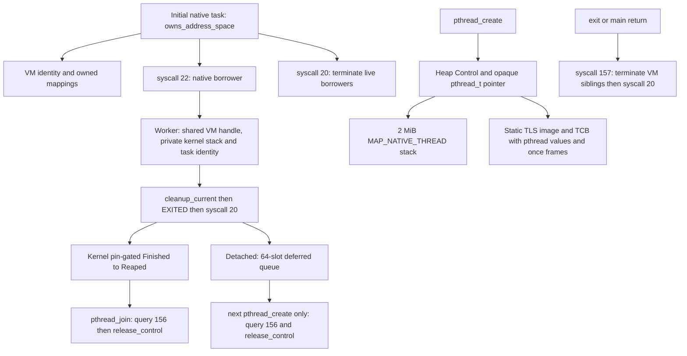

# Source-backed ownership before repair

Sources: sunlight-libc/src/pthread.rs:49-355; thread.rs:36-180;
std_runtime.rs:304; termination.rs:96; kernel/src/arch/x86_64/syscall.rs:2627,
3139-3172; kernel/src/sched/mod.rs:4435-4600, 2790-3168.

## Exact behavior

* Initial C main return enters exit, runs atexit, and uses native group exit 157.
* exit runs process callbacks and group exit; worker use also terminates the VM group.
* _Exit is absent from public stdlib.h and Rust exports: no supported API contract.
  The existing callback-free sl_std_exit uses group exit 157. Do not equate it with an exported _Exit.
* Initial pthread_exit cleans pthread TLS/once frames, then syscall 20 kills live borrowers.
* Worker pthread_exit finishes its Control and cleanup, then syscall 20 exits the borrower.
* Worker return runs finish then native thread_start syscall 20.
* The initial owner normally stays live; final worker exit alone does not terminate that owner.
* Detached worker runs TLS destructors before EXITED; its executing stack cannot be freed.
  Kernel Reaped acknowledgment is necessary before unmapping from another live thread.
* C opaque handles are allocation pointers, not generation-tagged capabilities. Stale use after
  detach/join is outside the supported valid-handle contract. TLS keys are generation tagged.
* Kernel TIDs are monotonic; query 156 checks native-thread status and VM identity for existing
  tasks and accepts an absent old TID as quiescent. Slot reuse is not TID reuse.

## Classification and blocked patch plan

G2 is a native process/thread-group ownership defect exposed by the libc wrapper.
There is no native owner-only thread exit operation preserving borrowers. Linux tgid
paths are distinct and cannot be substituted for native authorization/ownership.
Keeping the initial task parked in libc would keep its kernel identity, descriptors,
IPC and session ownership alive rather than terminate the calling thread; it also
cannot account for arbitrary native Rust borrowers with only a pthread registry.
That is not a qualified repair of this contract.

Proposed kernel work, NOT applied: give native groups a lifetime independent of the
initial schedulable task; provide explicit thread-only exit while retaining syscall
157 for process-wide termination. Retain the owner resource record until the final
borrower is Reaped and every outgoing execution pin is released; only then retire
VM, IPC and process completion. Reuse the existing identity and deferred retirement
primitives. Audit session and PTY ownership, parent wait/reaping, foreground groups,
IPC endpoint closure, quota ownership and capability revocation. Require native
initial-exit/worker-survival/final-cleanup witnesses and existing session/PTY/IPC
regressions before enabling. Do not merely remove borrower termination: present
owner cleanup closes IPC and publishes process completion too early.

## Detached lifecycle findings

The C deferred queue has 64 slots, but this is NOT a bound on retained resources.
enqueue_detached silently drops the reference on overflow; that Control, its stack
and TCB remain until process teardown. reap_detached is called only by create
(pthread.rs:215), despite the module comment mentioning join. pthread_join does
not sweep it. No autonomous exit acknowledgment consumer exists in libc.
The separate Rust std 256-slot reaper cannot reclaim C Control objects without
an adapter and also depends on later API activity. Kernel reaping alone does not
free libc allocations or unmap the thread stack/TLS.

TLS callbacks finish before EXITED, registry slots are permanent static storage,
key generations retire at exhaustion, and TCB cells are cleared before callbacks.
Once frames live on the initializing stack and are unlinked/reset before exit.
The kernel clears futex state on termination; userspace only frees after Reaped.
A safe follow-up needs admission before detach publication plus an explicit bounded
cleanup owner; enlarging the queue cannot establish reclamation. No production
repair is applied before this architecture has a qualified lifecycle owner.

## Additional identity and observer risks

Fresh controlled TLS logs reuse a public pthread_t Control pointer after join
while kernel TIDs remain distinct. The public handle is untagged; TLS-key
generations do not protect it. No stale-handle operation was attempted.

Source-only candidate detach/sweep schedule (native runtime witness UNQUALIFIED):
mark_detached sets detached 0->1 without DETACHED_LOCK, then reads Control.state.
The worker can finish, change 1->2, enqueue, exit and become Reaped while the
detacher is descheduled. A third pthread_create can sweep/free the Control before
the original detacher resumes its state load. No observer reference or registry
lock protects that interval. This is an open reclamation safety concern, not a
claimed observed guest use-after-free. A follow-up should force this exact interval
and serialize detach publication/observation with queue retirement or use explicit
observer ownership. Queue admission and overflow retention remain separate issues.
