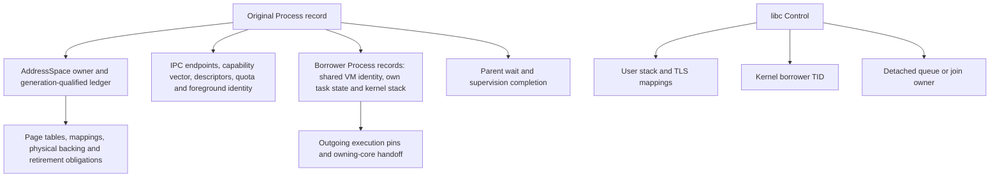

# R2B.3 pre-production ownership review

Baseline: f6b5ccb24d3ef2d2077eaada148a9208e3e2c738, main, already dirty.
The baseline manifest captures file hashes and symlink targets before edits.
Read R2B.1 and R2B.2 reports, R2B.2 lifecycle ownership, validation summary,
runner, handle/queue accounting method and native witnesses. Baseline locked
runtime build succeeded. This model was written before production edits.

| Resource | Authority for final reclamation | Source |
|---|---|---|
| Native process/group | Original Process record; no independent native group object | kernel/src/process/mod.rs:130-146; sched/mod.rs:2692-2746 |
| VM identity | Root plus nonwrapping generation; identity is a name, not a lifetime pin | process/mm2b_state.rs:7-41 |
| Region ledger | Generation-qualified static ledger slot; borrower shares handle, no reference count | process/address_space.rs:169-175,270-288,535-590 |
| Page tables/backing | Original owner reaper, only after every borrower Reaped and active mask zero | sched/mod.rs:2780-2920,2997-3010 |
| Mapping retirement | Existing retirement owner tokens; reserve before withdrawal; acknowledgments before freeing; uncertain obligations must remain owned | process/address_space.rs:1006-1068,1696-1723,2085-2170 |
| Scheduler context/kernel stack | Each task; physical pins, queued/current/owning-core checks precede Reaped | sched/mod.rs:2780-2835,3050-3115 |
| IPC endpoint closure | Per-task PID authority, close on self-exit and revoke/remove references in reaper | sched/mod.rs:2748-2778,2950-2994,4582-4584 |
| Capabilities | Per-Process vector/broker; cleared by reaper, never transferred | sched/mod.rs:2980-2994,3050-3063 |
| Descriptors | Borrower copy or opt-in native_shared_owner; owner record remains significant | syscall.rs:2848-2907; sched/mod.rs:2184; reaper:2925-2946 |
| Shared quota/session | Incarnation-qualified shared_quota_owner/account membership; generation-qualified foreground session | syscall.rs:2898-2907; process/foreground.rs:142-207 |
| Terminal/session | Existing session-owner authority and cancel_foreground; teardown targets broker/session/generation | process/foreground.rs:142-207; sched/mod.rs:3325,3400 |
| Control/stack/TLS | libc join or detached sweep only after syscall156 Reaped; TLS callbacks before EXITED | sunlight-libc/src/pthread.rs:102-193,262-302 |
| TLS values | Application ownership; callbacks outside registry lock, cells clear first | pthread.rs:TLS cleanup implementation |
| Once frame | Initializer's executing stack; cleanup resets state/wakes before exit | pthread.rs:pthread_once/cleanup_current |

## Exit contracts and defect

Main return calls exit (std_runtime.rs), runs atexit, invokes group syscall157.
exit from any thread does the same. _Exit is absent from exports and stdlib.h;
callback-free sl_std_exit is not an implementation of that missing public API.
Initial pthread_exit runs its TLS/once cleanup then syscall20: owner exit kills
borrowers, closes IPC, publishes parent completion. Worker pthread_exit/return
runs cleanup and syscall20, which exits that borrower alone. Detached exit has
identical TLS cleanup but queues allocation ownership for a future create sweep.
Last surviving borrower after initial thread exit cannot currently be reached.
Forced owner termination, fatal signals and session teardown use distinct
foreground/cancellation paths; they must retain group revocation effectiveness.
No individual pthread cancellation API exists. Kernel individual borrower
termination bypasses TLS callbacks and must still wait for physical retirement.

Two owner-kill sites exist: finish_current_process:4580 and
reap_process_resources:2864. Removing only one cannot repair E1. Retaining the
original Finished Process would pin mappings, but shared-descriptor resolution still addresses that original record, endpoint
authorization filters exiting owners (syscall.rs:1905), parent completion is already
published, and terminate_process_by_pid rejects Finished owners. A retained
record therefore needs a separate group-state/authority contract; merely parking
or handing resources to another runnable thread is insufficient.

## Architecture boundary: kernel repair BLOCKED, migration proposal

Under the mission's stop-on-larger-redesign policy, no kernel edit is applied.
The existing AddressSpace/ledger identity cannot serve as a group lifetime object:
it has no member count, group-exit state, completion receipt or resource authority.
The existing Linux tgid path is personality-specific, not a native group contract.

Concrete migration, required before enabling native thread-only owner exit:

1. Keep a non-runnable original resource record keyed by VM identity plus original
   PID/incarnation. Add explicit group state Live/Terminating/Retiring/Reaped and
   an independent per-task retirement state. Admit membership before publishing
   a spawned task; no arbitrary survivor receives owner rights.
2. Move owner-only endpoint, shared-descriptor and quota resolution to the retained
   resource authority with operation-specific liveness rules. Distinguish thread
   death from group authority revocation. Do not copy capabilities to borrowers.
3. Route syscall20 through task-only retirement for native members. Defer group
   completion and parent wake until final member handoff/reaping. Keep syscall157
   process-wide. Forced owner and session termination must find a group even when
   the original task is Finished; stale incarnations must be rejected.
4. After every member execution pin is released, no task is queued/current and
   VM active mask is zero, run existing shared-page, retirement, descriptor, IPC,
   capability and VM cleanup exactly once. Preserve quarantine/fail-stop tokens
   and exact quota refunds. Publish generation-qualified completion afterward.
5. Exercise E1-E8 including an endpoint-owning initial thread, std shared FDs,
   terminal tab close, forced kill after initial exit, slot reuse, failed shootdown
   and outstanding retirement. Gate each authority adapter before enabling it.

No new syscall is proposed. Changing syscall20 owner behavior affects alloc-only
and Rust native users as well as libc; syscall157 migration must be audited for
all process-exit callers. This spans existing scheduler/IPC/session authority and
is larger than a local exit-branch repair.

## Independent runtime repair plan

Baseline public handles are Control allocation pointers. Reuse is reproducible:
handle-baseline/elf.stdout.txt shows the next Control has the identical public value
and stale detach returns success for the new thread. Repair without changing
pthread_t's pointer-sized opaque ABI: issue nonwrapping serial tokens, resolve
under a bounded registry, reserve join ownership, and serialize detach observers
with sweep retirement. Reuse private allocation addresses freely, never tokens.
Admit at most 64 Controls before spawn; detached queue capacity then cannot lose
an ownership reference. Retain query156 before reclaim and all existing cleanup.

Autonomous reclamation remains separate. A permanent helper borrower would keep
the final group alive under the desired semantics. A retiring helper needs an
acknowledgment consumer for its own executing stack. No existing runtime event
consumer covers C Controls (the Rust queue also relies on later API activity).
Do not introduce an immortal helper or claim admission alone is autonomous.
A migration should attach a typed, bounded retirement adapter to kernel task-exit
acknowledgment, with pre-admission and exact VM generation; the group retains
adapter storage through helper teardown. Notification admission/failure ownership
and stack/TLS munmap receipts need explicit validation before implementation.

## Related exit paths examined

`arch/x86_64/interrupts.rs:265` routes fatal user exceptions through
finish_current_process too. `syscall.rs:507` rejects noncanonical SYSRET RCX
through process_exit; fatal signal post-actions also call process_exit. These
must preserve fatal process policy when syscall20 becomes thread-only: introduce
an explicit internal termination scope at the callers, not a global reinterpretation
of finish_current_process. `syscall.rs:3781-3830` accepts Finished as waitable,
so retaining an owner as Finished requires separating parent-visible group death.
`Scheduler::shared_process_index` currently resolves a retained original record
by PID even when Finished; preservation alone does not make all operations valid:
endpoint-owner resolution rejects exiting owners and forced termination rejects
Finished targets. Foreground/session cancellation is a separate authority path.

The new runtime registry does not alter these kernel paths. Join/detach lookup
and final release share DETACHED_LOCK; the join reservation protects the pointer
while waiting outside that lock. finish performs TLS callbacks and futex wake
before acquiring it. No runtime lock is held across callbacks. Spawn publishes
TID/mappings before a Control becomes sweep-eligible; self-detach before creator
publication is retained until publication. The registry's token is initialized
before spawn. Generic spawn rollback still ignores munmap failures; failure-
injected physical retention bounds for that pre-existing path remain UNQUALIFIED.
Individual forced termination of a runtime lock holder is not a supported robust-
lock/cancellation contract; it bypasses TLS callbacks. Do not claim such recovery.

## Scope separation required by the migration

The retained authority proposal does **not** make every original-task resource a
shared group resource. Endpoint creation/receive authority remains per-task PID;
thread-scoped endpoints must close on that task's death, and borrowers must not
receive as the dead owner. Per-thread capabilities and private descriptor snapshots
also retain their current scope. Only mappings/page tables and already opt-in
shared descriptor/quota resources require continued group lifetime. A review must
explicitly classify any endpoint advertised as process-scoped before retaining it;
no blanket endpoint defer/transfer is authorized by this proposal.

The Linux retained-leader pattern is a useful implementation candidate already
present in the reaper. It is not dismissed as structurally unusable. Adapting it
for native tasks still needs explicit group-alive versus task-Finished state,
parent-wait/completion rules, forced targeting of a dead original task's live
group, and generation-qualified session-owner cancellation. Those are the
cross-cutting migration boundaries that make a branch-only patch inadequate.
This report does not claim native group lifetime is impossible to implement.
