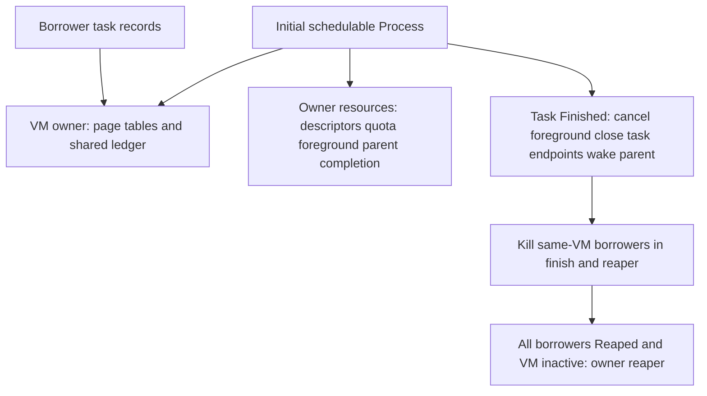
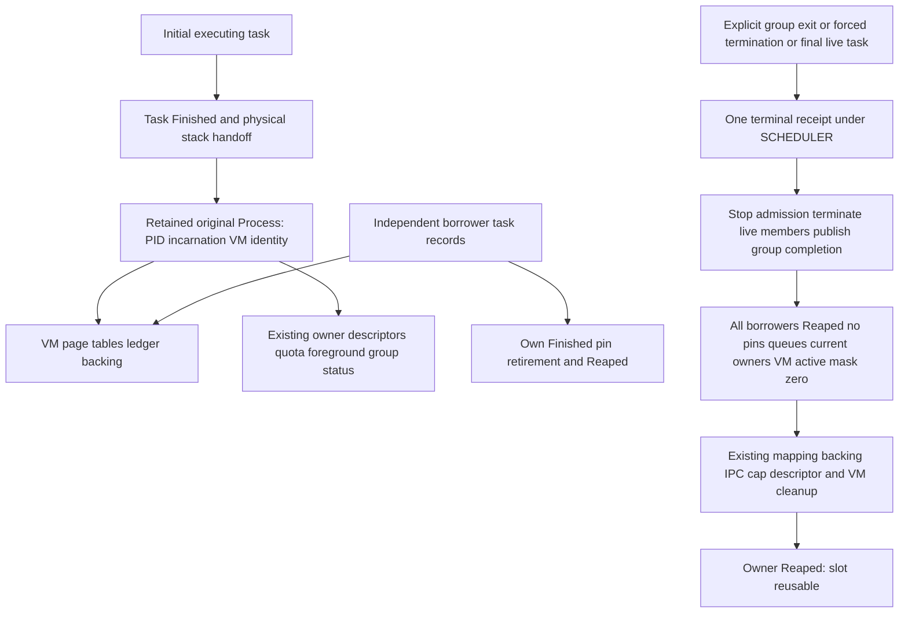

# Native ownership before and after

Baseline f6b5ccb24d3ef2d2077eaada148a9208e3e2c738, main, dirty runtime;
full initial status and all pre-existing file/symlink hashes: source-baseline.json.

Before:

After:

The original Process is one object with distinct task and group facts, not an
additional ThreadGroup allocation. `native_group_exit=None` means no terminal
receipt; Some(code) fences group admission and publishes the first status.
Finished with pending cleanup can therefore retain live native group resources.
Retiring is represented by the receipt plus pending physical cleanup; Reaped
remains the final reusable state. No borrower is promoted to owner. No new ABI
number, lock, reference counter, allocation or unbounded wait is introduced.

| Resource | Before | After and source |
|---|---|---|
| Thread identity | Process PID + foreground incarnation; native runtime public token separately | Unchanged; process/mod.rs, process/pid.rs, process/foreground.rs, libc pthread.rs |
| Group identity | Implicit original VM owner | Retained owner matched with exact AddressSpaceIdentity; sched/native_group.rs |
| Address space | Original Process, lifetime coupled to its task death | Same owner, lifetime independent of original task; sched/mod.rs reaper |
| Page tables | Owner AddressSpace | Same object, reclaim only after borrower Reaped and active mask zero |
| Virtual mappings | Shared generation-qualified region ledger | Shared handle unchanged; no ledger clone/refund on initial task death; process/address_space.rs |
| Shared backing | Per-resource SHM tracking, capability broker and retirement owners | Existing ownership adapters unchanged, task-local mappings still use task cleanup; memory/shared.rs, retirement.rs |
| Process-wide handles | Opt-in shared original fd table/cwd; private C worker snapshots | Same split, native shared owner now also checked against exact VM identity in shared_process_index |
| Capability references | Per-Process vector, broker token and recipient identities | No authority transfer; original vector retained physically, is_exiting still rejects dead task authority; capability/delivery.rs, channel_native.rs |
| IPC endpoints | Task PID ownership; self-exit closure and reaper removal | Same task scope; initial task endpoints close on its death, workers retain their own authorized endpoints. No promise that a dead receiver serves RPCs. No blanket group endpoint reclassification |
| Scheduler membership | Each task's queue/core/context and outgoing stack pin | Unchanged. Finished owner never requeued for group cleanup; borrower execution requires no owner execution |
| Exit status | Original task Finished wakes parent; worker status independent | Native group receipt is parent-visible; final task or explicit termination publishes once; wait_exit_code + begin_native_group_exit |
| Parent/child | PPID plus foreground parent incarnation | Links unchanged, original record retained; native group wait deferred independently from task Finished |
| Session/PTY | Group original also executing session owner, liveness equated with task state | ProcessIsAlive now uses group lifetime with existing PTY incarnation check; exact-session terminate_session finds retained owner; scope cancellation deferred for initial owner until group terminal |
| Resource accounting | Original memory owner and immutable shared quota owner identity | Same accounting/refund path; VM retained, no accounting ownership reassignment; memory/shared_quota.rs and current_memory_owner_index |

## Identity boundaries

Generation-qualified: VM root/generation, ledger handle identity, retirement
owner token/VM, recipient PID/incarnation/VM, session broker/session/generation,
shared quota PID/incarnation, foreground parent incarnation, PTY liveness when
trusted broker supplies incarnation. Runtime public pthread token is nonwrapping
and independent of kernel TID. These are different identities, not interchangeable.

Raw IDs remain: Process.pid, PPID, Linux TGID, native_shared_owner, numeric kill/
waitpid, endpoint-owner PID and thread-reaped TID argument. Stable retained owner
and exact VM checks prevent a live group from borrowing a reused owner row;
this does not magically make every numeric API generation-qualified. Existing
privileged generation operations keep their checks. Native stale-generation
reuse operations still need W8; host tests alone do not close that gate.

## Distinct exit operations

* Syscall20/pthread_exit: caller task only, TLS/once cleanup remains in libc.
* Syscall157/C exit/main return and IPC/Rust ProcessExit helpers: group scope.
* Internal fatal self-exit: explicit group scope for native members; Linux retains its separate personality rules.
* External numeric task termination: original owner means group, individual borrower remains individual; final borrower death still publishes group completion.
* Session teardown: exact session identity, independent of task-only exit.
* Final physical group retirement: every borrower Reaped, no owner execution pin/current/queue, VM inactive, then existing cleanup. Terminal publication is not physical reclamation.

## Failure and synchronization review

Membership creation uses existing reserve/publish guard and RAII rollback;
retained-owner admission requires no terminal receipt. Existing hard task limits
bound scans, so no separate refcount can underflow/overflow. Group receipt is
stored before invoking endpoint callbacks or terminating siblings; recursive
owner termination sees that receipt and cannot claim another transition.
Existing scheduler/broker/IPC and reaper/PMM lock orders remain; no wait, IPI
acknowledgment loop, allocation of sibling target lists, new callback interface
or callback-driven creation is added. Borrower final exit and external death
both check for last live task, so cleanup never relies on the initial task.

Physical cleanup retains all existing retirement assertions. In particular,
reclaim_user_space rejects persistent retirement obligations and active VM CPUs;
SHM cleanup keeps ownership before withdrawal and fails stop on an uncertain
free. Neither panic/quarantine behavior nor frame/quota release logic changed.
These source facts do not substitute for native W9 failure injection.
