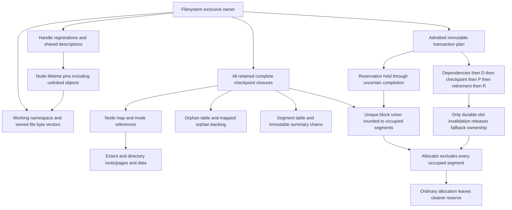

# SunFS SFS-4 segment cleaner and forward progress

Work started 2026-11-14; local qualification continued on 2026-11-15.
**SFS-4 COMPLETE: G1–G10 PASS within the bounded hosted scope.**
Authoritative verdict: [validation-summary.json](../../audit/sunfs/sfs-4/validation-summary.json).
No commit, push, native mount, physical formatting, boot/root migration, CPython
port or SunApp work occurred. Host Python scripts only orchestrate qualification
and derive evidence.

## Source baseline and allocation ownership

Incoming `main`, `24aa8186b8abd55099727d37d3da53e04d83c6be`, includes uncommitted
SFS-3 implementation and evidence. The SFS-4 baseline records these exact incoming
bytes; comparisons against HEAD alone would incorrectly attribute SFS-3 work.
Previous evidence is never a test output destination.

Source: `engine.rs::{accounting,plan,publish,retire,sync_all}`,
`engine/recovery.rs::{inspect,Scan::closure}`, `engine/namespace.rs::reap_orphans`,
and `engine/handles.rs::{close,pins}`. Recovery validates actual graph references,
data CRCs, bitmaps and summary ownership before accepting a closure. Segment
counters alone never grant allocation authority.

Working data is private memory. Handles never retain pointers to disk blocks.
Every commit copies remaining orphans too; last-close only changes eligibility.
Reaping removes current-map ownership transactionally and is separate from physical
retirement. Allocation is exclusively at whole-segment granularity. Unused offsets
in protected segments are placement overhead, not reusable capacity. Dead segments
are already allocatable after the ordinary retirement barrier; no erase is needed.

## Preimplementation decision

Keep format v0.2, codecs, geometry and golden fixtures unchanged. Implement a
single explicit bounded foreground request through the existing full-snapshot
planner and D/P/R publication path. Preserve logical content generations during
relocation, together with namespace, object identity, orphan state and handles.
Never rewrite a historical root. The source's whole-snapshot layout means cleaning
cannot compact equal-sized retained snapshots: useful net reclaim requires a
larger oldest closure than the replacement snapshot. Otherwise report bounded
fallback deferral or explicit relocation without net reclaim under caller policy.
Do not represent copied bytes as reclaimed space.

Admission reserves the entire actual replacement closure, not just victim data.
Ordinary writers retain the whole configured cleaner reserve. Cleaner admission
retains a floor of two geometry metadata bounds plus three publication blocks;
the remaining reserve covers at most one complete admitted transaction. Reject
plans too large for that tranche, or plans that cannot fit without allocating
from any still-protected segment. Every request has explicit scan and dependency
budgets and performs at most one checkpoint transaction. No recursive cleaning.

The initial candidate policy orders current-only sealed segments by verified
current block count and then index (all segments have equal capacity). Pure
fallback segments are skipped; relocation never modifies their bytes. Source
closure validation is bounded independently by the format's graph reader limit.
Source read/verification failure freezes mutation until fenced remount.

## Foreground API and scope

`Filesystem::clean_segments(CleanBudget, CleanPolicy) -> Result<CleanResult>`
is the only cleaner entry point. No fsync, close, allocation or reap operation
implicitly invokes it. `CleanBudget` limits segment scanning, complete source
verification reads and admitted dependency blocks. Each call performs at most
one full-snapshot transaction. A budget stops work before admission; it never
cuts an admitted D/P/R sequence short. Device faults may interrupt that sequence.
The format independently bounds graph traversal to 65,536 page reads per closure.
An additional read-only device wrapper enforces the caller's actual aggregate
read limit during verification. A different larger on-media graph therefore
cannot turn the cached cost estimate into an over-budget traversal. Its rejection
freezes the old owner because the changed source has not been qualified.

`CleanPolicy::Reclaim` requires strictly positive predicted whole-segment reusable
capacity after the ordinary oldest-root retirement. `Relocate` explicitly permits
one safe relocation whose source remains fallback-protected. Equal-size snapshot
copies cannot manufacture net capacity. The planner's cost is the same for every
victim because the initial implementation rewrites the whole current snapshot.
Trying another segment cannot make an unaffordable full snapshot cheaper.

Candidates are current-only sealed segments, ordered by verified live count then
index. Segment sizes are equal, so this orders exact utilization ratios without
floating point. Pure fallback, shared fallback/current and quarantined segments
are skipped. There is no unbounded retry, admission recursion or repeated victim
selection within a request. A short scan reports its unscanned suffix. Callers
need a sufficient scan budget to inspect later segment indices.

`segment_liveness(limit)` exposes actual current, fallback, runtime and reserved
block lists. FREE means empty physical ownership union. SEALED means current
ownership; RETIRED means fallback-only ownership. CLEANING is a transient admitted
reservation; uncertain/degraded owners conservatively report every segment as
QUARANTINED. ACTIVE is reserved as a conceptual state: this allocator has no append
mode and seals complete snapshot allocations. No on-disk segment state was added.
Runtime-only disk backing cannot occur in this engine: handles own memory and
every un-reaped orphan remains mapped. That unsupported state is not modeled as
an invented physical pin fixture.

Results distinguish reclaim, deferred retirement, fallback/runtime blocking,
no candidate, insufficient reserve, budget, dirty state, read-only state, device
failure and uncertain completion. Dirty epochs must be explicitly synced or
resolved by their caller. The cleaner cannot silently commit unrelated mutations.
`segments_cleaned` counts whole segments released by ordinary retirement during
the request; the representative victim itself can remain the new fallback.
`blocks_reclaimed` counts released old block ownership, while signed
`net_reusable_blocks` measures the actual capacity change after target consumption.
These are deliberately different quantities.

Logical relocation and checkpoint counters acknowledge only a completed D/P/R
transaction. I/O counters separately retain submitted bytes, device-confirmed
completed bytes, completed flush calls and attempted flush calls on failure.
Device-confirmed completion is not a durability assertion. Unknown completion
does not increment confirmed bytes. Raw simulator traces preserve all persistence
fragments and device outcomes.

## Immutable relocation and retention

Before admission, the cleaner re-traverses every retained root through the
engine recovery walker. It compares the recovered UUID, superblock, complete
checkpoint set and exact ownership maps against the mount's existing authority.
It validates complete data and metadata closures; checkpoint header CRCs are
insufficient. A changed or unreadable source freezes this owner without persistent
writes. The complete pre-encoded plan is then installed as the exclusive pending
reservation before any publication I/O.

The engine retains decoded inodes alongside each bounded snapshot. Cleaner
planning copies every inode attribute unchanged, replacing only its physical
extent/directory references. It preserves per-extent content generations and
recomputes checksums for new allocation epochs. Metadata pages, node map, orphan
table, segment table and summary chains receive new immutable physical mappings.
No historical metadata is edited, and all initially protected segments are
excluded from target placement, including those an R0 barrier will later release.

The publication function is shared with ordinary fsync and orphan reap:

1. With three retained roots, durably invalidate only the oldest through R0.
2. Write all admitted dependencies, then flush D.
3. Publish the new checkpoint, then flush P.
4. Zero the oldest remaining slot, then flush R.
5. Update retained ownership and acknowledge the completed transaction.

With two roots the first step is absent. The previous newest remains complete
as fallback. Copied source blocks therefore remain protected until another
successful checkpoint retirement releases them. New source placement never
depends on consuming the victim before that release. Failed publication retains
the complete plan and freezes mutation. Reset/remount fences the simulator and
reconstructs ownership; no uncertain operation is retried in the old owner.

## Reserve and orphan ordering

Ordinary admission still keeps the full existing superblock cleaner reserve.
Cleaner planning computes all data, directory/extent pages, inode/map/orphan pages,
segment tables, self-owning summaries and whole-segment placement overhead first.
It must fit the protected cleaner tranche and leave the recovery floor described
above, including during R0. There are always three existing checkpoint slots;
no reserve depends on an extra slot or format change. Overflow, transaction-bound
and tranche failure occur before any persistent write.

The minimum original geometry reserve does not promise to fit every populated
full-volume snapshot. Oversized plans are rejected explicitly. A fixture with
16 populated regular files plus 16 directories uses an existing valid enlarged
transaction-bound parameter to separate transaction admission from cleaner-tranche
exhaustion. It does not enlarge production geometry or the production reserve.

Object descriptions pin logical nodes independently of names. Open-unlinked files
retain their original bytes and shared offsets across cleaning. Cleaner planning
copies mapped orphan backing, even after last-close makes it reap-eligible. Last
close performs no storage I/O. A later explicit `reap_orphans` transaction removes
eligible nodes and orphan records exactly once. Fallback roots retain old orphan
backing until the same ordinary retirement path releases it. No separate physical
free operation exists in the cleaner, close or reap path.

## Progress fixtures and evidence interpretation

| Fixture | Required observed behavior |
|---|---|
| F1 | Smaller snapshot replaces a larger fallback with positive net capacity; reused dense source has a verified nonzero obsolete tail, is relocated, retained, retired and safely reused |
| F2 | Empty ownership segments are already reusable; no erasure or needless relocation |
| F3 | Shared current/fallback bootstrap backing is skipped without I/O |
| F4 | All protected source bytes stay unchanged; only durable slot retirement releases ownership |
| F5 | Real open/dup/unlink/clean/read/close sequence preserves bytes and offset; reap stays distinct |
| F6 | No ordinary admission headroom under a valid configured reserve; cleaner uses its tranche while preserving the recovery floor |
| F7 | Repeated equal-size refusal, zero scan/read/dependency budgets and dirty-state refusal terminate without writes |
| F8 | Cleaning restores previously refused admission, followed by 24 durable overwrites and real source reuse |
| F9 | 24 overwrite/create/rename/unlink/reap cycles preserve checker/accounting agreement |
| F10 | Crashes before/after every source read, dependency write, checkpoint write and retirement/barrier preserve a complete permitted generation |
| F11 | Fenced writable recovery retries relocation without duplicate retirement; damaged recovery stays read-only |
| F12 | Full populated plan exceeds cleaner tranche; admission rejects before I/O |

The 64-block geometry yields positive reclaim in the shrinking-snapshot fixture.
The same eight-file workload occupies one segment per snapshot at 256 and 512
blocks/segment, so `Reclaim` refuses it without copying. These are recorded
negative results, not evidence of forward progress in those geometries. The
near-full fixture models exhausted ordinary admission headroom by an existing
valid configured reserve; it is not described as a physically filled device.

The API does not guarantee compaction of arbitrary equal-sized generations.
Purely fallback-pinned victims and reservations that cannot fit safely terminate
with explicit reasons. Net capacity is measured from the union of verified
closures rounded to complete segments; relocated-block counts alone never pass
the positive-progress gate.

`RuntimePinned` is a conservative refusal classification when that nonpositive
projection includes mapped pinned orphans. It does not establish a second,
runtime-only disk owner or show that copying the orphan is unsafe. The same
operation under explicit `Relocate` policy safely copies it. Closing the last
handle only permits a separate reap transaction; it does not itself improve
physical capacity or change the cleaner's full-snapshot cost.

## Independent checking and deterministic faults

`sunlight-sunfs-check::check_relocation(before, after, manifest)` uses the checker's
own closure walker and format arithmetic. It imports no cleaner liveness,
planner, recovery selector or engine allocation implementation. It checks full
inode attributes, directory bindings, NodeId/incarnation, sizes, file bytes,
extent logical/content generations, orphan records, changed physical mappings,
retained fallback identity, exact target reservations, unique ownership, protected
segment exclusion, quarantine manifests and the independently calculated reserve
floor. Runtime pin manifests name expected nodes; real handle tests separately
prove their authority and offset behavior. Cold images never invent open counts.

Corruption fixtures include duplicate/unreserved targets, quarantined targets,
lost runtime pins, incorrect floor, orphan/count changes, generation transitions,
protected source overwrite, size/content-generation/attribute changes and
inconsistent linked-node nlink. Inode mutations reseal every map ancestor through
the checkpoint. Metadata summaries contain zero metadata CRCs under the existing
format; this does not excuse semantic validation. Raw malformed images and
manifests are retained with lossless compression and original SHA256 values.

Cleaner schedules exercise two retained roots, three roots requiring R0, and
persistent orphan backing. Device faults include failed reads/writes, power loss
before and after every I/O event, completed prefixes, torn byte/sector fragments,
uncertain writes with none/all persistence, and failed flushes with none/one/all
pending writes durable. Every case checks exact permissible selected generation,
namespace/bytes, all recoverable closures, no protected overwrite, held reservation,
zero false acknowledgment and fenced retry or explicit degraded read-only state.
Every result's attempted/confirmed I/O counters are compared with the simulator
trace. This is finite deterministic coverage, not arbitrary hardware ordering.

## Qualification and source integrity

The authoritative final attempt is `raw/qualification-20261114T204037.540668Z`.
The gate verdict is recorded in `docs/audit/sunfs/sfs-4/validation-summary.json`.
Earlier attempts remain separate in `attempt-history.json`.
Initial fixture setup mistakes, a last-source-read crash boundary that reached
admission, and later checker/counter refinements are not erased by later success.
Only final-source results qualify acceptance.

Both profiles passed **54 tests each**: 43 existing plus 11 SFS-4 tests. Each
profile passed **2,960 new cleaner schedules** (mixed 1,086, three-root/R0 1,196,
orphan 678), plus all **10,182 legacy mutation/reordering schedules**, for
**13,142 per profile**. Legacy rows match the reproduced baseline, and both final
profile corpora agree. The SFS-1 formatter/fault/malformed-input campaigns remain
separate. Seven new image mutations and five manifest defects are rejected.

Core `no_std + alloc` compilation, both hosted bins/examples builds, the existing
**139 storage regressions** (block 29, FAT 9, VFS 101), Clippy with warnings denied,
scoped formatting and unchanged golden regeneration all passed. The existing
unrelated startup-fixture duplicate-build-target Cargo warning remains. CPU 0/1
replayed the same source-read crash schedule with equal corpora; that replay is
not added to unique coverage.

| Gate | Result | Primary evidence |
|---|---|---|
| G1 | PASS | source baseline and allocation/retention graph |
| G2 | PASS | bounded deterministic foreground API and progress fixtures |
| G3 | PASS | reference-derived liveness, full closure validation and changed-source budget test |
| G4 | PASS | immutable relocation through shared D/P/R/R0 publication |
| G5 | PASS | full-plan tranche admission, recovery floor and pre-write exhaustion |
| G6 | PASS | positive 128-block gain, restored admission/churn and explicit negative outcomes |
| G7 | PASS | real handles/orphans, zero-I/O close, distinct reap and fallback retention |
| G8 | PASS | new/legacy matrices and independent checker agreement |
| G9 | PASS | builds, both profiles, golden, lint and storage regressions |
| G10 | PASS | final source/output hashes and unchanged prior evidence |

`tools/sunfs4_validate.py --qualify` builds locked and offline, executes independent
hosted test binaries with separate milestone evidence namespaces, runs both
profiles, compares all legacy schedule rows with the incoming SFS-3 reproduction,
checks storage regressions, builds hosted binaries/examples, and checks Clippy,
formatting and golden fixtures. Compiled-source hashes and an archive bind every
attempt. Two CPU-affinity replays compare the same deterministic schedule; this
is same-host placement independence, not cross-ISA or native concurrency proof.

Run `python3 docs/audit/sunfs/sfs-4/derive.py` after qualification to bind every
schedule row to its compiled-source manifest and geometry and derive scoped
request counts. F2/F3 share one operation and are not counted as two requests.
The fixed-loop counts are bound to the exact executed test-source SHA256;
fault requests, setup dry runs and recovery retries remain separate scopes.

After final documentation/evidence edits, `--seal` checks that compiled sources
still match and seals all changed/new output hashes. `--integrity-only` repeats
the verification. The baseline covers incoming tracked/unignored regular files;
ignored build artifacts and symlink metadata are outside that manifest. SFS-0
through SFS-3 evidence must remain byte-identical.

To replay one cleaner fault on this workspace, set `SUNFS_SFS4_CASE` to its exact
case string, set `SUNFS_SFS4_EVIDENCE_DIR` to an **absolute** new evidence path, and
run `cargo test -p sunlight-sunfs-lab --test cleaning --offline --locked --target
x86_64-unknown-linux-gnu f10_interrupted -- --nocapture`. The source snapshot and
raw command log identify the required bytes; CPU replay records provide a concrete
example. Replays are not added to unique schedule coverage counts.

## Measured foreground cost

The 16 MiB / 64-block shrinking-snapshot fixture has 4,032 segment-area blocks.
It starts with 194 protected blocks occupying four segments and ends with 58
protected blocks occupying two. Reusable capacity increases from 3,776 to 3,904
blocks: **128 blocks / 512 KiB net reclaim**. Retirement releases 165 old owned
blocks; replacement consumes one complete 64-block segment. These counts reconcile
through the independent checker.

| Observation | Measured value |
|---|---:|
| Data relocated | 16 blocks / 64 KiB |
| Metadata rewritten, including summaries | 13 blocks / 52 KiB |
| Total dependency blocks | 29 |
| Written bytes, including checkpoint and retirement | 126,976 / 124 KiB |
| Verification reads | 199 pages |
| Flushes | 3 |
| Write amplification per relocated data byte | 1.9375 |
| Relocated dependency bytes per net reclaimed block | 928 |
| Written bytes per net reclaimed block | 992 |
| Reserve high-water in the pressured fixture | 64 blocks |
| Protected recovery floor | 541 blocks |
| Occupied-segment utilization before / after | 75.78125% / 45.3125% |

Utilization falls because a larger old closure is retired; this is not a claim
that the current sparse tail was packed more densely. Equal-size explicit
relocation records zero net capacity and still incurs writes. The performance
artifact keeps those outcomes separate. No throughput optimization or device
performance claim follows from simulator command timings.

## Limitations and SFS-5 recommendation

Keep the existing bounded exclusive-owner API, full immutable snapshots and
whole-segment placement. There is no background GC, incremental map rewrite,
parallel mutation, native VFS mount, physical storage formatting or driver
durability qualification. Capacity that is entirely pinned or cannot fit the
cleaner tranche remains a bounded refusal. Last-close does not resolve low-space
reap admission, and cleaner requests never implicitly reap objects.
Cleaning requires a clean working epoch. If a caller first creates a dirty epoch
whose fsync cannot be admitted, this API does not roll it back or clean around it;
the caller must preserve/retry its uncommitted operation after resolving that
epoch (including fenced remount if necessary). The progress fixtures explicitly
request cleaning before admitting their next dirty epoch.

Follow the existing roadmap's SFS-5: qualify the native block/cache/partition
flush and timeout-fencing prerequisites, then a disposable secondary SunFS volume
with VFS object/mount authority and native consumers. Preserve FAT and the current
boot/root path. Require actual guest persistence, lifecycle and UI evidence for
those separate gates. If workloads require equal-sized-snapshot compaction before
native integration, first design an explicit incremental-allocation ADR and repeat
the hosted retention/reserve/crash proof; do not weaken fallback protection.
