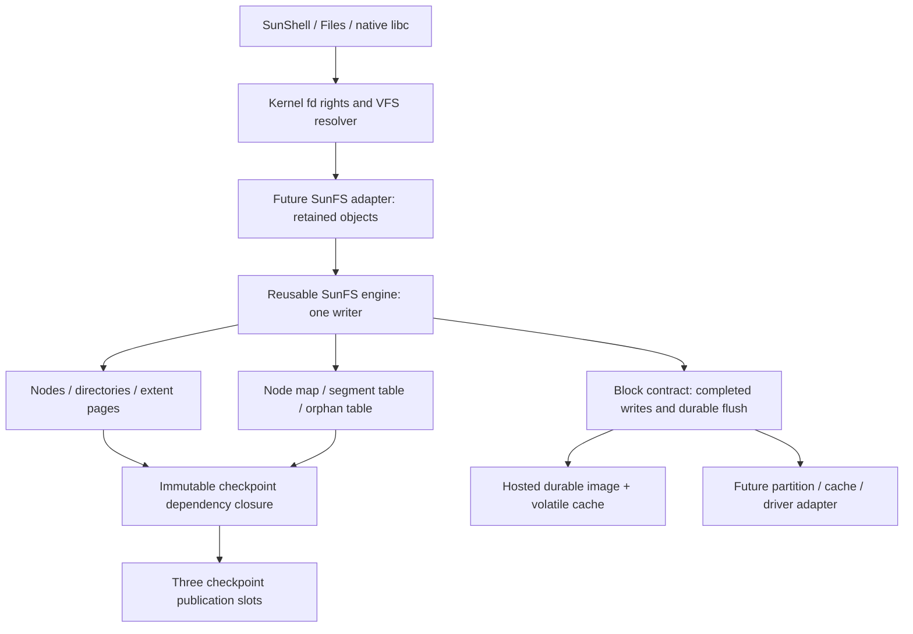

# SunFS architecture v0.2 — SFS-0

2026-11-14. Design proposal, not an implemented filesystem or frozen format.
Priority: correctness, recoverability, simplicity, performance, features.

## Scope and authority

SunFS will be a single-device native persistent filesystem. FAT remains for ESP,
removable media and supported exchange use. Existing root, boot, ramfs/tmpfs and
FAT paths remain operational. This milestone changes documentation only. There is
no installer, mount activation, CPython work, commit or push.

The normative design set is this document, the [format](sunfs-on-disk-format-v0.2.md),
[recovery contract](sunfs-crash-recovery-contract.md), [integration](sunfs-vfs-integration.md),
[roadmap](sunfs-implementation-roadmap.md), and [ADR 0001](adr/0001-checkpointed-segment-log.md).
Repository facts and exact source anchors are in
`docs/audit/sunfs/sfs-0/repository-capability-inventory.md`. Historical PY results are
reported history, not tests rerun or SunFS runtime evidence.

## Selected architecture and dependencies

Use the compact checkpointed segment log in ADR 0001. Data and nodes are immutable
once reachable from a checkpoint. Each node has stable ID/generation and its own
physical record. An immutable node map resolves that identity. Directories and file
extent lists are immutable paged arrays; namespace mutations modify the next working
snapshot. The checkpoint publishes the root node identity and roots of all global
tables. Full-table rewrites avoid an initial general tree and version-selector layer.
No hot/cold streams, inline data, compression, encryption, deduplication, background
cleaning, roll-forward or native snapshots are required in v1.

Stage A owns engine, codec, laboratory and independent checker. Stage B must extend
existing enum-based VFS dispatch and map existing mount incarnation/local handle
lifetimes without changing authorization. Existing filesystem-service IPC is a
separate namespace, not the authoritative native file backend. Native integration
requires stronger directory pins, versioned metadata and block-error contracts;
see integration and inventory for exact boundaries.

## Persistent identity and lifetime

Volume identity is a formatter-generated 128-bit UUID. Object identity is
`(volume_uuid, nid:u64, incarnation:u64)`. Zero IDs/generations are invalid; root is
`(1,1)`. Renaming changes directory bindings, never identity. The node map contains
one current incarnation per nid. Directory entries store both nid and incarnation;
a stale generation must fail lookup rather than bind a replacement.

Initial allocation uses monotonically increasing nid and incarnation=1. Persist
`next_nid` in every checkpoint. Never recycle nid in v1; fail on exhaustion. Future
recycling must persist generation tombstones and respect every retained checkpoint,
open reference and exported token; it is not authorized by spare generation bits.
An object discarded before any publication may consume an ID without reuse within
that mount. Failed or uncertain publication freezes the writer until recovery;
no old runtime handles survive a remount, so uncommitted IDs cannot resurrect them.
Persistent cross-session reference export is out of scope until durable allocation
reservation exists. Published IDs never move backward across writable recovery:
a corruption-driven fallback is read-only pending explicit operator recovery.

Data extent identity is `(owner NodeId, logical_first_block, content_generation)`;
content generation is the creating checkpoint generation. Relocation preserves this
logical identity while changing physical address; the epoch-bound checksum is recomputed. Physical segment
identity is `(segment_index, allocation_epoch:u64)`; reusing a fully free segment
increments its epoch without wrap. Page pointers and summaries carry the epoch.
Directory identity uses the same NodeId as files; a name is not a capability.

`nlink:u32` is persistent namespace ownership. `open_refs` and in-flight operation
pins are bounded runtime counters, never serialized. A regular file with nlink=0
and any authorized open/pin remains readable/writable through its existing object
handle. Unlink removes only the binding; pathname reopening fails atomically.
Dup/fork retain an open description, independent opens retain the object; last
reference release schedules reclaim, never synchronous unsafe reuse. Overflow or
allocation failure is checked before acquiring ownership. Retained directories
also need object-relative child lookup and enumeration; reconstructing a path is
insufficient. Unlinked directories disallow new mutations and have defined empty
lookup behavior; `.` retains self, `..` uses a pinned former parent until close,
and traversal remains subject to mount/credential policy. v1 forbids hard links
and nonempty rmdir; rename replacement is restricted to matching file kinds and
empty target directories, and rejects directory descendant cycles.

A commit includes every nlink=0 object still held by an open reference or runtime pin in the orphan table and node
map. After crash, runtime references are gone: recovery retains those objects while
checking the committed graph, then reclaims them in a new ordinary transaction.
A read-only mount never reaps. Last-close can remove an orphan from the next map,
but old checkpoint references continue to pin backing. A crash before unlink is
committed restores the old name; after committed unlink it cannot restore that
name. A file fsync while unlinked persists bytes for consistency, not a pathname
or a promise that another process can reopen it after reboot.

## Namespace and future POSIX contract

`stat` follows final symlinks; `lstat` returns link metadata; `fstat` reads the pinned
object. `openat` needs a retained directory and one authorized component walk,
not handle_path followed by a second lookup. `rename` is one same-volume namespace
transaction (both parents, replacement, parent relation and link counts); cross-volume
rename fails EXDEV. `unlink` changes nlink and orphan ownership together. `readlink`
returns stored bytes without traversal or implicit NUL; `realpath` walks existing
components through the authoritative VFS resolver with bounded expansion and actual
mount crossings. None of these POSIX APIs is implemented in SFS-0.

Directory names are case-sensitive UTF-8 bytes, 1..255 bytes, excluding slash, NUL,
`.` and `..`; normalization and case folding are absent. Byte order determines
sorting and uniqueness. Dot components are resolver operations, not stored entries.
Symlink targets eventually use UTF-8 bytes up to 4095, allow relative/absolute paths,
and preserve dot components for real traversal. SFS-2 rejects unsupported symlink
features; SFS-6 introduces them with VFS support. A filesystem cannot turn lexical
app normalizers into authorization or canonical paths.

Persistent metadata includes type, size, uid/gid/mode, nlink, parent for directories,
and versioned timestamps with an explicit validity mask. No invented time values:
unavailable clock data stays invalid. atime updates are disabled initially; mtime
and ctime updates require the later native time policy. The disk layout can preserve
validity without claiming a POSIX ABI; ABI translation requires SFS-6.

## Allocation, summaries and free space

4096-byte filesystem blocks and 256 blocks/segment are laboratory defaults only.
SFS-1 compares 64/256/512; see geometry model in evidence. Addressing uses filesystem
blocks; the existing native 512-byte interface needs an eight-sector checked adapter.
A 4 KiB write has no assumed atomicity. All metadata and data blocks are protected
by a type/address/epoch-bound CRC64, with parent references checking expected content.
Checksums detect accidental damage; they do not authenticate a hostile device.

Allocator truth is the union of block closures of ALL still-published recoverable
checkpoints, plus working reservations, open-object/in-flight pins and quarantine.
Current checkpoint live bits alone are insufficient. Accounting distinguishes:
current-live, fallback-only, runtime-pinned, working-reserved, quarantined,
cleaner-reserved and allocatable. These sets may overlap as ownership sets; compute
a unique union before counting unavailable blocks. Free totals are derived, never
trusted from a header count. Allocating a free bit and assigning an owner occurs
under the single writer lock; checked arithmetic rejects double reservation.

States are FREE → OPEN → CLOSED → CLEANING → RETIRED → FREE, with QUARANTINED on
uncertain I/O. OPEN means unused offsets may be allocated; never overwrite an
already protected offset, even when its current owner died. CLOSED segments accept
no user allocations. CLEANING and runtime reservations are transient; checkpoint
segment records describe their committed liveness. RETIRED means no current owner,
but possible fallback/pin ownership. FREE requires empty union and no outstanding
I/O. Segment reuse increments epoch; unused space may be appended within an epoch.

Summaries are immutable pages in the general segment area, referenced by the segment
table, rather than in-place segment trailers. A new summary version describes the
current snapshot; older checkpoints retain their old summary pages. Summaries name
owner/type/logical position but are only hints for cleaning: validate against the
selected checkpoint map/extent graph before relocation. Table and summary blocks
are themselves allocated metadata. Precompute/reserve the complete bounded commit
layout including those pages before I/O; include their ownership in the generated
bitmaps/summaries. No allocate-while-serializing recursion. SFS-1 must test layout
fixed-point sizing (extra summary/table pages can require extra segments), reject
nonconvergence/over-budget layouts, and record actual reserved blocks.

One foreground cleaner chooses a CLOSED segment with low current-live count, skips
purely fallback-pinned victims, and relocates a bounded batch through the ordinary
commit protocol. Readers hold pins until relocated reads complete. Metadata relocation plans copy all affected physical-reference ancestors through
their table roots, using the same bounded immutable graph plan (including summary
chains); identity references in directories do not change. New extents/map
and segment records become durable before publication; old locations remain pinned
until checkpoint retirement and last pin. Interrupted relocation leaves the old
checkpoint or new complete checkpoint; no free-in-place action exists.

Before accepting a mutation reserve enough space for dirty data, all rewritten
tables, summaries, checkpoint publication and bounded orphan cleanup. Separate
cleaner reserve must cover one maximum admitted victim's live blocks, relocation
metadata and two checkpoint generations' metadata growth. Compute it from the actual
capacity bound and transaction plan, not a magic percentage. Infeasible volumes
cannot format writable. User writes stop before dipping into that reserve. A cleaner
may fail ENOSPC when fallback pins prevent progress; return a bounded failure,
never spin indefinitely or discard fallback to satisfy allocation. Reserve pressure
must trigger a metadata-only retirement/commit when feasible; otherwise fail-stop.

## Security, forward progress and checker

VFS owns credentials, ancestor Execute checks, mount/device grants, protected paths,
symlink/mount policy and descriptor rights. SunFS owns pointer bounds, record typing,
generation authentication, namespace invariants, persistent ownership and quota/
reservation accounting. UUID/nid are identifiers, not authority. Malformed media is
untrusted input: reject unknown flags, overlaps, integer overflow, cycles, duplicate
owners, excessive page counts, invalid UTF-8 and invalid timestamps before exposure.
Use iterative bounded traversal with visited sets, maximum node/page/extent/name
budgets and fallible allocation. Never recurse on disk-supplied depth.

The hosted engine starts with one mutation/commit lock; it may hold that lock over
host I/O, but never calls back into clients while held. Future kernel code must not
perform blocking I/O under scheduler or global VFS spinlocks: capture authorized
pins, drop outer locks, run I/O, then validate mount/object incarnation before
publishing. Lock order and revocation schedules require explicit SFS-5 evidence;
existing polling under device locks is a dependency, not an acceptable latency proof.
Deadlines freeze/quarantine uncertain requests; a timeout cannot justify DMA buffer
reuse. Bound admitted dirty memory, handles, orphan count, cleaner work and commit
queue; starvation tests require independent progress events.

`sunfs-check` is a separate read-only graph walker, sharing only codecs/constants,
not allocator or mount acceptance logic. It checks all SB/CP candidates and classifies
corrupt/incomplete/unrecoverable separately. It verifies node-map uniqueness,
root kind, all directory targets/generations, parent acyclicity, reachability and
orphans, exact link counts (directories 2 + immediate child directories), extents,
checksums, allocation union and duplicate ownership. Sharing the same physical block
across checkpoint generations is allowed only with matching immutable identity and
checksum; sharing data between two current files is forbidden. It checks fallback
closures independently and reports generation conflicts. It never repairs or writes.
SFS-1 minimum: codec/geometry/SB/CP/pointer/bitmap/duplicate-block checks on generated
fixtures. SFS-2: full graph, link/orphan/extent/accounting and fallback checks after
every crash. Corruption is reported, never silently rewritten.
