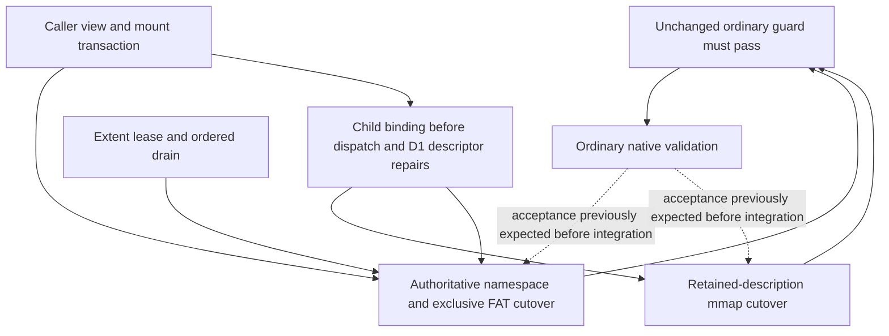

# VFS-N1C mount authority and coordinated storage handoff

2026-11-27. Runtime mount publication now initializes the complete record in
the existing table. The service mount transaction and storage transfer remain
designs. All four historical ownership findings remain open.

## Live authority and dependency audit

| Surface | Writers and lifecycle | Readers and retained state |
| --- | --- | --- |
| Kernel root and protected FAT | `init_block_and_fat` discovers and registers media, checks eligible FAT candidates and extracts a bounded boot share. It drops the probe backend. `init_kernel_vfs` seeds a private tmpfs from the selected boot resources, optionally probes and samples retained VirtIO FAT, attaches at `/boot`, trusted `/state`, or `/mnt`, records the registry source and creates the state marker directory before publishing the aggregate VFS. Runtime-test mode and deferred fstab UUIDs can suppress the boot attachment. Protected mounts reject StorageCtl removal. | Ordinary kernel pathname resolution and descriptor I/O, native and Linux syscall adapters, storage policy, executable/interpreter loading, private file mmap and scheduler close/reaping use this tree. Kernel state and secret policies also depend on its paths. Native C guest and storage qualification helpers use the table. Compressed resources supply initial bytes. |
| Kernel runtime FAT | StorageCtl obtains kernel UID and StorageAdmin authorization. Under the VFS lock, `storage::mount` checks a registered writable FAT extent and an empty secure target under `/mnt`, bounds the partition view, probes FAT and samples capacity on eligible non-USB media. The VFS prevents duplicate source/target and nested conflicts. UNMOUNT uses the current exported ID, rejects protected and busy mounts, syncs, then removes. A failed barrier keeps the same backend and ID. Remount probes again and consumes a fresh incarnation. The partition test uses a separate test-only remount. | Lookup/crossing, create and other mutations, enumeration, descriptor operations, file and directory sync use the mounted backend. `is_runtime_path` also informs write and directory-sync policy. Linux `statfs` resolves under kernel policy and then asks for capacity by exported mount ID under a second lock acquisition. A detached ID fails rather than aliasing a new mount. |
| Topology reporting | The VFS table is written by mount insertion, protected source assignment and runtime withdrawal. The boot source assignment occurs before global publication. Tags advance on insertion. Open/create and close adjust per-mount pins. Backend allocations, frees and uncertain I/O affect the live FAT capacity/poison state. The device registry records discovery, extent and transport accounting. | ProcFS samples the global table and source registry in VFS-then-devices lock order, with caller eligibility checked before sampling and again at FD install. StorageCtl LIST_MOUNTS and INVENTORY_MOUNTS expose indexed global rows, with no revision across calls. Mount metadata also feeds path and anchored lookup results and packed handles. The inventory of devices cannot determine attachment or caller visibility. |
| Service namespace | The server builds its own seeded root via fstab and shares the resulting `Arc<Mutex<Vfs>>` with retained-directory and legacy handlers. Legacy BootFs is a separate read-only share-page adapter selected by component prefix. Registration installs and retires endpoint identity, epoch, caller views, root/cwd receipts and grants. The service has no production live FAT mount transaction. | Selected copied pathname operations use authenticated retained anchors in the service tree. Legacy handlers also access the service tree and expose the BootFs share through their own dispatch. Each retained directory and regular-file description owns live backend references. Namespace withdrawal releases the corresponding pins; a distinct file-owner retirement releases description rows. Existing selected views do not establish the visibility of the kernel attachments. |

The mount slot table and FAT/cache state are serialized by the existing kernel
VFS lock. Source assignment, target selection, path crossing, mount reporting,
capacity, access policy, open objects and sync depend on the same attachment.
Moving just StorageCtl, statfs, or ProcFS leaves a second decision about which
mount a caller reached. The references above cover production topology readers
and writers, including lifetime and policy callers. The source audit also counts
test and bootstrap dependencies.

The service's mounted directory and description adapters use the default
`Vfs<NullDevice>`. Their anchored object metadata lookup declines FAT.
Live FAT needs a device-backed service adapter and stable retained file and
directory objects under mutation. The kernel's FAT lookup metadata lacks
the object and generation contract needed for a retained service receipt.
Runtime admission matches source IDs
and target paths. An exclusive lease must additionally rule out overlapping
extents and parent-device aliases. There is no coordinated freeze of all callers,
revision reservation, or cross-owner device lease. Path-string cwd and profile
state must be audited for pins beyond the VFS open-handle count. USB currently
bypasses write-back caching and checks media readiness on access. The kernel
FAT adapter owns its allocation counts, backend handles and poison state.
It uses a 16-entry block cache for non-USB mounts. Capacity initialization
is bounded to 1024 FAT sectors and can leave capacity unavailable. Isolated
host visibility tests cover retained path traversal only.

## Target contract

The VFS service owns the single runtime attachment graph, namespace crossing
and all backend objects. A storage backend may own an isolated device session
and cache without owning a namespace table. Kernel state records credentials,
grants, caller and registration incarnations, resource limits, device leases,
and publication/revocation fences. These fences protect an authorized
transaction and never enumerate or resolve mounts. Any kernel bootstrap
filesystem has a closed set of private consumers and is outside the runtime
namespace.

- **Identity and authorization.** Pin registration epoch, namespace identity
  and generation, retained root/cwd, mount slot ID and incarnation, and the
  exact backend reference. Bind device identity separately to parent extent
  and media generation. Existing local VFS encodings use export ID tag+1,
  anchored ID slot+1 and generation tag/8+1. They retire exhausted slots.
  Scope these local identities to the owning instance. Never use a pathname,
  registry ID or registration epoch alone as a mount identity. Authenticate
  task, shared process, address space and kernel-issued credentials/grants.
  The service enforces traversal and mount policy against that captured view.
- **Publication.** Reserve the target and resources off-table. Validate source,
  overlap, protection, mountpoint, parent enumeration, backend readiness,
  capacity availability and coverage of all reachable adapters before commit.
  Install the complete row, component crossing, visibility and serializable
  metadata at one linearization point. Advance a nonwrapping topology revision
  for every attachment, withdrawal, source or topology-visible change. View
  changes have their own non-reused revision. Failed staging changes neither
  visible revision. Serialize competing writers and reject stale reservations.
  Replace by retiring an incarnation and publishing a new one under the same
  transaction. Preserve protected-mount policy. Refuse when revision or identity
  space is exhausted.
- **Lookup and capacity.** Resolve with the caller's retained root/cwd or dirfd
  and existing search checks. Acquire a generation pin at crossing, then sample
  allocation units and counts from its backend under the backend's synchronization.
  Preserve statfs wire layout, copyout checks, errno and unsupported-capacity
  behavior, including USB and large FAT. A concurrent allocation may change
  capacity without changing topology. A late reply from a retired generation
  cannot satisfy a request for the replacement. Kernel admission and completion
  validate the caller and output mapping. No path reopen or cache from another
  generation.
- **ProcFS.** Follow [N1A](vfs-authoritative-mount-snapshots.md). Capture one
  bounded immutable snapshot (8 rows, 16 KiB wire, 8192 rendered) of the pinned
  visible view. Preserve the current ProcFS surface, formatting, errno and
  liveness policy. Initially decline unsupported rebased views. Order FD install
  against view and topology changes using a bounded commit lease or equivalent
  writer fence; a second status RPC cannot close that race. The open description
  keeps immutable bytes and authorization identity. Later topology churn cannot
  edit the sample. Read/seek/fstat recheck view eligibility and retirement. Last
  close releases sample resources. StorageCtl reporting must read the same owner
  while preserving its access classes and record ABI. Legacy indexed calls may
  still span revisions; they cannot construct the ProcFS snapshot.
- **Withdrawal and in-flight work.** Freeze new crossings and grants against
  the old incarnation; retain enough authority for close, settlement and the
  durability barrier. For normal FAT unmount/handoff return busy if retained
  cwd/root, dirfds, descriptions, cursors, mapping population or pending calls
  cannot drain under a bounded policy. Preserve installed descriptions and
  shared cursor semantics through ordinary operations. Match authenticated
  completions to the exact request and epoch, settle references exactly once
  after cancellation, and distinguish work completed before the fence from
  work rejected at it. Park outside scheduler, PMM, VFS and device locks. On
  commit remove the old crossing, row and capacity together. Ordinary explicit
  unmount can reveal the parent directory; loss and handoff must fence the
  mountpoint so a parent directory cannot impersonate the missing filesystem.
- **Retirement.** On endpoint, process, media or registration loss fence new
  requests, revoke device admission, settle queued/in-flight transport and
  reject late replies. Report I/O failure for the retired view and invalidate
  old descriptions. Separate namespace withdrawal, reference retirement and
  final backend destruction. Restart requires new registration, fresh mount
  identity, fresh authorization and validated disk state. A confirmed service
  write with a lost reply cannot be safely retried as an ordinary new write.

## Storage transfer

1. **Bootstrap independently.** Start block transport and discover validated
   extents in the kernel. Launch the server and required recovery/control
   processes from immutable embedded resources using the existing bootstrap
   handshake. Preserve compressed boot resources and seed selection. Copy any
   needed legacy boot share before transfers and retire its runtime prefix
   adapter as part of namespace convergence. The writable disk at `/boot`
   is a runtime attachment even when selected at boot. File-backed init,
   runtime loaders, interpreters and apps requiring `/state` must come after
   service authority and caller binding are ready. Preserve the trusted
   state-volume selection and fail closed if the persistent state marker is
   missing. A boot mount can originate directly in the service on a future
   cold boot once its complete consumer set is ready; it then needs no live
   kernel-to-service cache transfer.
2. **Stage device ownership.** Kernel authorizes a bounded block endpoint for
   the exact service registration, media generation and validated physical
   extent. Check ranges and overflow across parent/child aliases, enforce
   read/write/flush rights, bounded buffers, DMA ownership and quotas, and keep
   drivers and transport protection in the kernel. Stage endpoint and memory
   reservations with I/O fenced while the existing owner is live. The lease
   serializes *every* path to the range, including boot probes and test mounts.
   Media reset invalidates the lease and bars stale DMA completions.
3. **Freeze and drain the predecessor.** Block new access at the existing
   crossing and check all pathname and descriptor adapters. For the first
   live transfer require zero live references and bounded settlement of
   in-flight work. No live handle or cache transplant. FAT sync drains dirty
   data and metadata through the cache and device barrier, and requires confirmed
   durable completion before revoking old transport. Device write completion
   alone does not establish durability. Drain or fence queued commands and
   confirmed DMA before enabling the new lease. On an ordinary sync failure
   with intact and certain ownership, resume the existing mount and ID.
4. **Initialize and publish under the new owner.** With exclusive extent access,
   probe fresh geometry and FAT metadata, construct a private cache, perform
   bounded capacity sampling, and validate target and policy. Keep initial
   probing read-only for rollback. Correlate readiness to transaction,
   registration and device generation. Commit once the authoritative parent
   topology, all path crossings and retained-object adapters, reporting and
   capacity have switched as one unit. The initial production switch must
   include the authoritative parent namespace and its mutable root consumers.
   A cold-boot switch can happen before these consumers start. A delegated
   mountpoint inside an independently mutable kernel parent would leave two
   topology writers. The target stays fenced while the old cache is being
   retired and the new owner is staged. No kernel capability
   holder runs an independent writable filesystem beside it.
5. **Recover explicitly.** Before a transfer starts, release failed
   reservations. Before publication, regrant the old owner only after proving
   the staged owner cannot issue I/O, commands have drained, media is unchanged
   and no staged writes occurred. If the old backend was destroyed, reprobe
   with a fresh incarnation and cache before publishing again. After
   publication or uncertain writes, fence the extent, settle transport and
   require validation/repair and explicit remount. Never restore the old
   cache. Qualify failures at each boundary, including unavailable barriers,
   media loss and stale completion.

## Circular prerequisites and staged resolution

Arrows denote prerequisite to dependent. The FAT switch needs authoritative
parent crossing and runtime adapters. ProcFS and statfs need that same mount
transaction. Qualifying either reader first against the service seed tree
would use a different authority; patching the guard to accept a wrapper would
keep the dependency. D1 production qualification needs a coherent service-owned
mount plus pre-dispatch launch binding, while one guard finding requires D1's
retained descriptions to remove mmap's backend dependency. A mount that can
serve executable files needs retained loader/mmap support or an explicit,
compatible boundary before publication. Publishing scratch first would still
leave the live FAT, ProcFS and statfs references, and an ordinary baseline
before removing those references is impossible with the current guard.

Use host qualification as the pre-integration evidence tier. The smallest
coherent next milestone is a **host-only attachment transaction at the existing
service VFS owner**. Add one revision for complete row publication/withdrawal
and a bounded snapshot view/commit fence using the real retained-directory
primitives. Use an isolated fixture with a probe-ready mock backend, target
reservation and busy pins. Exercise failed reservations, aborted publication,
concurrent crossing and snapshot/install, view ABA, stale capacity, teardown
and loss. Qualify the device lease/drain state machine independently with fake
transport, including overlap and unknown write completion. In parallel in the
roadmap, stage descriptor epoch/cleanup and unpublished child-binding contracts
in host tests without enabling D1 or L1C-3. These parts can be verified without
the ordinary boot gate. An explicitly approved future isolated fixture can
provide component evidence under its own prescribed tooling; it cannot count
as ordinary qualification or bypass the ordinary guard.

Assemble a coordinated future candidate covering all affected adapters and the
two cutovers before asking for ordinary acceptance. The storage/topology
changes eliminate the three live FAT/ProcFS/statfs dependencies together;
retained-description mmap eliminates the fourth when its final independent
integration is ready. Review actual source removal with the unchanged guard
before QEMU. Treat ordinary guest results as post-switch acceptance on that
candidate. Preserve a pre-cutover build for operational rollback with its
original guard status. If any live dependency remains or the guard fails,
ordinary native qualification stays blocked. A clean source audit by itself
cannot prove ownership or runtime compatibility.

## Implementation and qualification boundary

Runtime FAT now initializes source and protection in the same insertion as
backend and tag. It still validates the same target, uses the same kernel VFS
lock, and requires the same sync to withdraw. Tests exercise failed staging,
source/capacity identity, failed sync, stale generation after remount, and
retained-root visibility in the service. Existing tests cover stale handles,
slot exhaustion, pin release and registration retirement. This stage adds no
wire operation, topology revision, device lease or production routing. The
owner/view commit fence requires the transaction milestone above. PREAD and
shared offsets, ProcFS eligibility and snapshot design, ordinary storage
policy and memory/boot settings are preserved.

The unchanged ownership guard reports 71 references and the same four
unmatched sites. Ordinary native validation was skipped before QEMU.
Build and host test outcomes are in the [qualification results](vfs-mount-authority-storage-handoff-results.json).
