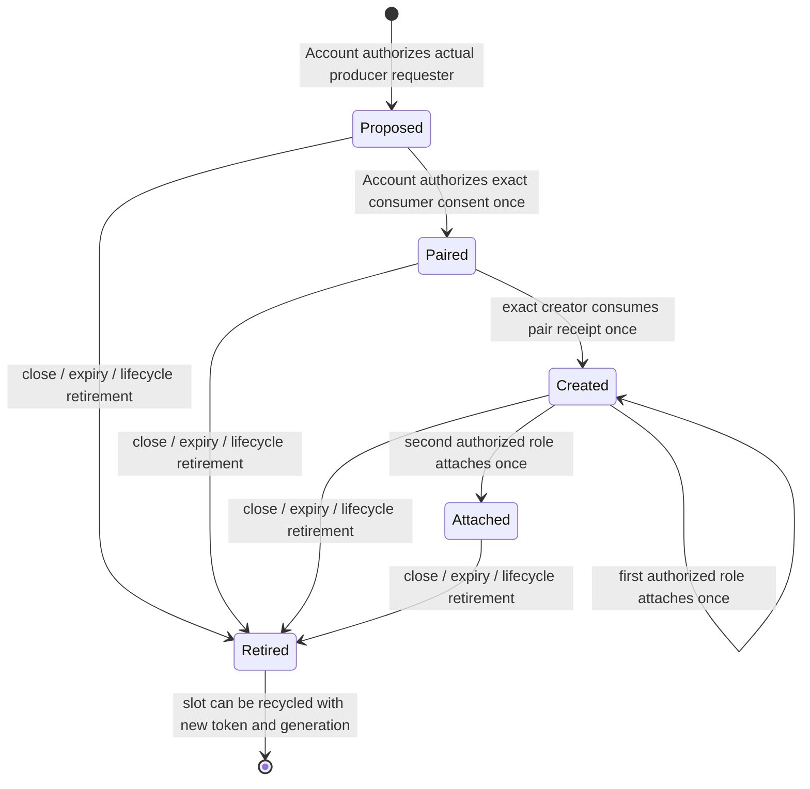

# Native FastLane M1: channel authority and one-use attachment

2026-10-31. Authority only. Experimental functionality is behind
`fastlane_channel_test` in a debug kernel and `fastlane-channel-test` in Account
and its userspace fixture. Production FastLane remains blocked. There are no
channel mappings, ring transfers, or userspace Doorbell operations.

**COMPLETE for M1 authority only.** Final-source native authorization passed on
2/4/12 CPUs, with existing IPC, scheduler, lifecycle and authenticated authority
regressions green. The evidence and scope are recorded below.
This document does not promote the historical Global Authority, Grant Lifecycle,
Session Authority, Doorbell or production gates.

## Authentication and explicit policy

Account has a new, separately gated request label. Its narrow policy allows a
live root requester in the current authenticated active root session to propose
as producer or consent as consumer. The producer and consumer must independently
make the Account request. Existing account group-mutation grants do not satisfy
this policy. The policy uses the existing active-session and caller-query
contract; it does not introduce an additional password reauthentication rule.

The kernel entry authenticates the trusted Account image role, exact session
issuer and session-manager identity, active session epoch, root principal, and
Account's actual synchronous pending IPC caller. It accepts no recipient PID
argument. A proposal selects its producer/creator from that caller. Consumer
consent selects the consumer from the second actual caller and names the exact
proposal. Distinct processes and distinct native VMs are required. The consumer
can be assigned once. The original producer alone can finalize creation after
both consents exist, using a fresh one-use pair-confirmation receipt returned
only to the consenting consumer. The creator obtains that receipt through its
intended peer IPC exchange. The kernel binds it to this object, issuer, session
and exact consumer, and consumes it at creation. A leaked proposal handle, a
guessed receipt, or a receipt presented by any other process cannot finalize the
pair. Losing the consent reply leaves only an expiring reservation. Repeated proposals by a live member, repeated consumer
assignment, and repeated finalization fail.

This is bilateral consent: the producer offers its channel and the consumer
explicitly accepts that offer. It is not an authority for Account to assign any
arbitrary pair of PIDs. Root without the verified Account/session/request path
cannot propose or bind roles through the raw syscall.

No deferred reply, grant delivery registry, or transferred completion handle is
introduced. Kernel operations return immediately. An IPC reply transports an
object reference, never bearer authority. Losing a reply can leave only a bounded
expiring reservation for the original identities; it cannot authorize its holder
or an arbitrary replacement. No retry reassigns a role.

## Identity and rights

`CapabilityBroker` owns the table and uses its existing entropy-conditioned token
issuer and boot-lifetime nonreuse history. The object is a distinct token class,
rejected as an IPC or VFS bearer. Its handle is `{token, channel_generation}`. Consumer consent prepares a second
nonreused broker token as the exact pair-confirmation receipt; it grants no
attachment rights to its holder.
The retained table index supplies the kernel slot; a recycled slot gets both a
fresh token and a checked fresh generation. Neither generation nor PID is
sufficient authority. Tokens are never printed in the new diagnostic traces. The reserved legacy
`SPAWN_TOKEN` retains its original untagged IPC/VFS classification; the existing
issuer excludes its payload from all issued identities. A focused regression
checks this compatibility boundary alongside channel token class isolation.

Both immutable role bindings use existing `RecipientIdentity`:
`{pid, process_incarnation, vm_generation}`. The VM generation is allocated once
per address-space identity, with checked fail-stop exhaustion in the existing
VM allocator; root reuse cannot inherit a generation. The issuer and session
reference are retained too. Every native operation validates live identities
under lifecycle serialization. Creator permission, producer ATTACH/CLOSE, and
consumer ATTACH/CLOSE are independent method rights in the broker's channel
record. They are nondelegable and not derivable through generic IPC capabilities.
A common object handle does not combine these rights.

Exactly one successful attachment is possible per role. Each role separately
transitions `Issued -> Attached`; neither state is reset in that channel lifetime.
A role argument outside producer/consumer, a peer's role, a foreign process,
wrong channel generation, retired identity, or duplicate attachment is rejected.

## State machine and terminal arbitration

`Attached` means both roles are attached, never payload-open. No M1 state admits
mapping or transport. There is no shared-memory backing, operation lease,
Doorbell waiter, or deferred channel operation to drain.

The first terminal transition stores one of `Revoked`, `ProcessRetired`,
`SessionRetired`, `Expired`, or `IdentityChanged`. Subsequent terminal requests
preserve that reason and attachment history. An authorized repeat revoke is
idempotent. All future attachment/finalization is fenced. Retired rows are bounded
tombstones until slot reuse; old handles then fail exact token/generation lookup.

The original lifetime deadline is immutable and applies to the entire M1 object,
including fully attached authority. The maximum is 30,000 scheduler ticks. Expiry
is swept synchronously on channel admission, proposal/consent, inventory, and VM
membership queries. Idle expired metadata remains bounded until the next sweep;
there is no background timer or retained process/VM reference. Incomplete setup
therefore cannot reserve unbounded authority or prevent sharing indefinitely.

All operations use existing `SCHEDULER -> CAP_BROKER` serialization. They perform
bounded table scans and fallible reservation; they neither wait on IPC nor touch
user pointers under these locks. No new production lock is added. Debug race
hooks have bounded rendezvous waits and only choose execution timing; they do not
mutate channel authority. An actual failed lock acquisition is required evidence,
not inferred from timestamps on different CPUs.

## Exit, exec and VM isolation

Existing `retire_recipient_grants` retires every channel naming the exiting or
successfully execing creator/producer, consumer, or Account issuer. Existing
session removal/suspension retires its channels. Before every channel operation,
the kernel additionally fences logically dead/replaced participants, even before
delayed physical reap. Exec retirement precedes new VM activation; failed image
preparation reaches no retirement hook. An attached role thus survives failed
exec and is withdrawn on successful exec, following the existing VM-scoped
authority contract. It is never implicitly inherited by spawn or replacement.

Admission requires a native process owning its VM with no unreaped borrower.
Native thread spawn (both descriptor-sharing modes) and Linux clone additionally
reject while any proposal, paired reservation, or channel membership is live.
The existing fork/process-clone denial remains. Independent-VM spawn is allowed
and inherits no membership. Linux participant admission is deliberately denied in
this milestone. Expiry/revocation ends this authority-only sharing exclusion.

## Resource and exhaustion contract

The global table has eight slots and at most one live membership per principal
process incarnation. All states from proposal onward count. The first allocation
uses `try_reserve_exact(8)`; nothing is published if it fails. Later reuse needs no
metadata allocation. Existing broker active-token and nonreuse-history limits
also apply. Each live proposal/channel charges one token; a paired reservation
charges a second token until its one-use receipt is consumed at creation. A retired row owns only bounded identity/state values, no process,
address-space, allocator frame, IPC endpoint or service reference.

The channel generation counter uses checked addition and never wraps or resets.
At `u64::MAX`, new proposals permanently fail closed for that broker. Existing
objects remain usable. Failed entropy/history preparation publishes no channel;
any identity already prepared by the broker stays burned in its nonreuse ledger.
Arithmetic exhaustion tests use an isolated real broker on the host, not mutated
live kernel process identities or a forged native counter wrap.

## Native authorization matrix

Run `python3 tools/fastlane_channel_validate.py --section build`, then
`--section native --cpus 2 4 12 --image-manifest <build/validation-summary.json>`.
Start with 2 CPUs before expanding. The runner performs real graphical/TTY root
login using the established login fixture, then launches the ordinary user probe
from the authenticated shell. Actors use independent VMs and ordinary private
IPC only. There are no kernel-installed participant roles or impersonated actors.

| Case | Required evidence |
|---|---|
| Authorized creation | Real Account session and two independently pending callers; exact producer finalizes once |
| Independent attachments | Both intended participants attach their own roles once |
| Negative authority | Raw unauthorized proposal, foreign creation/attach/revoke, wrong role, duplicate role/create/consent, wrong channel generation |
| Revocation | First terminal reason preserved; no subsequent attach |
| Slot reuse | Fresh channel generation; original handle fails |
| Failed exec | Actual missing-path exec; original attached consumer role remains consumed |
| Successful exec | Actual same-PID replacement VM; old role rejected and producer observes retirement |
| Exit incomplete | Actual consumer exit before attachment; creator/producer proposal exit; new-PID replacement cannot adopt |
| Attach versus revoke | Both forced orders, different CPUs, independent failed `try_lock`, normal method outcomes |
| Attach versus actual exit | Both forced orders versus real ProcessExit, one terminal and no late role resurrection |
| Metadata exhaustion | Eight actual independently authorized producer processes; ninth refused before allocation/publication; all reclaimed |
| Abandoned reservation | Immutable short deadline; incomplete proposal expires and cannot create |
| VM sharing | Real native thread syscall denied while membership is live |
| Arithmetic boundaries | Host broker tests only: channel-generation exhaustion and fallible allocation/entropy failure atomicity |

Host tests compile the actual broker with synthetic process identities. They
supplement native authentication and include concurrent ordering, identity/VM
mismatch, session suspend/revoke/expiry, stale handle adoption and exhaustion.
Parser negative controls construct labelled synthetic traces solely to test
assessment rejection. Such traces are never recorded as native execution.

## Evidence, decision and next step

The accepted source map contains **1,334 executable/configuration inputs** at
HEAD `2491e22b4db4b2b15f0dfe56059d505327a8753a` plus the uncommitted working tree. No commit or
push was made. The runner retains each attempt in a new timestamped
directory under `target/fastlane-channel-evidence/`, including source hashes and
copies, commands, ELF/ISO/extracted ELF, embedded services, serials and hashes,
per-topology results, independent host acceptance receipts and an artifact index.
An image is accepted only with an unchanged source map and matching archives.
Failures and source-changing development builds remain visible.

The next smallest executable milestone after M1 acceptance is M2: one distinct
restricted mapping authority path, no payload operations, with asymmetric page
rights, alias/borrower exclusion, real unmapping/TLB completion, stale-VA faults,
and normal allocator reuse/sanitization proof. M1 provides no evidence for those
mapping invariants and does not enable production transport.

## Final acceptance receipts

| Configured CPUs | Actual race CPUs | Channel authorization | Forced races | Original host receipt |
|---|---|---|---|---|
| 2 | 0,1 | PASS | all four orders PASS | `target/fastlane-channel-evidence/final/native-20261031T174052.841314Z/2cpu.host-ack.json` |
| 4 | 0,1 | PASS | all four orders PASS | `target/fastlane-channel-evidence/final/native-20261031T174141.306580Z/4cpu.host-ack.json` |
| 12 | 0,1 | PASS | all four orders PASS | `target/fastlane-channel-evidence/final/native-20261031T174141.306580Z/12cpu.host-ack.json` |

The first final-source 2-CPU pass preceded expansion to 4/12. Each topology
executed two actual role attachments, wrong-role/foreign/duplicate/stale/revoked
rejections, exact consumer pair-receipt checks, successful and failed exec,
incomplete peer/creator exits, bounded exhaustion and expiry. The four races are
attach-wins/revoke-wins and attach-wins/actual-ProcessExit-wins. Every race has
independent actors on different CPUs and an observed failed lock acquisition.

Both race snapshots retain the expected attachment flags. An attachment winner
starts in Created with no terminal reason and finishes retired; a retirement
winner remains retired with the same reason and permits no successful attach.

The kernel `[FL-BIND]` records correlate the authenticated issuer, active session
epoch, immutable producer/consumer incarnations and VMs, creator syscall, and
one successful attachment per role. Actor/issuer/recipient substitution or a
second successful role attachment fails the independent host assessment. Debug
coordination changes timing only; normal broker methods decide every result.

After each completed scenario, the userspace fixture asserts the real kernel
channel live count is zero. Final process cleanup and the original host receipts
are retained. Tombstone storage is bounded to eight rows, and prepared token
history is intentionally retained under its existing boot limit. No frames,
mappings, leases, Doorbell waiters, deferred channel operations or process/VM
references are owned by M1. This is a channel-local census, not a whole-system
Account/sessiond/service-heap/allocator reconciliation. The authenticated login
session legitimately remains live when the fixture ends.

Final regressions:

* IPC deferred-call and reply-race prerequisite matrix: PASS on 2/4/12.
* Scheduler lifecycle/exit/reap/reuse matrix: PASS on 2/4/12.
* R2D initial-pin/exit and delayed-dispatch/new-pin matrix: PASS on 2/4/12.
* Real authenticated S1 grant-wins and S2 retirement-wins: PASS on 2/4/12,
  with original independent host acknowledgements.
* Host kernel: 150 tests, including nine focused channel tests; IPC: 62; Account: 18; all PASS.
* Focused scheduler host checks and 157 FastLane parser controls, including 14 channel controls: PASS.
* Ordinary ELF/ISO and extracted-ELF audit: PASS; channel/race/userspace fixture
  markers absent, experimental feature list empty. Ordinary release kernel check:
  PASS. The ordinary syscall dispatcher excludes the experimental selector.
* Native arithmetic wrap and numeric PID reuse are not fabricated. Channel
  generation exhaustion and identity/VM mismatch boundaries are host tests of
  the actual broker; numeric PID reuse remains unreachable under the existing
  checked monotonic allocator.

Accepted experimental ELF SHA-256:
`78975626ac1cba757a40698b1397223001e99ab6b7b76dd2a3bf0a0ad167153b`.

Accepted ISO SHA-256:
`53d01e8b3fc06f93585cd606ad9526129035a66e2b278292531454b39b4885df`.

Final manifests:

* channel image: `target/fastlane-channel-evidence/final/build-20261031T174014.014956Z/validation-summary.json`.
* host checks: `target/fastlane-channel-evidence/final/checks-20261031T175224.890611Z/validation-summary.json`.
* ordinary image: `target/fastlane-channel-evidence/final/production-20261031T174307.446846Z/validation-summary.json`.
* IPC regressions: `target/fastlane-channel-evidence/final/regression-ipc/native-20261031T174346.716898Z/validation-summary.json`.
* authenticated authority regressions: `target/fastlane-channel-evidence/final/regression-authority/native-20261031T174755.337573Z/validation-summary.json`.

`target/fastlane-channel-evidence/validation-summary.json` joins final source,
images, original serials/host receipts, regressions, retained attempts and scope.
`final/source-identity.json`, `final/final-source.tar.gz`, `final/task.diff.patch` and
`artifact-index-final.json` make the dirty-tree source and archive reviewable.
The final orchestration and aggregation scripts are archived with the final
receipts. Earlier development drivers remain available for audit.

Development attempts remain intact. Initial failures were the Cargo auto-bin
layout, an incorrect mmap substring audit, QMP socket path length, a sandbox
socket denial, rejected source changes during a build/check, or the regression driver expecting
a status field absent from a legacy manifest. The latter was resumed after
verifying all six completed stages. The final matrix reran every stage from
a frozen source map. Earlier channel 2/4/12 passes preceded pair-receipt, binding
assessment, or legacy-token compatibility changes; they do not validate the
final source. No final native authorization or regression
failure was replaced with host/synthetic evidence. Historical N3M/D3 failures
and broad production gates keep their prior classifications.

The next smallest executable step is a mapping-only restricted page fixture:
use these exact role bindings to publish one sanitized producer-RW/consumer-RO,
NX page through a distinct provenance path, reject aliases/rights escalation,
and prove revocation/unmap/TLB completion and stale-VA faults. Complete the
checkpoint's M2 reuse/sanitization and retirement gates before any payload
access or userspace Doorbell operation.
