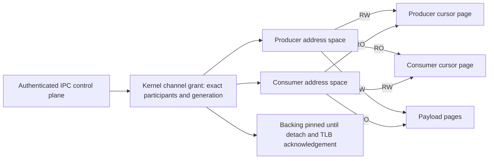
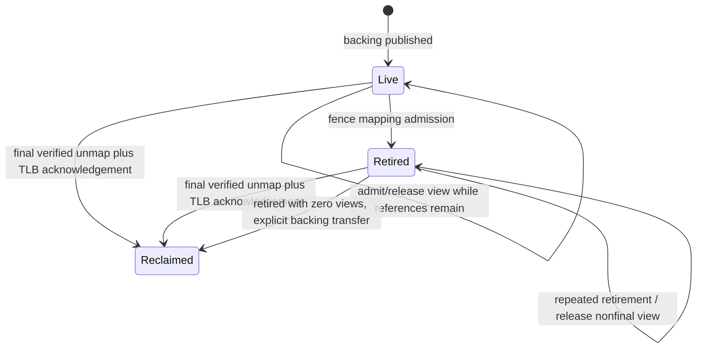

# FastLane F1: prerequisite audit and backing retirement

Audited source base: `baea0de1de88f0ce6de77b7cf2e2d93a1a3772c2` plus the
working-tree changes recorded with the evidence. Date: 2026-10-20.

**F1 is incomplete and blocked at F1B's isolation prerequisite.** This increment
implements SHM backing-retirement repairs and an opt-in VM prerequisite gate.
It does not expose a FastLane syscall, create channel capabilities, implement a
ring/Doorbell, or migrate a service. Kernel VM fixtures with separate page tables
are not the required two running ring-3 processes. No FastLane performance claim
follows from these changes.

The gate deliberately records the failed prerequisite: a process possessing a
legacy SHM token, without a recipient-specific grant, can map the whole object
writable. Its mappings are NX, but the producer/consumer write boundary is
absent. Per the requirement to stop at a failed security prerequisite, ring
traffic and later layers have not been enabled. This is a remaining
implementation boundary, not a claim that secure grants are impossible or that
a scheduler redesign is required.

There is also a fundamental control-plane prerequisite: ordinary capability
issuance is predictable. The opt-in probe uses the actual broker, mints an
undisclosed private endpoint token followed by an attacker's token, and tries
at most 62 low-bit XOR masks of the attacker's token. A guessed handle passes
the private endpoint's SEND check without delegation. It never reads the seed,
counter or private token value to construct guesses. This breaks the premise
that possession proves an authorized capability grant, even though sender
badges and receive-owner checks still prevent PID impersonation. FastLane
cannot safely inherit that control-plane assumption.

Correcting general capability issuance needs a separately validated issuance
and failure contract across the existing IPC/VFS/SHM mint paths, including
entropy readiness, collisions, exhaustion, publication and rollback. This
increment does not substitute another predictable token or silently change the
existing infallible mint APIs. The backing-lifetime repair is independent of
that blocker. No channel is exposed while either authority prerequisite fails.

## Status

| Subsystem | Status | Scope |
| --- | --- | --- |
| F1A current-source audit and threat model | Implemented and validated | Source findings below; native legacy-permission probe |
| Backing retirement and verified view release | Implemented and validated | Production helper, host model and 1/2/4/12 CPU VM gates; limited to retirement, not active revocation |
| F1B capability issuance, recipient-bound grants, channel identity and active revocation | Blocked | Predictable ordinary handles and missing per-peer permissions; no protected channel exposed |
| F1C no_std SPSC ring | Deferred | Memory-order requirements below are a specification only |
| F1D kernel Doorbell | Deferred | Proposed proof below; existing notify syscalls remain stubs |
| F1E control-plane integration | Deferred | Existing authenticated IPC retained |
| F1F native producer/consumer | Blocked | VM fixtures do not satisfy native channel acceptance |
| F1G channel races, peer death and quota validation | Deferred | Only backing-lifetime prerequisite cases exercised |
| F1H comparative measurements | Deferred | No benchmark samples |
| Audio pilot / production migration | Deferred | No production service changes |

## F1A: current mechanisms

Read together with the earlier [Phase 0 assessment](../fastlane-phase0-architecture-assessment.md),
[IPC audit](../ipc-performance-audit.md), [C1.2F report](../kernel/scheduler-phase-c12f-tick-tail.md),
[D1](../services/sunlightd-d1.md), [D2](../services/sunlightd-d2.md),
[D3](../services/sunlightd-d3.md), [D3.6R](../services/sunlightd-d36r-ownership.md),
[retirement audit](../services/sunlightd-d36r2-retirement.md),
[D3.7](../services/sunlightd-d37-resource-baseline.md) and
[D3.8-W](../services/sunlightd-d38w-idle-wakeups.md). Historical measurements in
those reports are not new F1 results.

| Mechanism | Verified current source | Consequence |
| --- | --- | --- |
| Creation | `memory/shared.rs::alloc_shared_region`: checked page rounding, fallible frame/vector allocation, sanitization, complete owner mapping before token publication | Reuse backing allocation/rollback; no arbitrary frame-mapping API needed |
| SHM handles | `capability/mod.rs::ShmEntry`: one bearer token, backing frames, owner PID and view count; no producer/consumer, rights, channel generation or lifecycle owner | Not a channel grant |
| Token generation | Ordinary handles use a counter XOR a boot seed and type tag; actual broker accepts a private SEND handle predicted from an adjacent token in at most 62 attempts. Authenticated-session grants separately consume fresh entropy | General ordinary capability issuance is a security prerequisite, not a safe basis for an F1 grant; recipient checks remain necessary after issuance is fixed |
| IPC authority | Broker `check`, `derive`, `token_owner`, endpoint owner checks; kernel overwrites message badges with sender PID | Preserve mediation and service policy; payload identities are not credentials |
| Delegation/revocation | Derive attenuates rights. Endpoint IDs are checked monotonic/nonreused. `revoke` removes one IPC token; endpoint destruction revokes endpoint tokens. No derivation revocation tree | Define which exact capability closes a channel; do not invent cascading revocation semantics |
| VM permissions | `address_space.rs::map_shared_region` sets `READ_WRITE`; `sys_shm_map` ignores reserved protection argument | Cannot enforce consumer RO payload/cursor or producer RO consumer cursor |
| NX/user copies | Protection conversion adds NX for non-executable mappings; `memory/user.rs` validates user/PRESENT/WRITABLE flags and performs physical-map copies under SCHEDULER | Existing checked copy path is suitable; do not bypass it |
| Mapping inventory | Address-space ledger records SharedMemory backing token; `mapped_shared` is a task-local `(token, VA, size)` vector. Borrowers share ledger/cursor/VM identity, not the vector | Reuse ledger, but do not claim a process-wide channel view inventory exists |
| Duplicate views | Legacy mapper permits duplicates; free removes newest local view | Preserve existing persistent-view behavior; a channel needs its own exact attachment rule |
| Mapping failures | Region/PTE preflight and rollback precede publication, cursor commit occurs after complete mapping | Reuse; native MM-2A allocation/collision gates remain relevant |
| Physical lifetime | SharedMemory accounting class charges backing once. Final view release transfers backing to PMM | Repairs below retain metadata across retirement and verify every detach |
| TLB | `memory/tlb.rs` generation-qualified active CPU tracking, epoch retry, serialized mailboxes, fixed-vector IPI plus NMI delivery, synchronous acknowledgement; timeout is fail-stop | Reuse existing invalidation; no second shootdown protocol. PCID is disabled |
| Exit/exec | Reaper checks task stack pins, CPU ownership/current tasks, borrowers and active VM mask, releases SHM before private page-table reclaim. Spawn rollback also uses SHM cleanup | Preserve the ordering; a channel still needs explicit participant-exit closure hooks |
| Owner loss | Ordinary reaper does not call `revoke_all_for` for SHM. Existing peer views survive owner release | Do not describe the test-only owner-retirement call as production peer-death channel handling |
| SHM revocation before this increment | `revoke_shared` deleted entry without touching live PTEs. `revoke_all_for` fenced resolve, but explicit free used that same resolver | Lost backing inventory / rejected release of retired views; repaired below |
| IPC notification | Native `ipc_notify_send` returns zero without validation/delivery; `ipc_notify_wait` ignores token and blocks without pending-state comparison | Not a functional Doorbell |
| Functional wake path | Kernel timer/input queued/deferred coalescing under SCHEDULER and IPC shard; checked receive/register shares locks with publication | Useful implementation precedent and possible B signaling control path; not C |
| Futex | Native and Linux private waits key on `(address_space_identity, address)` | Different process mappings of shared frames do not share a futex key |
| Scheduler | `wake_pid` checks blocked state, publishes Ready and `priority_wake_pending`, respects live CPU owner/ready queues; syscall epilogue flushes coalesced dispatch notifications after locks | Future Doorbell must use this path; no payload copying under scheduler lock |
| Service lifecycle | D3.6R binds manager/service incarnations and supervisor epoch. Diagnostic successors remain RecoveryBlocked. D3.8-W no-session SessionD wait and DialogD blocking receive remain | No recovery/adoption or service-policy changes |

The ordinary message register ABI carries four u64 data words and two token
words. It is not a bulk 4 KiB message transport. A future A benchmark must name
its validated bulk-buffer protocol, including mapping/copy costs, rather than
pretend 4 KiB fits in register IPC. `shm_map_sized` already reports verified
capacity; another size-query syscall is unnecessary.

## Minimal threat model and channel contract

The following is the required contract for a future F1B implementation, **not
an ABI or a claim about legacy SHM**. A grant must bind a nonzero slot identity
and checked/nonwrapping generation to exact producer/consumer kernel process
incarnations, address-space identities, backing identity, role/page rights,
revocation authority and original lifecycle ownership. Setup must follow
authorized IPC and capability delegation. Userspace-supplied PID, generation,
service name or ring header cannot prove any of these identities. Untrusted
peers may corrupt their own writable state; this must not corrupt the kernel or
expand access to another process.

The two roles must use distinct address-space identities. Two task IDs sharing
one page table cannot enforce this access matrix against each other. An initial
single-task attachment restriction, or complete address-space lifecycle ownership,
must be enforced by the kernel rather than assumed from the synthetic program.

| Threat | Required response | Current F1 status |
| --- | --- | --- |
| Unauthorized peer mapping | Check exact authenticated caller incarnation and role on every attach; reject legacy-map aliases for channel backing | Blocked: legacy token possession suffices |
| Unauthorized writable mapping | Enforce separate RO/RW NX PTEs and ledger rights for all aliases, including setup creator | Blocked |
| Stale channel handle | Lookup class, slot and generation before acting; no authority from shared descriptor | No channel handles exposed |
| Predicted capability | An unrelated process must not construct a private SEND grant from its own token | Blocked: reproduced against actual broker; no delegated authority required |
| PID/generation reuse | Compare task incarnation plus VM identity; a reused PID alone never matches | Existing VM generations available; no channel binding |
| Peer death | Atomically close channel and wake waiters; retain backing through detach/shootdown and all kernel references | Legacy mapping references protected; channel hook absent |
| Mapping revocation | Fence admission, enumerate exact live views, remove PTEs, wait for acknowledgements, then release backing | Retirement repaired; active channel revocation absent |
| In-flight operations | Serialize kernel operations with close, or pin backing until operations finish; no raw user-memory references across unmap | No channel operation exposed |
| Resource exhaustion | Reserve bounded channel/view/frame quotas before allocation; rollback partial setup; no reuse of exhausted generations | Existing checked sizes/ledger bounds; no channel quotas |
| Forged notification | Check role, capability class and exact generation under lifecycle lock | Doorbell absent; stubs must not be used |
| SHM use-after-free | Retain frame metadata and references until every verified unmap and TLB acknowledgement completes | Repair tested for legacy retirement; not a complete live channel proof |
| Malicious cursor/payload | Validate geometry, cursor distance and framing; do not trust shared counters for memory bounds or authority | Ring deferred |

Required page access matrix (all user views NX):

| Backing page | Producer | Consumer | Kernel lifetime authority |
| --- | --- | --- | --- |
| Producer cursor | RW | RO | Retained backing object |
| Consumer cursor | RO | RW | Retained backing object |
| Payload | RW | RO | Retained backing object |



This is a target design. The implemented legacy mapper gives both peers RW to
the entire object. `mprotect` is not a fix: its policy preflight accepts eligible
anonymous mappings, not general SHM rights attenuation. No user-facing channel
is advertised using this matrix until the kernel actually enforces it.

## Implemented lifetime increment

`memory/shared_lifetime.rs` is a no_std state machine compiled both in the kernel
and directly in host tests. `ShmEntry` uses it under CAP_BROKER; it is not a
second reference-counting registry. Counts refer to views, not distinct tasks.
Addition checks retirement/overflow before installation. Release rejects
underflow. Final release removes the broker entry exactly once.

`revoke_shared` now retires an entry. It keeps backing and counts while any view
exists, returns backing only for a zero-view object, and is `must_use` for that
return. The security self-test returns the actual transferred frames to PMM.
Owner-wide retirement uses the same state. Retirement fences **new mappings**;
it does not withdraw access through existing PTEs. It must not be used or
marketed as completed active revocation.

Explicit free resolves backing through a cleanup-only broker method after
finding the caller's existing view record. Retired tokens therefore release
correctly without reopening mapping admission. Before mutation it verifies size,
nonzero page count, every physical frame/PRESENT PTE, exact ledger record and a
nonzero reference count. A failed preflight leaves all remaining PTEs, records,
counts and backing intact. It then removes each expected PTE using the existing
synchronous shootdown, removes the exact ledger/view record, and only then
decrements backing references. Invariant failure after preflight is fail-stop;
it cannot fall through to PMM reuse.

Exit cleanup uses that same checked path, without draining records first or
allocating a temporary vector. Unexpected cleanup failure stops before private
VM reclamation. These changes preserve legacy newest-view release and
owner/peer sharing. No syscall number, userspace API or production service
protocol changes. Individual IPC capability revocation is unchanged.



## SPSC memory-order specification (Deferred)

No ring implementation is included past the failed isolation gate. A future
fixed-slot version should use immutable, validated geometry and one fixed
message size per channel, with explicit protocol version/size in setup. This
avoids variable-length framing in the first native experiment.

Use supported aligned `AtomicU64` cursors on x86_64, each on its own page for
permissions and separate cache line for coherence. With power-of-two capacity
`N < 2^63`, wrapping subtraction `producer.wrapping_sub(consumer)` is occupancy;
reject a distance greater than N. Power-of-two indexing keeps slot selection
consistent across integer wrap. Reject unsupported atomic targets at compile
time. Producer and consumer each keep their own trusted local cursor; never
let a peer's cursor select an unchecked address.

Producer observes reclaimed capacity with Acquire, returns WouldBlock on full,
writes exactly one complete initialized slot and publishes its cursor with
Release. Consumer Acquire-loads publication before copying a complete slot,
then Release-stores its cursor only after finishing access. Producer's Acquire
of that reclaim publication precedes slot reuse. Empty returns WouldBlock; no
indefinite spin, allocation or kernel/global-lock work belongs in enqueue/dequeue.

Do not manufacture shared `&mut` slices or trusted borrowed Rust references to
untrusted shared payload. A malicious writable peer can violate a cooperative
SPSC non-atomic payload access contract; the eventual unsafe API and/or atomic
payload representation needs explicit review for that case. Zero-copy views
must hold capacity until drop/commit. Variable-length framing, malformed-length
validation and a general allocator are deferred.

## Doorbell transitions and lost-wakeup argument (Deferred)

This is a specification for review, **not an implemented or tested Doorbell**.
Use a kernel-owned, generation-qualified sequence and one bounded waiter per
direction. Serialize lookup/authentication, sequence comparison, waiter
registration and close under the existing scheduler/lifecycle synchronization.
Notify increments the sequence with checked arithmetic, takes the registered
waiter, and publishes Ready through existing wake primitives. Repeated signals
without a waiter update sequence without redundant ready-queue work. On
exhaustion, close/wake and retire the generation; never wrap to an old observation.
Close/revoke/death fence admission and wake waiters before reclaiming their state.

Consumer protocol: query sequence, Acquire-check ring, drain bounded work if
present, otherwise `wait_if_unchanged(cap, observed)`, then recheck the ring on
every return. Producer Release-publishes data **before** notify. Start with one
notify per publication/batch; suppressing calls using independent Acquire/Release
"armed" flags needs a separate proven handshake.

Let W be the atomic compare/register point and N the notify sequence increment,
ordered by the same lock. If N precedes W after the observed query, W sees a
different sequence and cannot sleep. If W precedes N, N finds and wakes its
registered waiter. If N precedes the query, query synchronization plus the ring's
Acquire check observes published data. Close participates in this same ordering
and returns a terminal peer/lifecycle error. A spurious wake changes no ring
truth. This proof depends on the actual syscall restart/return path preserving
the comparison contract; a host-only state model is insufficient validation.

Publication, notification delivery and liveness are distinct events. Producer
death after Release publication but before notify leaves committed data without
a delivered notification; authenticated peer-death closure must wake the
consumer to recheck/drain according to protocol. A timeout/poll loop is not that
closure hook. A full producer returns WouldBlock; blocking capacity wait would
need a separately authenticated reverse doorbell and the same proof.

The current 5/6 syscalls do none of this. Private futexes do not provide the
shared object key. Existing synchronous IPC can support configuration B's
signaling, but must be measured as B and cannot establish C's completion.

## Validation and evidence

Reproduce the prerequisite audit (and deliberately retain blocked F1 status):

```sh
python3 tools/fastlane_f1_validate.py --native --cpus 1 2 4 12
```

Host-only reproduction omits `--native`. The runner records commands and
exit codes, compiler/QEMU versions, source hashes, working-tree patch, frozen
ELF/ISO hashes and serial logs under `target/fastlane-f1-evidence/`. Generated
artifacts are not committed. `validation-summary.json` always reports
`f1_complete: false`; passing a prerequisite harness does not mean F1 passed.
The source hashes include new untracked implementation files, which `git diff`
alone would omit.

The supplemental lifecycle checks use the existing runners:

```sh
python3 tools/test_scheduler_smp.py --cpus 1 2 4 12 \
  --evidence-dir target/fastlane-f1-evidence/scheduler-lifecycle
cargo test --locked --offline -p sunlightd --lib --target x86_64-unknown-linux-gnu
bash tools/test_sunlightd_d36r.sh --cpus 1 2 4
```

The last command runs the existing after-ready D1/D2/D3/RecoveryBlocked scenario;
its raw results are additionally copied from `target/d36r-evidence/after-ready/`
under this increment's evidence directory. It is not a new manager recovery path.

The host model checks idempotent retirement, rejected admission, all remaining
view counts, final ownership transfer, overflow/underflow and bounded exhaustive
operation orderings. It does not model hardware TLBs, scheduler registration or
weak-memory ring execution. The opt-in native gate tests 32 two-address-space
backing lifecycles with recreated VM generations, duplicate maps, both retirement
entry points, stale-token mapping rejection, owner cleanup with peer preservation,
double free/cleanup and exact PMM return to baseline after page-table teardown.
The separate token-prediction probe and the legacy RW probe intentionally
reproduce current blockers. Future hardening must update these audit assertions
and the security assessment; they are not requirements to preserve those flaws.

Controlled fault injection removes the second PTE before free and verifies that
failed preflight leaves the first PTE, local records, reference count and frame
count unchanged; it restores the second PTE before normal cleanup. Remote tests
pre-touch one shared mapping on every online CPU, retire/release it, require
exact shootdown acknowledgements, reuse old backing as a guard and remap a
different frame at the same VA. All CPUs must read the replacement, then leave
the test VM before its tables are reclaimed. This reuses the MM-2B test mailbox
transport, not an invented revocation protocol. Remote CPUs execute real
concurrent invalidation handlers; this is **not** concurrent ring/close stress.

| Validation | Result |
| --- | --- |
| Direct no_std lifetime state tests | PASS, 4 tests |
| Kernel host memory library | PASS, 39 tests, including the same 4 lifetime tests |
| IPC host library | PASS, 61 tests |
| Audiod host library | PASS, 25 tests |
| SunlightD host library | PASS, 29 tests |
| Production scheduler state/accounting/policy host runner | PASS; raw focused log retained |
| Native scheduler lifecycle | PASS on 1/2/4/12 CPUs; separate isolated ring-3 scheduler fixtures |
| D1/D2/D3 and D3.6R after-ready RecoveryBlocked | PASS on 1/2/4 CPUs; existing native lifecycle runner, no authority adoption |
| Default kernel target check | PASS |
| Opt-in kernel target check and build | PASS |
| Targeted Rust formatting / diff whitespace checks | PASS |
| Media host library | 36 passed, 1 failed: missing generated repository WAV fixture; unrelated to modified packages |

The failing media test is
`decoder::tests::mp3_converted_repository_wav_is_valid_but_exceeds_loader_limit`.
It attempts to read
`docs/songs/onaldin_music-catch-the-sunlight-333176.wav`, which is absent. Both
the initial combined-suite failure and the isolated media failure are retained.
The runner accepts only this specific one-failure/missing-file combination as
an unrelated limitation; it never reports that suite as passing. No test in a
modified package is skipped. Dependency warnings predate this increment.

| CPUs (QEMU TCG) | VM retirement cycles | Remote release acknowledgements | Unexplained frame drift | Existing SEC/SHM/IPC + resident SunlightD markers |
| --- | --- | --- | --- | --- |
| 1 | 32 | 0 | 0 frames | PASS |
| 2 | 32 | 1 | 0 frames | PASS |
| 4 | 32 | 3 | 0 frames | PASS |
| 12 | 32 | 11 | 0 frames | PASS |

The SMP rows verify real invalidation handlers on remote CPUs, not ring-3
channel races. The audit-feature image remains opt-in; ordinary kernel code
was separately target-checked. No workspace-wide bare-metal check was used:
the repository includes host/native-std applications and renderer dependencies;
the modified kernel and the relevant per-package host suites were checked with
their appropriate targets.

## Comparative performance

| Configuration | 64 B / 256 B / 1 KiB / 4 KiB; 1/2/4 CPUs | Reason |
| --- | --- | --- |
| A: existing IPC | Not measured | Matching synthetic benchmark deferred at security boundary |
| B: persistent SHM + IPC signal | Unavailable | No F1 protected synthetic setup; legacy persistence alone is insufficient |
| C: SPSC + Doorbell | Unavailable | Grants, native ring and Doorbell not implemented |

There are zero throughput or latency samples. Messages/s, payload bytes/s,
one-way and RTT p50/p95/p99/max, context switches/message, crossings/message,
notify calls, wakeups/s, CPU busy time, setup cost and mapping overhead are
unavailable. JSON stores unavailable measurements as null. Functional PMM
baseline checks are resource-lifetime evidence, not setup/per-message cost or
throughput measurements. The timer's historical "1000 calls OK" marker is a
functional boot marker, not a benchmark. QEMU TCG test duration is not guest
transport latency or power evidence.

## Remaining work and F2 prerequisites

1. Fix and validate ordinary capability issuance before treating existing SEND
   delegation as an authorization boundary. Add adversarial native isolation
   tests and preserve all current endpoint lifecycle/publication contracts.
   Then complete F1B with recipient/role-bound channel capabilities, immutable backing
   provenance, per-page RO/RW NX permissions, no legacy writable aliases,
   exact live view inventory, bounded reservations and rollback. Validate
   actual ring-3 write faults, wrong-recipient denial and forged/stale handles
   before enabling data traffic.
2. Define channel close and single-capability/endpoint revocation effects;
   serialize participant death/exec and all in-flight references. Retirement
   alone cannot promise access withdrawal or bounded reclamation if a live
   malicious peer refuses release. Bind new slots to fresh nonwrapping
   generations, not reused PIDs/names. Keep RecoveryBlocked ownership intact.
3. Implement/test the specified fixed-message ring, then the conditional
   Doorbell and real two-process lifecycle. Cover all notify/wait/close/death
   orders, counter exhaustion, admission quotas and full/empty behavior.
4. Run bounded concurrent SMP stress at 1/2/4 and optionally 12 CPUs, including
   busy remote consumers, affinity, fairness and the C1.2F timer regression.
   This increment does not change ready queues, priorities, quantum policy,
   timer dispatch or the scheduler lock.
5. Collect A/B/C with identical geometry, payloads, sample counts and placement;
   separate cold setup, steady throughput and tail latency. Retain raw samples
   and uncertainty, and test lifecycle frame drift independently.
6. Before an F2 audio pilot, pass all F1 criteria, define Audiod session/format
   authorization and drain/retire ownership, measure persistent-SHM benefit
   separately, and revalidate playback/recording under mixed load. No audio,
   networking, graphical, supervisor adoption or recovery migration is included
   here.
