# FastLane F1.1: restricted-memory authority audit

Date: 2026-10-20. Audited baseline: `4c70511d0` (the committed F1 retirement
repair). **F1.1 is partial: authority audit complete; restricted grants remain unimplemented.**
This table records the F1 baseline before the [F1.1P issuance repair](fastlane-f11p-capability-authority.md). The opt-in SHM fixture has since become a negative prediction regression; it does not implement restricted grants.
There is no new userspace ABI, restricted backing, ring, Doorbell, service
migration, or performance claim. The specifications below are requirements for
the next implementation, not properties of legacy SHM.

The previous [F1 report](fastlane-f1.md) and
`target/fastlane-f1-evidence/validation-summary.json` report successful backing
retirement tests, but explicitly report F1 incomplete. Their successful
unmapping/reclamation results do not establish permission isolation. This audit
also reviewed the [Phase 0 assessment](../fastlane-phase0-architecture-assessment.md),
[IPC audit](../ipc-performance-audit.md),
[scheduler lifetime audit](../kernel/scheduler-hardening.md), and
[service retirement limits](../services/sunlightd-d36r2-retirement.md).

## Security boundary and stopping point

Ordinary `generate_token` uses `(counter XOR boot_seed) & ((1 << 62) - 1)` plus
a type tag. For adjacent counters, their XOR is a low-bit mask of ones. An
attacker knowing its own adjacent token can enumerate at most 62 candidates
without knowing the seed, counter, or private token. Existing F1 tests reproduce
private endpoint SEND admission. The F1.1P regression additionally attempts the actual SHM mapping helper with guessed private tokens, rejects all guesses, and separately verifies deliberately delegated legacy maps. It does not run a successful SHM exploit and does not establish restricted PTE isolation. Historical successful endpoint prediction is a failed baseline security prerequisite, not a passing isolation test.

The exact unsupported operation is establishing a private memory grant by
reusing ordinary bearer capability issuance and its IPC control plane. Legacy
SHM tokens have neither recipient-incarnation binding nor rights attenuation.
Changing only SHM PTE flags would leave both forged authority and writable
aliases. Changing only token mixing would leave recipient isolation and active
revocation absent. A restricted implementation can instead use kernel-bound
recipient authority, but must prove every issuance/delegation/peer-discovery
path avoids reliance on forgeable bearer possession. F1.1P repairs ordinary issuance separately. Recipient-bound grants have not been implemented here; unpredictability alone is not a substitute for recipient binding.

The initial F1.1 stop followed the task's execution-order rule: "If a significant prerequisite
is missing, stop at the exact unsupported operation and document it." Repairing
general issuance requires an explicit fallible contract across endpoint create,
mint, derive, VFS and SHM publication: entropy readiness, bounded collision
handling, exhaustion, reservation and rollback. `generate_secure_token` exists
for other grant types but cannot safely replace infallible mint APIs without
those changes. No temporary restricted interface is exposed. F1.1P now supplies the fallible issuance prerequisite; see its separate current results before resuming F1.1B–F.

## F1.1A audit table

All paths below describe the audited F1 baseline. Ordinary issuance, publication failures, secure-grant collision handling and token logging were subsequently repaired in F1.1P; remaining SHM isolation findings still apply. Kernel-internal unsafe mapping
helpers are trusted mechanisms, not independent userspace authorization APIs.

| Path and source function | Authority and authenticated identity | Effective rights / bypass | Lifetime and revocation |
| --- | --- | --- | --- |
| [Syscall allocation](../../kernel/src/arch/x86_64/syscall.rs), `sys_shm_alloc` (92) | Scheduler's current `Process`; no caller-supplied PID | Size from user; flags do not create a restriction | SCHEDULER → PMM → CAP_BROKER held through commit |
| [Backing creation](../../kernel/src/memory/shared.rs), `alloc_shared_region`, `alloc_shared_page` | Kernel caller supplies current process | Owner maps entire object RW/NX before publication; zero/single-page compatibility retained | Checked rounding, 4 GiB window/object limit, fallible reserves, zeroed SharedMemory frames, rollback; publish after full mapping |
| [Handle mint](../../kernel/src/capability/mod.rs), `mint_shared_region`, `mint_shared_page`, `generate_token` | Trusted kernel mint; records owner **PID only** | Predictable bearer token; SHM shares VFS tag but has a separate lookup table; no grant rights, backing generation or recipient | `ShmEntry` contains frames, size, PID, `SharedLifetime`; unchecked token counter wrap/truncated payload is not a nonreuse proof |
| Same broker, `create_endpoint`, `mint`, `check`, `token_owner` | SEND validates bearer possession, receive/destroy additionally validates current owner PID at syscall | Predictable ordinary IPC tokens; resolving owner does not prove authorized delegation to presenter | Checked nonreused endpoint ID; token revocation removes one token, endpoint removal removes endpoint tokens |
| Same broker, `derive`; [IPC](../../kernel/src/ipc/mod.rs), `enqueue_call` | IPC requested rights must be subset; sender badge overwritten with actual caller PID | Passing `msg.caps` copies token values, not per-recipient memory rights. `derive` applies to IPC only; RO SHM delegation does not exist | No derivation revocation tree. Badge authentication survives token prediction, private bearer authority does not |
| Same broker, `resolve_shared_region`, `resolve_shared_page`, `validate_shared_page`, `preflight_shared_mapping` | Token table equality + not retired, **no presenter identity** | Whole backing; no requested/granted rights comparison | Retired resolves denied; cleanup-only resolver deliberately retains backing |
| [Map syscall](../../kernel/src/arch/x86_64/syscall.rs), `sys_shm_map` (93); [helper](../../kernel/src/memory/shared.rs), `map_shared_page` | Current process selects destination VM; token alone selects source | Reserved `rsi` protection ignored; duplicate aliases allowed, each RW/NX | Same locks as allocation; preflight view overflow and reserve before PTEs, increment view count after complete map |
| [PTE installation](../../kernel/src/process/address_space.rs), `map_shared_region`, `map_shared_page`, `protection_to_pte_flags` | Unsafe trusted frame list, no separate policy authority | Fixed READ_WRITE → PRESENT, USER_ACCESSIBLE, WRITABLE, NO_EXECUTE; read-only conversion exists but SHM does not select it; no GLOBAL flag | Collision/ledger preflight, transactional PTE installation/rollback, shared bump committed last |
| [Ledger](../../kernel/src/process/region.rs), `MappingRegion`, `RegionBacking::SharedMemory`; `Process::mapped_shared` | VM identity protects ledger lookup; task vector records `(token, VA, size)` | Ledger records rights but is not grant authority. Borrowers share ledger and PTEs, not task view vectors | 256 records/VM, 16 pending insertions; exact shared records do not merge. No complete recipient-grant inventory |
| [Anonymous mapping](../../kernel/src/process/mmap.rs), `map_anonymous_kind`; ledger `preflight_replace`, `preflight_unmap`, `preflight_protect` | Current VM, full-range policy preflight | Only private anonymous mmap supported; SHM lacks MAY_REPLACE/MAY_UNMAP/MAY_CHANGE_PROTECTION. MAP_FIXED, munmap and mprotect cannot upgrade a SHM record | These operations cannot replace SHM cleanup or grant revocation |
| [Fault handling](../../kernel/src/arch/x86_64/interrupts.rs), `handle_cow_page_fault`, `page_fault_handler`; [user copies](../../kernel/src/memory/user.rs) | Current process/VM, checked PTE access | CoW requires writable **Anonymous** ledger policy, excludes SHM. User-copy write checks require writable user PTE. User protection faults terminate process | Ring-3 fixture must verify termination/reap, not just flags or supervisor access |
| [Clone](../../kernel/src/arch/x86_64/syscall.rs), `thread_spawn`, `sys_linux_clone`; [fork](../../kernel/src/process/fork.rs) | Current process creates borrower with same VM; independent fork disabled | All borrowers inherently access every user mapping in that VM; different task PIDs are not an isolation boundary | Ledger/cursor/VM generation shared, task mapping vectors separate. Future per-task grant design must reject shared VMs or define VM-wide ownership including future clones |
| [Identity](../../kernel/src/sched/mod.rs), `add_process_after_reaping`; [foreground](../../kernel/src/process/foreground.rs), `allocate_incarnation`; [VM](../../kernel/src/process/mm2b_state.rs), `allocate_identity` | Kernel allocates nonwrapping nonzero process incarnation and VM generation; must reject zero/exiting processes | Existing SHM does not bind either; PID/name/header cannot substitute | Reaped task slots and physical PML4 frames can be reused; exact incarnation and VM generation required, including exec |
| [Explicit release](../../kernel/src/memory/shared.rs), `free_shared_page` (syscall 94) | Existing caller task's newest matching view record authorizes release | No arbitrary peer-view release syscall | Whole-view frame/PRESENT/size/ledger/count preflight, exact unmap + synchronous shootdown, then record removal and reference decrement; invariant breach fail-stop |
| Broker `revoke_shared`, `revoke_all_for`; `SharedLifetime::retire` | Trusted kernel API; owner-wide selector is PID | **Retirement only**; existing RW PTEs remain. No recipient grant revocation API | Fences new mapping under broker lock, retains backing inventory; duplicate retirement idempotent. Zero-view `revoke_shared` transfers frames to caller |
| [TLB](../../kernel/src/memory/tlb.rs), `activate`, `invalidate`, `handle_shootdown_ipi`, `activate_kernel_root`; `ShootdownMailbox` | Exact physical root + VM generation, active online CPU mask | Local invalidation alone insufficient; fixed IPI + NMI consume one claimed request, release/acquire ack | Epoch closes activation/snapshot race; no PCID, user SHM non-global. Wait for all required acks; timeout fail-stop. See limits below |
| [Exit](../../kernel/src/sched/mod.rs), `reap_process` cleanup path; [spawn/exec](../../kernel/src/process/spawn.rs) | Scheduler serializes exit; waits for stack/CPU/queue/borrower/active-VM safety | Ordinary reaper revokes endpoints, releases task SHM views; does **not** retire every SHM object owned by exited PID | Cleanup precedes private page-table reclaim. Peer views survive owner loss. Exec releases old views before old root reclaim; future grants must invalidate old VM binding |
| `cleanup_shared_pages`, broker `decrement_map_count`; [reclaim](../../kernel/src/process/address_space.rs), `reclaim_user_space`; [PMM](../../kernel/src/memory/pmm.rs) | Verified release under kernel locks; reaper owns final VM reclaim | Shared backing excluded from ordinary private-frame reclaim | Last verified view returns backing exactly once, even if never retired. Outstanding grant/kernel references do not yet exist and are not counted |
| Other trusted frame mapping sites: ELF/stack, boot init/VFS page, telemetry, framebuffer, USB/device mappings | Kernel selects frames; no generic user physical-frame selector found in these map call sites | Boot shared page is outside broker SHM. Telemetry maps fixed RO frames; devices use kernel-selected DMA/MMIO; none consumes an SHM handle | This is source tracing, not proof against malicious DMA or all device-driver bugs; do not route restricted backing into these APIs |

Ownership, bearer possession, authority to map, and rights of a live PTE are
different facts. In legacy SHM, possession authorizes RW mapping regardless of
owner PID. Closing an owner view does not revoke a peer. Retiring admission does
not remove PTE authority. A zero mapping count is safe for reclamation only
after verified unmapping and acknowledgements, and would be insufficient once
unmapped grant references exist.

## Threat model

Untrusted native peers can issue arbitrary syscalls concurrently, copy/guess
token words, request flags, create aliases/threads, exit or exec during setup,
and retain mappings after owner close. The kernel, page tables, PMM and checked
IPC badge assignment are trusted. Shared headers and peer cooperation are not.

| Threat | Required enforcement | Current result |
| --- | --- | --- |
| Unauthorized writes / execute | RO/RW subset check and real user PTE permissions, every page NX | Legacy SHM always RW/NX; RO missing |
| Forged capability | Fail-closed authenticated issuance and exact recipient incarnation on use | Ordinary tokens predictable; prerequisite fails |
| Writable alias | Immutable restricted backing provenance; reject every legacy resolver; check each grant to same VM | No restricted provenance exists |
| Stale mapping / concurrent revoke | Close admission, pin in-flight operations, enumerate/remove all views, await TLB acks | Retirement retains existing access |
| Process/PID/VM reuse | Nonzero live process incarnation + exact VM identity, generation checked under lifecycle serialization | Available identity primitives unused by SHM |
| Resource starvation / premature reuse | Bounded reservations, no slot overwrite, grant and view references through verified release | Legacy heap metadata is fallible but not a bounded grant store |

## Proposed per-peer authority specification (not implemented)

Extend the existing backing record with immutable Legacy/Restricted provenance
and a checked nonwrapping object identity/generation. Preserve legacy APIs for
Legacy objects. Both legacy admission resolvers must reject Restricted objects
even if presented an internal object token; cleanup must still resolve existing
views. Do not publish a legacy token for restricted backing or automatically
install an unrestricted owner alias.

Use one bounded grant store within the broker, because the present object-wide
view counter cannot express independent recipient revocation. Each grant binds:
object identity/generation; grant identity/generation; recipient kernel process
incarnation and exact address-space identity; RO or RW rights; delegable rights
if delegation is supported; issuer/revoker incarnation; and original owning
lifecycle identity. Resolve peers from authenticated kernel state under
SCHEDULER, reject dead/zero-generation targets and same-VM peers. A PID argument
can locate a candidate but cannot itself authorize the operation. Holding one
recipient grant does not grant issuer/revoker authority.

Requested rights must be a subset of immutable granted rights. Reject unknown
bits and execute requests explicitly; never silently upgrade or merely mask
execute off. RO → RW delegation fails. Initial implementation may reject all
recipient delegation; issuer-only attenuation is sufficient. A VM with only RO
grants must have no writable alias to that object. Separately authorized RW
processes are legitimate writers. Multiple grants to one VM need a defined
effective-authority policy and complete revocation inventory; initially permit
one live grant per object/recipient VM to avoid ambiguous alias withdrawal.

Require exclusive single-task VMs initially: reject borrowing a restricted VM
and granting into a VM that already has borrowers, under the same scheduler
serialization. Grant-only PID checks cannot prevent later clone inheritance.
Exec and task exit must invalidate grant authority before incarnation/VM reuse.
An owner handle/grant must pin unmapped backing if it remains valid after final
view release; legacy final-view reclamation cannot be reused unchanged.

No ABI change is made in this increment. A later implementation needs distinct
restricted create/issue/map/revoke/close operations with explicit errors and
verified-size returns; generic SHM flags must retain compatibility and must not
become a privilege escalation route.

## Mapping rights matrix

Use separate backing objects/grants per protection class, or a fixed validated
per-page policy. Three objects provide the smallest initial whole-object grant
model. All mappings have PRESENT + USER_ACCESSIBLE + NO_EXECUTE; RW additionally
sets WRITABLE. RO clears WRITABLE. Revoked mappings have no user leaf PTE.

| Page/object | Producer | Consumer | Unrelated process | Legacy map |
| --- | --- | --- | --- | --- |
| Producer cursor | RW | RO | Denied | Denied |
| Consumer cursor | RO | RW | Denied | Denied |
| Payload | RW | RO | Denied | Denied |

This layout is a proposal only. No cursor or ring traffic is implemented.

## Revocation and lifetime contract (not implemented)

```mermaid
stateDiagram-v2
    [*] --> Active: authenticated issuance / backing reference
    Active --> Active: serialize authorized map commit / view reference
    Active --> Revoking: authorized revoke fences map and delegation
    Revoking --> Unmapping: enumerate every grant view; hold lifetime pins
    Unmapping --> TLBAwaiting: remove exact PTEs, publish invalidations
    TLBAwaiting --> Revoked: all required acknowledgements, release views
    Revoked --> Closed: drop final grant reference exactly once
    Closed --> Reclaimable: no owner, grant, in-flight, view or retirement pins
```

Revoking one grant removes only that grant's views. Other recipients and owner
references keep backing alive. Backing destruction first retires all admission,
then withdraws grants, and waits for the same lifetime contract. A failed
preflight retains metadata and backing; an unacknowledged unmap cannot complete
revocation or free frames.

| Serialized order | Required result | Present mechanism |
| --- | --- | --- |
| Map commits before revoke | View visible in complete grant inventory, then removed and acked before revoke returns | Existing broker lock orders legacy map vs retirement, but retirement never removes view |
| Revoke fences before map | Map fails before PTE or frame allocation; old generation remains invalid | Existing retirement admission fence provides only this half |
| Owner close vs map | Existing grant/operation references pin object; closing last owner cannot destroy valid peer authority | Legacy pins only mapped views |
| Exit/exec vs issue | Scheduler validates exact live incarnations and reserves refs before publication, or rejects | No grant issuance path |
| Exit vs revoke / duplicate revoke / close vs unmap | Exactly one view release; all callers see stable revoking/revoked generation; cleanup resumes safely | Legacy whole-view cleanup only |
| Object/grant slot reuse | Increment generation without wrap, stale identifier rejected even for same PID/VA/physical frame | No object/grant generation registry |

Do not hold a global VM/scheduler/broker lock through extended acknowledgement
waits in the future revocation operation. This requires a pinned revoking work
record and exclusion between PTE installation and withdrawal while locks are
released. Existing synchronous legacy free waits while SCHEDULER, PMM and
CAP_BROKER remain held; copying it into a many-recipient revoker would not meet
the latency requirement. No lock-drop or scheduler redesign is attempted here.

## SMP TLB review and validation limits

`tlb::activate` loads CR3, publishes exact VM identity, and retries if the
mutation epoch changed. `invalidate` publishes the PTE mutation before epoch
update and active-mask snapshot. A migrating entrant either becomes a target or
reloads CR3 after observing the epoch. Noncurrent roots cannot retain tagged
user translations because PCID is unused and SHM leaves are non-global.
Idle switches to the permanent kernel root before leaving the active set.
Mailboxes release-publish fields/sequence, reject overwrite of unacknowledged
requests, permit one fixed/NMI claimant, and release-ack after flush (or after
observing the CPU left that exact identity). Initiator acquire-waits for every
target; failure stops before reference release. Capacity is 64 tracked CPUs.

These are audited assumptions and the F1 kernel-fixture test scope, not a proof
of new per-grant revocation. Epoch wrap is unchecked (sequence and VM generation
allocation are checked); an exhaustion policy remains required for a complete
unbounded-runtime proof. Delayed-ack injection, continuously running ring-3
remote readers/writers, concurrent grants in distinct VMs, migration during
grant withdrawal, post-revoke native faults and revocation latency distributions
remain untested. F1 remote tests read cached translations on APs, release/unmap,
verify expected acknowledgement count and remap to distinct backing; that is
useful narrower evidence only.

## Bounds and accounting

| Resource | Existing bound / charge | Required grant extension |
| --- | --- | --- |
| Data backing | PMM capacity, zeroed SharedMemory frames, up to 4 GiB object/window | Explicit global/per-owner object and page quotas; reserve before allocation |
| Mapping ledger | 256 records/VM, 16 pending; reject capacity before PTE install | Reserve matching grant-view record and task inventory atomically |
| Broker/task metadata | Heap Vec with fallible reserve on SHM paths; capacity retained after removal | Fixed maximum active grants/views/retired operations; no active slot reuse |
| Recipient/in-flight references | Legacy counts views only, checked overflow/underflow | Separate grant/owner/operation pins, checked release and generation exhaustion |
| Revocation / retired backing | Legacy retired backing remains charged as SharedMemory; no independent retired-byte gauge | Bounded work records and explicit pending/blocked retirement counters |
| Shootdowns | 64 fixed mailboxes, serializer, bounded-spin fail-stop wait | Reuse protocol, expose bounded completion/wait diagnostics without extra mailbox registry |
| Page-table frames | Separate PageTable physical class, release on VM reclaim | Report separately from data and heap metadata |

Aggregate zero free-frame drift in the F1 cycles does not measure heap-vector
capacity release or prove restricted-grant cleanup. The new negative regression
records data and page-table class deltas separately, live view/object counts and
aggregate frame counts. Metadata is reported as counts and retained capacities
are not claimed freed. Retirement is tested while references remain; a separate retired-byte gauge is not implemented. Restricted-grant counts/latencies are
unavailable, not zero successful operations.

## Evidence and acceptance

Raw new evidence belongs in `target/fastlane-f11-evidence/`; the machine-readable
result is `validation-summary.json`. The validation tool records commands,
source/image hashes, raw failures, explicit scope, and unavailable tests.
Historical F1 evidence is not overwritten. Results are recorded below after
execution.

| Deliverable | Status |
| --- | --- |
| F1.1A authority/path/threat audit and proposed rights/lifetime specification | Audited only; counterexamples separately exercised |
| F1.1B authenticated restricted grants and delegation | Not implemented; issuance foundation addressed separately by F1.1P |
| F1.1C restricted PTE permissions / native user fault fixture | Blocked; no restricted mapping API |
| F1.1D active per-grant revocation | Blocked; legacy retirement is not active revocation |
| F1.1E restricted SMP stress / delayed-ack and migration races | Blocked; only existing VM/TLB prerequisite can run |
| F1.1F restricted quotas, grant teardown, separate metadata reclamation | Blocked; existing lifetime regression only |
| Ring / Doorbell / production services / transport benchmarks | Deferred, outside scope |

All twelve F1.1 completion criteria remain unmet or insufficiently demonstrated
for restricted grants. Existing legacy behavior and prerequisite regressions can
pass without making any of these restricted-memory acceptance criteria pass.
Native kernel fixtures are not native userspace protection-fault tests.

Before F1.2: validate unforgeable or independently recipient-bound authority end
to end, then implement F1.1B–F, including legacy provenance fencing and clone
exclusion, active withdrawal without long global-lock waits, nonwrapping object
and grant generations, bounded reference/work records, isolated ring-3 RO-write
and post-revoke faults, 1/2/4 CPU tests plus 12 CPU stress, both map/revoke orders,
all close/exit races, and category-separated cleanup. Preserve D1/D2/D3 and
RecoveryBlocked. F1.2 ring/notification work remains blocked until those pass.
