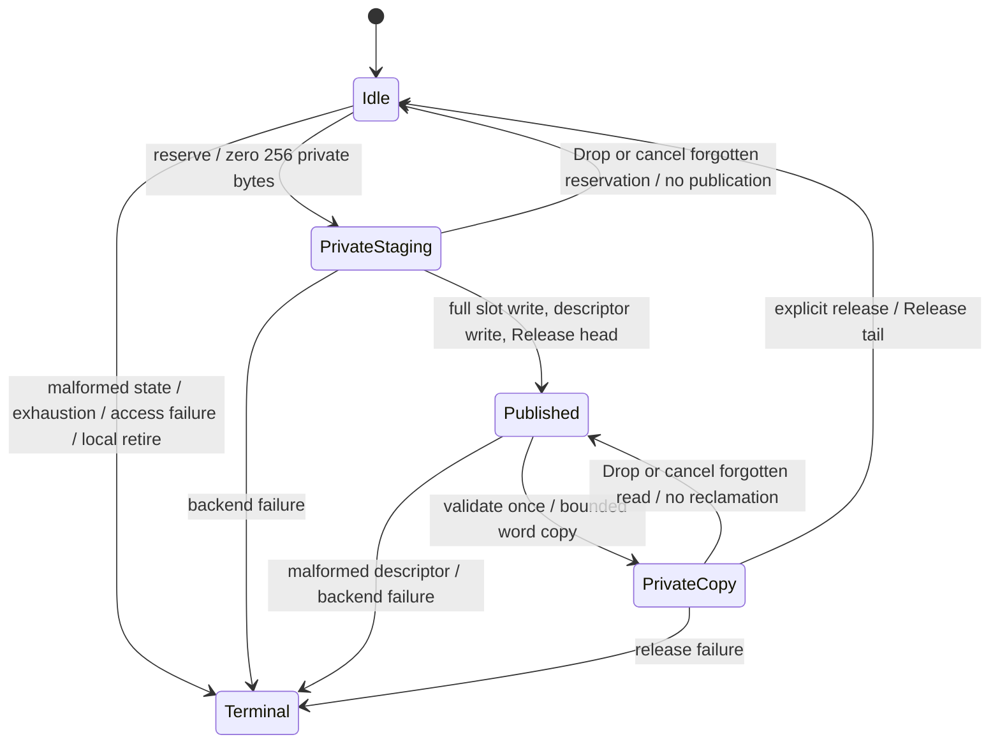

# FastLane M3.0: hostile-memory-safe SPSC representation

2026-11-01, Asia/Tehran. Representation and bounded access only. Production
FastLane remains disabled. There is no native ring attachment, native payload
transfer, userspace Doorbell, resizing, reconnect or production enablement.
No commit or push is authorized.

**M3.0 PARTIAL.** Host representation validation passes. Original native global
census failures remain unexplained; subsequent passing replays do not discharge
them. Native regression receipts and the exact blocker are recorded below.

## Selected contract

`sunlight_fastlane_ring::hostile` is a separate representation from the existing
cooperative `Ring` and `leases.rs`. Small messages use private initialized staging
followed by bounded shared-word writes, and bounded shared-word reads followed
by private payload access. No shared payload slice or shared mutable Rust
reference exists. The module forbids unsafe code, allocates no heap memory,
introduces no locks and never spins or retries on peer bytes.

A cooperative peer delivers FIFO messages and follows publication/reclamation
ordering. A hostile peer can change any byte on its writable pages, fabricate
messages and acknowledgements, cause rejection, discard messages or prevent
progress. An accepted private copy is initialized, in bounds and stable after
return. Its bytes can mix multiple hostile writes made during copying. It is
**not a coherent snapshot, authenticated content or immutable publication**.
Application parsing must validate that private copy, and must never validate a
shared view and then reread it for use. Corruption that still satisfies the
format is indistinguishable from a malicious but well-formed message.

M2's producer retains write permission to published payloads. No sequence
counter, checksum, Acquire load or read-only consumer mapping removes that
writable alias. Strict zero-copy delivery with hostile-producer immutability at
sub-page granularity is unavailable with the current VM model.

## Phase A: threats and enforcement

| Peer behavior | Representation outcome | Enforcing boundary and remaining limit |
|---|---|---|
| Cooperative producer and consumer | FIFO, bounded full/empty behavior, explicit commit/release, zeroed partial messages | Private local cursors; Release publication/reclamation and Acquire observation; fixed representation |
| Producer mutates after commit or during receive | Copy may contain replacement or mixed bytes; returned private copy remains stable | Single-word host atomics and private initialized storage ensure host language safety; bounded copying and validation ensure access safety. Hardware does not freeze the producer |
| Consumer corrupts its writable metadata | Impossible, regressing or ahead-of-publication acknowledgements close the producer locally; plausible false acknowledgements may cause early reuse | Producer compares against its private cursor and highest observed acknowledgement. Page permissions keep consumer writes out of payload/producer state. A false plausible acknowledgement cannot be detected universally |
| Peer publishes malformed lengths or offsets | First observed invalid identity/range/cursor yields a specific terminal error; no peer address is followed | Checked arithmetic and validation of locally copied words; addresses derive exclusively from private geometry |
| Peer abandons a reservation or read lease | Write Drop publishes nothing; read Drop leaves message queued; forgotten lease returns Busy until explicit local cancellation | Trusted local pending identity and serial; cancellation never advances either shared cursor. Capacity remains bounded |
| Peer exits during an outstanding operation | Private staging/copies grant no backing ownership; no automatic progress promise | M1 exact incarnation/VM/session retirement fences admission. M2 withdraws both views and completes TLB invalidation before backing reuse. No native ring operation is implemented here; future machine access can fault during withdrawal |
| Peer repeatedly exhausts capacity | Full is returned after one bounded acknowledgement load; no forced reclaim of an active peer | Fixed 16-slot storage; M1 membership/expiry and M2 frame quotas/retirement bound resources. Availability and scheduling fairness are not promised |

Hardware enforces the existing asymmetric page permissions and NX. Kernel-owned
authority enforces recipient identity, generation, attachment, mapping provenance,
VM borrower exclusion, terminal admission and physical lifetime. Shared words
confer none of those rights. Memory ordering supplies cooperative visibility;
it does not constrain hostile writers. The representation supplies fixed geometry,
private ownership state and no shared Rust borrowing. Runtime validation checks
observations once before use. Lifecycle retirement, rather than a ring byte,
owns eventual physical reclamation.

Malformed-state detection is deterministic for the actual words observed.
Concurrent hostile changes need not yield the same observation on every run.
There is no retry-until-stable loop, recovery by accepting repaired metadata,
shared closed flag, producer-controlled lock or kernel parsing of these pages.

## Phase B: layout and ownership

The existing lease implementation uses `UnsafeCell<Slot
>`, ordinary length
loads/stores and references to actual slot bytes. Its unique role handles and
Acquire/Release ordering are sound only when all participants follow its
cooperative ownership contract. Its wrapping cursors and four-region layout are
also different from M2. Neither that type nor its header is mapped by M3.
The old implementation remains available for its existing cooperative callers.

The M3 format fixes 16 slots of 256 bytes, for one 4096-byte payload page.
Geometry and channel generation come from trusted local configuration, never
a shared header. The generation must be the M1 object's nonzero generation in
a future native adapter; it is a correlation identity, not bearer authority.
Each region is independent and can have a different VA in each process.

| M2 region | Byte layout | Writer / reader |
|---|---|---|
| 0, producer | offset 0: u64 publication count; offset `8 + slot*40`: five u64 descriptor words `{channel_generation, sequence, slot_generation, payload_byte_offset, length}` | Producer RW / consumer R |
| 1, consumer | offset 0: u64 reclamation count; remainder reserved and uninterpreted | Consumer RW / producer R |
| 2, payload | slot `s` occupies `[s*256, (s+1)*256)`; all 16 slots fit exactly in the page | Producer RW / consumer R |

All words are aligned, little-endian u64 values. Remaining producer metadata
bytes are reserved and ignored. M2 sanitizes all three pages before exposure.
There is no Rust object, pointer, enum discriminant, allocator owner, hidden
kernel control field or synchronization lock in the shared format. Page padding
does not contain private endpoint state.

Private `Local` state contains the immutable channel generation, next sequence,
highest peer cursor observed, checked local lease serial, optional pending
identity/serial and first terminal error. Neither role reads back its own shared
cursor to choose an operation. Constructors create fresh local roles at sequence
zero; they do not attach, resume, authenticate or clear any shared page. Exactly
one fresh local role per fresh channel is a protocol precondition. Creating
duplicates cannot produce Rust memory unsafety with a sound backend, but does
not create a valid SPSC session or authorize any mapping.

For sequence `q`, slot is `q % 16` and slot generation is `q / 16 + 1`.
Both the sequence and derived generation are checked; publishing or reclaiming
requires representable `q + 1`. `u64::MAX` is a terminal exhaustion boundary,
never rollover. Lease serials also use checked increment and never reset.
The descriptor must exactly match the expected channel, sequence, slot generation
and canonical offset. Length is at most 256, `offset + length` is checked in u64,
and the end must fit in 4096 before any integer conversion. No peer value is
used as an address even after validation: payload indices use the expected slot.
Compile-time geometry assertions bound all remaining fixed-loop arithmetic.

The producer validates `observed_ack <= ack <= private_next`, with distance at
most 16. The consumer validates a nonregressing head with
`private_next <= head <= private_next + 16`, expressed using checked subtraction
to avoid addition overflow. A correct-looking forged head still needs the
expected descriptor to pass; a malicious producer can fabricate that descriptor,
which is content forgery rather than memory authority.

## Phase C: alternatives and the hybrid boundary

| Strategy | Security and zero-copy guarantee | Mapping/TLB and small-message cost | Memory cost and M2 compatibility |
|---|---|---|---|
| Page ownership transfer with permission changes | Can freeze publication only after removing **every** producer writable alias and completing required TLB invalidation; then consumer can read immutable pages without payload copying | Permission transitions and synchronous shootdowns per ownership change; poor amortization for small messages | At least page-sized ownership units; existing M2 fixed payload RW producer view does not implement this transition |
| Writable staging plus protected published pages | Copy from staging into a kernel/private protected destination, or remove staging aliases before publishing the same backing | Separate destination and authority operation; mapping/TLB work can be amortized by batching, but a copy is still required when distinct backing is used | Additional pages; mapping a second view read-only does not help if its physical frame still has a writable alias. Requires a later distinct VM contract |
| Bounded copying into trusted private memory (**selected**) | Shared bytes stay hostile; returned copy is stable and safe, including mixed-byte observations. No zero-copy or coherent-publication guarantee | No per-message mapping change or TLB work; at most 32 payload word loads plus private copying for a receive | Existing three M2 pages plus 256 private bytes per live lease; unchanged role permissions |
| Generation/sequence recheck or checksum | Detects some stale/corrupt observations, never enforces immutability or authenticates a hostile writer. A writer can retain/reuse the same sequence or checksum | Extra reads/computation; a hostile writer can make retry loops nonterminating | Little extra storage, compatible with M2 but insufficient for immutable delivery; not used as an immutability mechanism |
| Immutable page-backed large messages | Future kernel-sealed page objects with no writable aliases can offer immutable zero-copy receive; writable aliases must be excluded before publication | Larger-message amortization is plausible; still needs page accounting, admission, sealing and retirement/TLB proof | Additional page pool and explicit read-only payload grants; cannot be claimed under M2's current payload permission model |

The smallest safe hybrid is private-copy small messages now, and a future,
separately authorized immutable-page path for large messages. This milestone
implements only the small-message representation. There are no message-size
performance measurements or native speedup claims. Host per-word Acquire/Release
is deliberately conservative; it is not a latency acceptance result.

## Phase D: operations and lifecycle

`WriteLease` borrows its producer and exposes only its initialized private staging
slice. Commit checks the exact local identity/serial, writes **all** 256 bytes
including zero suffix, writes the descriptor and publishes head last. Dropping
or unwinding publishes nothing. Forgetting pins only a bounded local pending
marker; `cancel_pending` clears it without advancing the cursor. The next
reservation has a different checked serial and freshly initialized storage.

`ReadLease` borrows its consumer and owns a private 256-byte array. Receive reads
one head, five descriptor words and at most `ceil(len/8)` payload words. Unused
private bytes are explicitly zeroed. It exposes only validated length. No second
metadata read is used to change bounds, even if metadata changes during copying.
Release checks the exact pending identity/serial and advances only the private
expected cursor. Drop/unwind leaves the message queued; forgotten reads can be
cancelled locally. A repeated read can observe new hostile contents. No reader
is forcibly reclaimed while its Rust borrow exists.

Full, Empty, Busy, local input Length and OutputTooSmall are recoverable.
Malformed producer/consumer state, wire identity/length/offset, sequence/serial
exhaustion, backend failure and local retirement close the endpoint. The first
terminal error wins; shared-byte repair never resets it. Explicit local retire
does not revoke native authority or free backing. A backend store failure can
have partially written an unpublished slot; the endpoint cannot retry it.
`try_recv` leaves output untouched on validation/copy failure or short output.
If the private copy succeeds but reclamation fails, output may contain that safe
copy while the method returns the terminal error; callers must check the result.

No timeout automatically reclaims a living peer's slot. Capacity exhaustion can
stall a cooperative sender indefinitely, but every API attempt performs bounded
work. Kernel channel expiry/revoke/exit/exec handles the native backing lifetime.
The future backend must bind its lifetime to the exact admitted M2 mappings;
holding a local lease is no authority to keep withdrawn native mappings alive.
M3 adds no unsafe Rust reference whose validity spans that withdrawal.

A raw consumer mapping can inspect every payload byte, including old messages
and a partial commit before publication. This is not per-message secrecy from
an authorized peer. Whole-slot clearing protects the cooperative writer's reused
storage and private API exposure; M2's full-page sanitization supplies the
cross-channel/new-backing isolation. A hostile producer can always insert its
own bytes again. No copy API can prevent voluntary disclosure by the writer.

## Unsafe-code audit

| Area | Audit result and required invariants |
|---|---|
| `fastlane-ring/src/hostile.rs` and its tests | `#![forbid(unsafe_code)]`; zero unsafe operations, raw pointers, UnsafeCell, manual Send/Sync, transmute or uninitialized storage. Shared host access exclusively uses uniform AtomicU64 operations; leases contain only trusted local references and initialized arrays |
| `Memory` / `AtomicPages` / `View` | Safe backend interface; .get bounds checks; M2 role matrix enforced for stores; host atomics supply legal concurrent access. An arbitrary safe backend can return adversarial values/errors without causing ring memory unsafety. A future native backend is explicitly absent and requires a separate audit |
| Existing `lib.rs` / `leases.rs` | Existing cooperative unsafe code unchanged. No raw attach or conversion to that layout is added. Its slice validity assumes cooperative single-writer/single-reader ownership and must not be inferred for native hostile pages |
| Native M3 compatibility probes | Two new assembly helpers, one aligned qword load and one qword store. Callers use checked `mapped_page_va + 4088`, wholly within the authenticated M2 page; only the page owner writes. No Rust reference to shared bytes, recovery from faults, token exposure or extra mapping alias. The actor opcode remains inside the existing debug-only mapping fixture |
| Kernel authority / SHM / VM / TLB retirement | No M3 source changes. Existing admission, permissions, provenance, borrower exclusion, fail-stop preflight, synchronous shootdown and last-view PMM ownership are preserved |

The host backend is a Rust-owned object, not a type to cast over process pages.
Actual hostile machine writes may be byte-sized; the future native adapter must
handle them as external memory effects using audited machine loads, not assume
Rust atomic-reference validity merely because a word is aligned. M3 native
probes validate machine access width/permission assumptions, not that missing
adapter or a native Rust memory-model proof.

## Phase E/F: validation and evidence

At entry, every one of M2's 1,340 executable/configuration inputs matched, and
all 13,890 retained artifact-index entries verified. `target/fastlane-m3-evidence/entry.json`
records this independently checked baseline; original M1/M2 reports and attempts
are preserved. No destructive Git operation or baseline restoration is used.

Host reproduction: `python3 tools/fastlane_m3_validate.py --section host`.
It retains commands, environment, original logs, before/after source maps,
source copies and artifact hashes in a new directory per attempt. ASan's leak
check requires execution outside the sandbox's ptrace restriction here.
TSan rebuilds `std,panic_unwind,test` with instrumentation and unwind enabled;
it does not silence the ABI mismatch or omit standard-library instrumentation.
Miri is NOT_RUN because cargo-miri is not installed; its failed availability
command is retained. No exhaustive memory-model or native-transfer proof follows
from host sanitizers.

The 21 M3 tests cover every length 0..256; invalid lengths/offsets and u64
overflow; channel/sequence/slot-generation mismatch; producer/consumer cursor
corruption and private own-cursor isolation; sequence and local-serial exhaustion;
Drop/forget/cancel and stale local lease rejection; capacity/backpressure;
partial writes and whole reused-slot clearing; short output; post-commit mutation;
deterministically interleaved metadata/payload mutation during copy; false plausible
acknowledgement and reuse; failure at every access boundary; first terminal
retirement; 20,000 concurrent cancelled/retried transfers; concurrent hostile
payload writes; and a 5,000-case adversarial descriptor corpus with bounded
access-count assertions. The full ring suite also runs the existing 12 cooperative
tests, including both existing 1,130,000-transfer stress paths. Four documentation
tests include compile-time lease-borrow rejection. These are real host workloads,
never substituted for guest execution or benchmark measurements.

Native reproduction: `python3 tools/fastlane_m3_regressions.py` builds fresh images
and runs M1/M2 on 2 CPUs before 4/12. All M1 authority races, M2 hostile permission
faults/withdrawal/TLB/free receipts, six-cycle censuses and original host ACKs
remain mandatory. Six extra word witnesses per topology cover both fresh
participant-role arrangements and all three regions. Both views observe two
different qword values at offset 4088 while a private scalar copy remains stable.
The assessor correlates the exact region/generation/PID/VA to distinct mappings
of the same frame and the appropriate write/read permissions. These are ordinary
user loads/stores, not kernel-created authority or a synthetic mapping model.

The same runner repeats M2's IPC/VM/SHM, authenticated Account S1/S2, privileged
failed/successful exec, actual caller-exit modes 11/12/13, scheduler, R2D and
existing kernel Doorbell suites on 2/4/12. It finishes with kernel/IPC/Account
host checks, production ELF/ISO/embedded-service exclusion, absence of the new
M3 marker from production and an ordinary release kernel check. It performs
sequential builds to preserve embedded-service provenance. Original failures
remain FAIL; later passes do not replace or reissue their receipts.

Acceptance remains PARTIAL because original M1/M2 native assessments fail
their unchanged global census requirement. In the first 2-CPU run, page tables
increase from 391 to 392 at checkpoints 104/105. In the first 4-CPU run, total
SHM frames change from 1304 to 1305 at checkpoint 105 and return to 1304 at 999.
An earlier 12-CPU compatibility run has page tables 391 at checkpoint 100 and
392 at checkpoints 101-105. Restricted channel objects/views/frames are zero at every census in these runs;
per-object mapping/TLB/free and six hardware-fault checks otherwise pass. The
existing assessor rejects these attempts. Their data does not attribute the
extra global frames to a channel, a service, or a particular allocation path.
No unrelated VM, desktop or audio change is made to force acceptance.

The exact same first image passes a separate 2-CPU replay. That establishes
non-reproduction in that run, not a cause or a corrected regression. Later
matrix passes, where recorded, are supplementary scoped evidence. The
failed native assessments remain FAIL and receive no replacement acceptance
receipts. `target/fastlane-m3-evidence/validation-summary.json` keeps this aggregate
blocker distinct from host PASS and the status of each later native suite.

### Final source-bound receipts

The final host receipt is
`target/fastlane-m3-evidence/host-20261101T083129.282916Z/validation-summary.json`:
PASS for 21 adversarial and 12 existing unit tests, four documentation tests,
193 parser controls, Clippy, bare-metal target checking, formatting, whitespace,
ASan and TSan. Miri remains NOT_RUN. All 1,357 indexed host artifacts were
independently rehashed successfully.

The final regression receipt is
`target/fastlane-m3-evidence/regressions-20261101T083130.431852Z/orchestration.json`:
PASS with no suite failures. Its before/after maps and the host maps all match
the same 1,345 executable/configuration inputs. The following 33 real guests
completed; Account/native acceptance includes the original host acknowledgements.

| Native suite | 2 CPUs | 4 CPUs | 12 CPUs |
|---|---|---|---|
| M1 authority + M2 restricted mappings + M3 word probes | PASS | PASS | PASS |
| IPC/VM/SHM with reply race | PASS | PASS | PASS |
| Authenticated Account S1 and S2, two guests per topology | PASS | PASS | PASS |
| N6 failed/successful exec, three cycles | PASS | PASS | PASS |
| N6 actual exit mode 11, three cycles | PASS | PASS | PASS |
| N6 actual exit mode 12, three cycles | PASS | PASS | PASS |
| N6 actual exit mode 13, three cycles | PASS | PASS | PASS |
| Scheduler | PASS | PASS | PASS |
| R2D pin handoff | PASS | PASS | PASS |
| Existing kernel Doorbell | PASS | PASS | PASS |

These final mapping guests independently reap 18 hardware permission faults,
retire 90 backing lifetimes and 174 views, and witness 54 remote unmaps with
handler flush acknowledgements. All 18 additional qword/private-scalar witnesses
pass. The unchanged M2 repeated-cycle census checks pass in these three guests.
They do not explain the three earlier failed mapping assessments.

The final regression host checks pass 153 kernel, 62 IPC and 18 Account tests,
plus the existing scheduler model and 21 M2 mapping-assessor controls. The ordinary
production ELF, extracted ISO kernel and embedded services pass fixture exclusion;
the additional M3 marker is absent and the feature list is empty. The ordinary
release kernel check passes. No native ring workload or userspace Doorbell runs.

`target/fastlane-m3-evidence/M3-source-delta.json` records only three changed
existing executable inputs (`lib.rs` and two debug fixture files) and five new
Rust/Python inputs relative to the verified M2 archive. All kernel inputs and
the old `leases.rs` remain byte-for-byte unchanged. The final aggregate retains
every original failed attempt, the complete source delta, final source/report
copies and an independently verifiable artifact index. No commit or push occurs.

| Acceptance criterion | Decision |
|---|---|
| Explicit hostile-peer threat model | PASS, scoped guarantees and non-guarantees above |
| Documented representation safety invariants | PASS |
| Bounded payload access | PASS, validated private lengths and canonical addresses |
| Untrusted metadata cannot cause memory unsafety in this representation | PASS, safe code and initialized storage; native raw backend remains absent |
| Post-publication mutation safely handled under the stated contract | PASS, possible mixed bytes copied into stable private storage |
| Cancellation/stale leases cannot expose unrelated memory | PASS, private initialized leases, serials and full reused-slot clearing |
| Adversarial host tests | PASS, including ASan and TSan; Miri NOT_RUN |
| M1/M2 native regressions remain intact across attempts | PARTIAL, unexplained global census failures on 2/4/12 CPUs retained |
| Zero-copy limitations documented honestly | PASS, immutable zero-copy publication not implemented |

## Next smallest executable milestone

First attribute the census discrepancy using bounded, opt-in ownership tracing
at the existing serialized census points, then repeat the affected native
workloads. Do not infer a leak or a harmless background allocation from totals
alone, suppress the census check, increase timeouts or alter unrelated services.

After that blocker closes, M3.1 is an opt-in, authenticated **copy-only** native
backend and bounded polling
transfer fixture using the existing M1 attachments and M2 views. Audit raw-word
access and mapping lifetime first; run actual hostile mutation, malformed words,
peer exit/revoke/exec during operations and capacity/cancellation workloads on
2/4/12 CPUs. Retain the explicit mixed-byte contract and perform application
validation on private copies. Keep userspace Doorbell and production transport
disabled. Immutable page-backed large payloads need a separate authority/VM
milestone and cannot be inferred from this representation acceptance.
