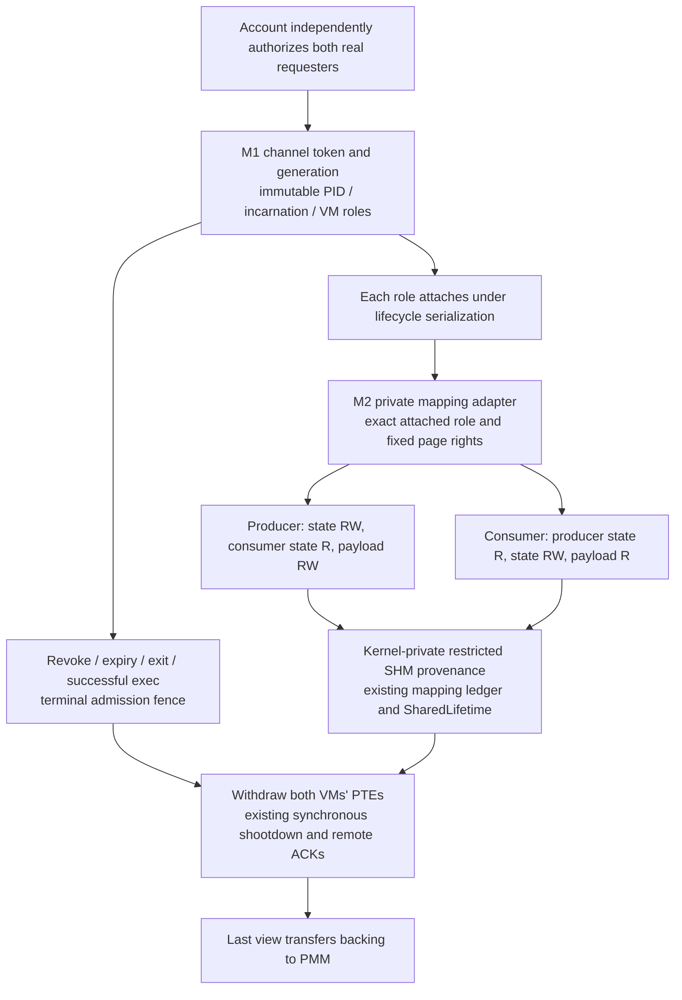
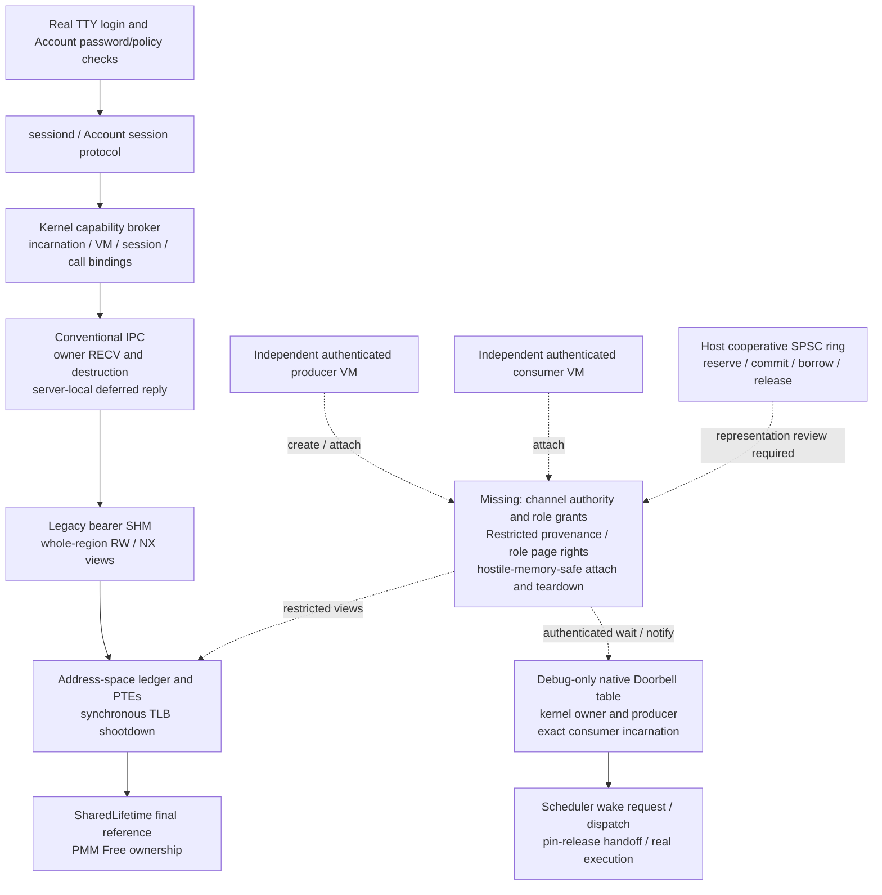

# FastLane native architecture and security checkpoint

2026-11-02, Asia/Tehran. **Production readiness remains BLOCKED.**
Production FastLane, production Restricted SHM and public Doorbell remain disabled.
No commit or push is performed.

## M5 first authenticated native transfer

The [M5 report](fastlane-m5-authenticated-transfer.md) records the first gated
single-message native path. Two independently Account-authenticated userspace
VMs use actual M2 backing with the unchanged M3.2 private-copy representation
and authenticated M4 notification. Only descriptor zero and a 256-byte payload
are admitted. A private per-channel publication/acknowledgement state allows
one message in the entire channel lifetime; direct shared cursor forgery cannot
admit another publication. Per-word native admission serializes actual access
against mapping withdrawal under the existing lifecycle locks. The backend is
kernel-mediated; no unsafe shared references or performance claim are introduced.
Private copying, validation and application examination run in the consumer VM.

Memory safety and snapshot stability do not provide coherent publication or
application authenticity. The producer retains a writable alias. A native
interleaving deliberately changes payload/metadata between consumer loads and
returns a stable mixed snapshot with both stronger integrity claims false.
The M5 report and source-bound aggregate distinguish functional completion from
overall readiness, retain every failed attempt, and track the exact 2/4/12
matrix plus per-object retirement. Historical census drift, the M1 debug
rendezvous timeout and unavailable Miri remain separate. A fresh M4 4-CPU producer-exit run also ends in an
unexplained instruction-fetch fault at `rip=0` before guest completion; its
failed attempt remains a distinct blocker even if an identical-image replay
passes. A newly reproduced
required regression failure keeps overall readiness PARTIAL even if the final
M5 transfer matrix passes. Production transfer remains disabled.

Earlier sections below describe their named milestone snapshots. In particular,
M3.2's historical host-only linkage and absent native transfer statements do not
describe M5's optional userspace dependency. The kernel still does not link Ring.
The older proposed milestone numbering in this checkpoint is historical; the
current M5 task means the first authenticated message transfer, with production
prerequisites still separate.

## M4 authenticated Doorbell integration

The [M4 report](fastlane-m4-authenticated-doorbell.md) records the opt-in native
notification adapter bound to M1's existing broker channel, independently
Account-authenticated userspace actors, scheduler wake/park integration and
lifecycle accounting. **M4 notification functionality is COMPLETE**: final-source
authenticated userspace validation passes on 2/4/12 CPUs, with six forced
cross-CPU race orders, 32 physical parks and 32 collected completions per guest,
plus confirmed withdrawal for a killed blocked consumer. All 33 broader native
regression guests, M3.1B repaired/pre-repair control matrices, host checks,
ordinary production-image exclusion and the supported release build pass.
Overall regression readiness remains **PARTIAL** because historical failures
are still unresolved; these new passes do not close them. Production FastLane
remains disabled and no Ring payload transfer is added. M3.2's memory safety
and private snapshot stability do not imply coherent publication or application
authenticity. Historical census failures and the M1 debug rendezvous timeout
remain open; M4 functionality and overall regression readiness are separate
decisions. Earlier statements below about absent userspace Doorbell describe
their historical milestone snapshots, not this new opt-in experiment.

## M3.2 message-integrity contract

The [M3.2 integrity report](fastlane-m32-message-integrity.md) fixes the
hostile-producer contract for the small-message path and keeps three properties
separate: **memory safety** (provided), **snapshot stability** (provided) and
**publication integrity** (not provided). A new `Integrity` type in
`fastlane-ring/src/hostile.rs` reports these with private fields and read-only
accessors, and has no constructor that can claim coherence or authenticity. The
only value the representation produces is `Integrity::PRIVATE_COPY`, returned by
`ReadLease::integrity`. Sequence counters, checksums and Acquire loads are
explicitly rejected as coherence proofs because M2 leaves the producer a
writable alias to every published byte. The large-message page-ownership path is
documented and deferred, not implemented. `fastlane-ring` is a host-only crate
not linked by the kernel; the M3.1B page-table reclamation repair, M1 authority,
M2 mapping rights and SHM/TLB ordering are unchanged. No native ring workload or
userspace Doorbell runs, and production FastLane remains disabled.

The November 2 review adds a forced host writer/acquirer interleaving that
returns bytes which never existed together in shared storage, while correctly
reporting stability and no coherent publication. It also checks the final slot
generation before sequence exhaustion and documents `try_recv`'s identical
contract and possible output modification on release failure. Host injected
retirement errors are not native exit-during-transfer evidence: that matrix is
NOT_RUN. Native operation admission, commit/retirement serialization and access
quiescence before unmap remain required before the first payload experiment.

## M3.1 bounded census attribution — PARTIAL

The [M3.1 ownership report](fastlane-m31-census-attribution.md) records the new
bounded, debug-only PMM/page-table/SHM/TLB observations. They add no authority,
payload path or userspace Doorbell, do not alter census thresholds, and retain
the existing synchronous acknowledgement and final-view release ordering.
Production remains disabled; ordinary and release builds exclude the recorder.
The historical M3.0 evidence directory and its source/image/raw-log manifests
are unavailable in this checkout. References below to retained original M3.0
attempts describe the historical report, not recovered local artifacts.

The reported 2-CPU +1 table, 4-CPU +1 SHM frame and 12-CPU +1 table remain
unclassified. No original frame identity can currently be linked to an owner or
release event. The new guests are separate experiments; later passing global
counts do not discharge the original failures. The trace's independent verifier
checks allocation identities, object/view ownership, table retirement conditions
and real remote acknowledgement completion before release. Overflow, missing
publication, unmatched owners and unresolved additions fail its diagnostic
receipt. A linked empty table alone is not proof that retention was necessary.

A new 2-CPU diagnostic attempt **FAILS** the unchanged census: 391 tables at
100–102, 392 at 103–105. Its extra table is frame 620990464, VM 79, root
473878528, parent 513253376, VA `0x300400000`. It remains linked and empty at
999 after SHM object 65's final view, synchronous invalidation and backing-frame
620986368 release. This accounts for retained VM ownership in that new guest;
legitimate retention policy, long-term bounds and actual teardown of this
persistent VM remain unproved. The strict empty-addition assessment remains
unresolved. No harmless/leak classification is assigned to an original failure.

The final revision-3 trace matrix passes M1/M2 and M3 native word witnesses on
2/4/12 CPUs, with zero overflow and full allocation/view/table-retirement/TLB
reconciliation. A separately identified 4-CPU table 606158848 appears before
checkpoint 100 and remains linked/empty in Vortex VM 79; its retention-policy
limit also remains visible. Initial observer versions omitted the PMM claim for
a boot security test's OtherAccounted SHM backing. Their failed reassessments
are retained; revision 3 observes those transitions without changing primary
accounting classes or any count threshold.

Kernel/IPC/UAC/scheduler host checks, hostile/cooperative ring tests, and the
ordinary production image/boot gate pass. Selecting the debug fixture in release
is rejected by the existing compile guard; its nonzero command receipts remain
visible. Broader historical native IPC/grant contention, R2D and kernel Doorbell
suites are not rerun in M3.1. Exact matrices, source/image hashes, failed attempts
and scope limits are in the M3.1 report and
`target/fastlane-m31-evidence/validation-summary.json`. Later passes do not
replace the captured new FAIL or the three original unresolved observations.

## M3.0 hostile-memory representation update

The [M3 representation report](fastlane-hostile-memory-representation.md) defines
a separate 16-slot, 256-byte-message format within M2's unchanged three-page
rights matrix. Shared words supply no Rust references or kernel authority.
Private initialized staging, bounded validated copying, private cursors, exact
slot/channel/sequence identities, checked nonwrapping exhaustion, local lease
serials and terminal malformed-state handling are implemented in
`fastlane-ring/src/hostile.rs`, with unsafe code forbidden. The original
cooperative reference-based leases remain separate and unchanged.

The selected contract permits mixed hostile payload writes during a bounded
copy; returned private bytes are stable. **Immutable publication and coherent
delivery are not claimed.** M2 retains a producer-writable payload alias, so
strict zero-copy plus sub-page hostile-peer immutability is unavailable here.
The report compares protected staging, page ownership transfer and future sealed
large payloads, including their VM/TLB and memory costs.

Host checks pass on the 1,345-input source snapshot: 21 adversarial M3 tests,
12 existing ring tests, four documentation tests, Clippy, no_std target checking,
parser controls, ASan and fully instrumented TSan. Miri is NOT_RUN because it is
not installed. Native width probes use the existing authenticated debug-only
mapping fixture and direct aligned qword accesses; no ring is attached.

**M3.0 is PARTIAL because native census regressions remain unexplained.**
The first 2-CPU run completed its M1/M2
workloads but failed M2's global page-table census: cycles 100-103 had 391 tables,
cycles 104-105 had 392. Restricted objects/views/frames remained zero. An exact
same-image replay passed with 391 tables throughout; that pass does not explain
or replace the first failed assessment. A separate 4-CPU attempt observed
global SHM frames 1304 -> 1305 -> 1304; an earlier 12-CPU compatibility run
observed page tables 391 -> 392 from checkpoint 101 onward. Restricted channel
objects/views/frames stayed zero, and their per-object retirement checks passed,
but the unchanged M2 assessor rejects the global drift. Original attempts are retained
under `target/fastlane-m3-evidence/`. No permission, authority, retirement or
assessor check was weakened. The final report records the aggregate result.

The final unchanged-source matrix passes all 33 native guests on 2/4/12 CPUs,
including M1/M2, IPC/VM/SHM, authenticated Account S1/S2, exec, all three actual-exit
modes, scheduler, R2D and existing kernel Doorbell. Its mapping guests validate
18 hardware faults, 90 backing lifetimes, 174 retired views, 54 remote unmaps
with handler flush ACKs and 18 additional M3 word witnesses. Production
ELF/ISO/service exclusion and the ordinary release check pass. Kernel/IPC/Account
host tests pass 153/62/18. Exact receipts are
`target/fastlane-m3-evidence/host-20261101T083129.282916Z/validation-summary.json`
and `target/fastlane-m3-evidence/regressions-20261101T083130.431852Z/orchestration.json`;
the aggregate `target/fastlane-m3-evidence/validation-summary.json` remains PARTIAL
and retains the three earlier failed native assessments. Passing final receipts
do not discharge their unexplained census changes.

First attribute these count changes with bounded opt-in ownership tracing at the
serialized census points, then rerun the affected cases. A passing later replay
does not resolve an earlier failed combined run. The following representation integration step is an opt-in copy-only native backend
with audited raw-word access, actual hostile mutation and lifecycle tests,
followed by independent later notification work. Production FastLane and
userspace Doorbell remain disabled. Host tests and mapping-width probes do not
prove native end-to-end transfer readiness.

## M2 restricted mapping implementation update

The [M2 mapping report](fastlane-restricted-native-mapping.md) defines three
separate 4 KiB regions with one writer per physical page, kernel-private backing
provenance, exact attached-role admission and active peer withdrawal through the
existing SHM/TLB/PMM path. The implementation and disposable userspace fault
fixtures are behind the additional `fastlane_mapping_test` debug feature.
No ring operations or userspace Doorbell are present. **M2 restricted mapping
validation is COMPLETE** on the unchanged 1,340-input source snapshot: all
2/4/12-CPU mapping, M1 authority, IPC/VM/SHM, Account, exec/actual-exit, scheduler,
R2D and existing kernel Doorbell regressions pass. Eighteen actual hardware
faults are independently reaped; 90 backing lifetimes and 174 views retire after
their required TLB completion, including 57 real remote handler flush ACKs.
Six repeated lifecycle cycles per topology show no SHM, page-table or free-frame
drift. Ordinary ELF/ISO/embedded-service exclusion and the release check pass.
Exact rights, limits, receipts and the full matrix are in the linked report and
`target/fastlane-mapping-evidence/validation-summary.json`.
Historical architecture statements below are preserved as earlier snapshots.

The mapping implementation now composes the authenticated control path with
existing VM ownership and physical retirement. Shared bytes never become kernel
authority. Read-only peer observations can change at any instruction and grant
no integrity or safe Rust borrowing contract.



Current implementation anchors are
`kernel/src/capability/{channel,channel_native,channel_mapping,mapping_trace}.rs`,
`kernel/src/memory/{shared,shared_lifetime,tlb,pmm}.rs`,
`kernel/src/process/address_space.rs`, and
`services/sunlight-uac/src/bin/channel_fixture/mapping.rs`. The mapping report
contains the page matrix, trust boundary, partial-failure behavior and per-object
native evidence. Existing broader production and Doorbell gates are independent.

## M1 authority implementation update

The recipient-bound authority object and one-use role attachment are implemented
behind the debug-only `fastlane_channel_test` feature. **M1 authority-only validation is COMPLETE**: final-source native
2/4/12 authorization and all four attach/revoke/actual-exit orders pass, with
original host receipts. Existing IPC, scheduler, R2D lifecycle and authenticated
S1/S2 authority regressions are green on 2/4/12. Ordinary images exclude access
and the ordinary release kernel check passes. [The M1 report](fastlane-channel-authority.md) specifies the exact
policy, lifecycle, bounds, native matrix and evidence. Account independently
authorizes each actual requester; creation consumes the intended consumer's
one-use pair receipt. Both immutable roles then attach separately under existing
lifecycle serialization. No mappings, data path or userspace Doorbell were added.

M1's next milestone was **M2 restricted mappings and retirement, without payload
transfer**. The update above and its linked report supersede the earlier
unverified mapping inventory below. The next step after M2 acceptance is a
hostile-memory-safe SPSC representation and bounded payload access; userspace
Doorbell and production transport require later independent acceptance.

**Historical checkpoint entry:** the architecture inventory, source comparison,
42-guest audit and original implementation plan below describe the checkout
before M1. Their original hashes and results are preserved, not represented as
new M1 or current-source execution. In particular, statements below that channel
authority is missing describe that earlier checkpoint. Historical broad security
gates remain PARTIAL/BLOCKED independently of this scoped authority milestone.

The shortest remaining path is a bounded, recipient-bound authority object,
restricted mappings with verified retirement, a hostile-memory-safe payload
representation, and an authenticated userspace Doorbell binding. Existing
mechanisms cover substantial portions of lifecycle serialization and physical
retirement, but do not compose themselves into a channel. Completing every
unrelated service audit first is unnecessary; satisfying every applicable
channel authority and memory invariant first is mandatory.

## Evidence boundary and current-source identity

Audit entry is clean at `2491e22b4db4b2b15f0dfe56059d505327a8753a`.
The latest completion/actual-exit evidence records the older HEAD
`1e6a22e2401cc28c17cd61f8e715742505cc4587` plus its then-modified tree.
**All 1,326 executable/configuration file hashes in that evidence's final source
manifest match this checkout.** The commit IDs alone would obscure that match.
Documentation is outside that executable source map.

Checkpoint artifacts are under
`target/fastlane-architecture-checkpoint-20261031/`:

* `validation-summary.json`: current-source comparison, verification of all 645
  entries in the latest artifact index, and fresh raw-log assessments. All 645
  files exist and match their recorded SHA-256 hashes.
* `report-inventory.json`: all 45 pre-existing FastLane and scheduler remote-wake
  reports, their hashes, decision lines, headings and evidence-path availability.
* `audit.py`: reproducible read-only artifact/source/serial assessment. It does
  not rerun QEMU, rewrite old results or issue new host acknowledgements.

The latest evidence root below is abbreviated **E**:
`target/fastlane-completion-exit-evidence/`. Its top-level
`validation-summary.json` SHA-256 is
`731b1d1b95ea68e7a84f181ec73faba807b487df7e0dd8bdc74dcd52180ab85d`.
Its manifests bind original serials, original independent host receipts, images,
embedded service binaries and source maps. This audit verified the artifact
index and reran the current assessors against the original logs; it did not
repeat those native executions. No new native acceptance is claimed.

The original F1.3N-B and R2D top-level evidence roots are unavailable here.
Their original 1/2/4/12-CPU results remain report-derived. A later archived R2D
2/4/12 replay is available under the Account-exec evidence root; its actual
images/logs are checked separately below, with source differences retained.
Fresh-source 2/4/12 Doorbell and scheduler regressions retained under E are
another available evidence set. Historical missing artifacts cannot be silently
reconstructed from later passes.

## Current architecture

Solid arrows are existing paths. Dashed arrows are missing native FastLane
integration. The host ring and kernel Doorbell fixture are separate components.



Source anchors:

* `fastlane-ring/src/{lib,leases,lease_tests}.rs`: cooperative layout v1 and leases.
* `fastlane-doorbell/src/lib.rs`: serialized Doorbell model; no kernel authority.
* `kernel/src/sched/{doorbell_state,doorbell_native,doorbell_test}.rs`: debug-only
  bounded native adapter. `Table::create` supplies `KERNEL` for owner/producer;
  `doorbell_notify` accepts an internal handle, without userspace role authority.
* `kernel/src/sched/{mod,handoff,requests,pin_release_test}.rs`: wake,
  dispatch, physical pin release and lifecycle machinery.
* `kernel/src/capability/{mod,lifecycle,sessions,delivery,token_history}.rs`:
  issuance, request-bound grants, session retirement and bounded token history.
* `kernel/src/ipc/{mod,reply_identity,deferred_token}.rs`: terminal arbitration,
  exact pending-call identity, checked deferred handles, successful-exec withdrawal.
* `kernel/src/memory/{shared,shared_lifetime,security,tlb,pmm}.rs` and
  `kernel/src/process/{address_space,region,spawn,pid}.rs`: mapping, sanitization,
  synchronous invalidation, backing lifetime, exec and monotonic PID allocation.
* `kernel/src/arch/x86_64/syscall.rs`, `ipc/src/lib.rs`,
  `services/sunlight-uac/src/bin/uac_service.rs` and its `account_cancel/` fixture:
  authenticated control path and actual syscall boundaries.

There is no FastLane capability class, Restricted SHM provenance or native
channel create/attach ABI in these sources. `CapabilityRights` has IPC and VFS
variants; legacy `ShmEntry` has an owner PID and `SharedLifetime`, without role
or recipient/VM mapping grants. `AddressSpace::map_shared_region` installs
READ_WRITE views. NX is already enforced. Those legacy views cannot implement
the proposed asymmetric rights.

## Verified versus unverified security matrix

**PASS** means the named scenario, not the entire subsystem. CPU columns describe
configured topology; participants are identified separately. **Reusable** means
the same source mechanism and invariant can be retained, subject to a new
integration test. It never means native FastLane has already passed.

| Property and source | Exact evidence and CPU configurations | Verified scope and limitations | Native FastLane reuse |
|---|---|---|---|
| Zero-copy leases; `fastlane-ring/src/{lib,leases}.rs` | `target/fastlane-leases-evidence/20261031T101316.913777Z/validation-summary.json`: host PASS, 12 ring tests, 3 doc tests, 1,130,000 transfers per copying/lease stress path; host Doorbell integration. No native CPU matrix | Exclusive cooperative roles; length/distance checks; Release/Acquire publication and reclamation; cancel/drop/forget behavior. Executable ring inputs still match. The report input `fastlane-security-closure-progress.md` subsequently changed. Earlier `101243` attempt remains FAIL | Algorithms, bounded geometry and cooperative tests reusable. **No raw native attach or hostile-memory-safe slice proof** |
| Entropy, fail-closed issuance and nonreuse; `capability/mod.rs`, `token_history.rs`, `entropy.rs` | F1.1P through G reports; E `regression-authority/.../validation-summary.json`: authenticated S1/S2 on 2/4/12; E host-check manifest contains broker/history tests | Bounded issuance, lifecycle serialization and identity history have scoped evidence. Production history limit is 65,536 prepared identities/boot; exhaustion refuses issuance. No unlimited availability claim | Reuse issuance and lock order; add a distinct channel grant class, rights and budget. Legacy bearer possession remains insufficient |
| Authenticated Account/session lifecycle; `capability/{lifecycle,sessions}.rs`, Account/sessiond | E `regression-authority/native-20261031T163027.791510Z/validation-summary.json`, E `regression-reply/native-20261031T163430.846263Z/validation-summary.json`; 2/4/12. Earlier E3R/S/T/H5 reports retain original attempts | Real login, role checks, S1/S2 grant/retire contention, reverse requests and actual peer lifecycle. Original N3M lookup failure unexplained; no channel creation policy | Reuse authentication and exact live identity checks. Account GroupCreate authorization does **not** authorize channel creation or attachment |
| Reply/closure arbitration; `ipc/mod.rs::{defer_current_reply,finish_call,finish_peer_closed_calls}`, `reply_identity.rs` | E `regression-ipc/native-20261031T163644.980243Z/validation-summary.json`: 2/4/12 kernel-method races; E reverse-reply regression and cancellation modes 6/7: owner-ordered native endpoint closure | Checked exhaustion and failed-deferral rollback; late deferral/publication rejection; one terminal. Method races are not independently authenticated userspace close contenders. Actual Account-owner destruction concurrent with its completion remains unforced | Reuse ordinary IPC arbitration if used. A deferred channel setup would inherit the missing authenticated close race; the minimum proposed setup avoids deferred reply ownership |
| Successful/failed exec with outstanding authority; `spawn.rs`, `ipc/mod.rs::retire_exec_replies`, grant retirement | E `regression-exec/native-20261031T162705.760620Z/validation-summary.json`: 3 cycles each on 2/4/12, 9 selected objects and frees, 9 real remote ACK/flushes | Failed exec preserves old image/authority; successful privileged Account exec withdraws image roles/replies and old VM mappings while preserving process-owned endpoint identity. No Restricted mapping tested | Reuse the lifecycle hook and failure ordering; channel membership must be VM-scoped and withdrawn explicitly |
| Ordered deadline/cancel/exit/endpoint lifetimes; existing IPC and SHM cleanup | Original `target/fastlane-cancel-exit-evidence/validation-summary.json`: 7 modes × 3 cycles × 2/4/12 = 63 objects, 44 remote ACK/flushes. **Current-source** E regression-cancel: 21 guests, one cycle each, 21 objects, 15 remote ACKs and 27 zero-target unmaps | Original repeated-cycle evidence is older. Current-source regressions preserve seven cases, including endpoint owner denials and different-caller stale-grant rejection. Ordered winners alone do not prove overlap | Exact pending identities, withdrawal and physical cleanup are reusable; no channel lease or notification race is proved |
| Actual completion/cancellation overlap; `capability/completion_race.rs`, ordinary IPC paths | E `regression-completion-cancel/mode-{8,9,10}/native-*/validation-summary.json`: 9 guests on 2/4/12, 27 objects, 54 unmaps, 25 remote ACK/flushes, 29 zero-target unmaps | Real authenticated syscall actors enter on different CPUs and independently contend on the lifecycle lock; both forced orders and coordinated winner selection. Test-only wake/coordination is explicit | Reuse first-terminal-wins control-plane invariant and test technique. It proves no FastLane commit/release/close operation |
| Completion versus actual caller ProcessExit; `capability/completion_exit.rs`, syscall 20, scheduler finish/reap | E `mode-{11,12,13}/native-*/validation-summary.json`, `physical-objects.json`: 9 guests on 2/4/12, 27 objects/exits/frees; 11 completion winners, 16 exit winners | Independent real syscall actors; exit winners publish no IPC terminal. All 54 unmaps have **zero remote targets after quiescence**. No hostile instruction or later frame reuse | Reuse lifecycle serialization, dead-recipient rejection, quiescent cleanup. Separate remote unmap evidence must remain separate |
| Verified unmap and final backing retirement; `shared.rs::free_shared_page`, `SharedLifetime`, `AddressSpace::unmap_page`, `tlb.rs`, `pmm.rs` | Above E physical traces plus exec/completion-cancel regressions, 2/4/12. Existing VM gate separately observes 1/3/11 remote targets | PTE/frame/ledger preflight; actual PTE removal; exact handler ACKs when targets exist; retain at views=1; final release at views=0; real PMM Free update. Failed preflight pins backing or fails stop | Core ordering reusable. Restricted provenance, aliases, per-role views and channel teardown still need direct proof |
| Doorbell conditional wait and cross-CPU acceptance; native adapter and model | E `regression-doorbell/results.json` and `{2,4,12}cpu.serial.log`: freshly reassessed PASS, 42 rounds and 43 creations/retirements each; zero final objects/waiters/references/obligations/deferred/pending/queues/pins and equal frame totals | Native blocked-state registration, remote dispatch/execution and terminal cleanup. Model owner/producer is kernel identity, consumer is exact PID/incarnation. No VM-bound producer grant or native payload ring. Historical 1-CPU remote cases NOT_FORCED | Reuse sequence/check/register serialization and bounded scheduler path. **Userspace producer-to-consumer acceptance remains missing** |
| Remote wake/pin release; `handoff.rs`, scheduler reschedule state | R2/R2V/R2C/R2D reports: host counterexample → repairs → native 1/2/4/12, UP is local control. Later raw replay: `target/fastlane-account-exec-evidence/regressions/20261031T125739.434903Z/r2d/results.json`, 2/4/12. E `regression-scheduler/results.json` separately passes current-source lifecycle on 2/4/12; E Doorbell tests exercise its wake path | Original R2D root and 15-repeat artifacts absent. Later R2D images/extracted ELF and raw parser assessments checked here; its source map differs in scheduler `mod.rs`, syscall and kernel manifest. It is older-snapshot evidence, not final-source R2D acceptance. `requests.rs`, `handoff.rs` and pin fixtures match | Preserve repair and exact same-CPU/task-identity checks. New slice needs direct remote consumer execution, not merely Ready/requested |
| Hostile post-unmap instructions | Explicitly NOT_RUN in all Account retirement reports; no matching E case | PTE removal and ACK evidence are strong mechanism evidence, but no stale-VA load/store/fault observation | **Unverified**; required on the actual Restricted path before payload activation |
| Same backing frame safely reallocated | Actual PMM frees observed; subsequent same-frame allocation/sanitization NOT_RUN | Different later frame addresses do not prove leakage; lack of reuse-hook output does not prove no reuse | **Unverified** reuse boundary; require normal allocator evidence, no forced allocator mutation |
| Repeated-cycle resource reconciliation | E actual-exit/completion-cancel/exec: three same-guest cycles/topology; broker/object inventories and exact frame frees. Historical Account-exec report separates retained container capacity/token history | Selected-object live ownership reconciles; whole-system service heaps and common-epoch allocator census NOT_RUN | Require bounded channel-specific reconciliation first; defer broad system census only with hard quotas and no unaccounted channel ownership |
| Numeric PID reuse | `process/pid.rs::next_pid`, spawn/fork/thread publication, retained reaped rows; host boundary tests and native process-slot reuse | Checked max-retained-PID + 1, no wrap. Numeric PID reuse is unreachable under current allocator, distinct from slot reuse and exec preserving incarnation | Exact incarnation/VM/channel generations remain mandatory. Do not fabricate numeric reuse or count new-PID replacement as reuse |
| Production feature isolation | `kernel/Cargo.toml` default `[]`; scheduler adapter cfg; syscall fixture selector `0xf1a0` debug/test-only. E `image-audit/production.json`, ordinary native 2/4/12 logs | Ordinary ELF, ISO extraction and embedded services exclude fixture features/markers. No production FastLane ABI exists | Preserve off-by-default build and admission gates; new experimental ABI must fail closed in ordinary images |

The current artifact audit reassessed **42 existing lifecycle guests**: 9 actual
exit, 9 completion/cancel, 21 ordered cancel/exit and 3 exec. That is 84 selected
objects and 84 actual final frees, without counting repeated regression records
as new executions. It also reassessed three Doorbell logs. Source-matched
authority, reverse-reply, conventional IPC, scheduler and ordinary-image evidence
is present in the verified artifact index; this checkpoint did not independently
reexecute their guests or reassess every parser in that index.

## Minimum secure experimental contract

This is a proposed contract, not a new ABI or authorization to implement it in
this checkpoint. Initial scope: one unidirectional bounded channel, fixed small
capacity and payload, one producer VM and one consumer VM, one data Doorbell,
no delegation, migration, resizing, reconnect or fallback transport. Full
producer operations return `Full` immediately; producer capacity waiting is
excluded, so a second Doorbell is unnecessary. Any userspace retry must have a
finite budget/deadline. Consumer wait must be cancellable or deadline bounded.

1. **Creation and authentication.** Both participants must have independently
   verified live kernel identities and authorized user/session bindings. They
   may share an authenticated user; they must be distinct processes and address
   spaces. A UID, process name, endpoint SEND token or inherited PID alone does
   not prove login or consent. An explicit narrow policy authorizes this exact
   participant pair. Reuse Account/session verification, but add a channel
   operation/policy; do not reinterpret a GroupCreate grant as a channel grant.
   Session revocation/expiry/restart must fence uncommitted setup and invalidate
   session-scoped channel authority under the same lifecycle serialization.

2. **Unique role attachment.** Kernel-owned object identity is checked
   `{slot, channel_generation}`. Nondelegable role grants bind issuer authority,
   authenticated principal/session epoch, exact recipient PID/incarnation,
   address-space root/generation, role and grant generation. Attach reserves
   exactly one role once; wrong process, VM, role, stale grant and duplicate
   attach fail without state/PTE changes. Possession of a leaked handle is
   insufficient. All counters/exhaustion fail closed. Bounded records and
   fallible reservation precede publication; partial setup rolls back.

3. **VM authority boundary.** Initial participants have no native/Linux VM
   borrowers. Enforce that restriction at attach and at every later thread,
   clone/fork or other address-space sharing entry while membership is live.
   Checking only at creation is insufficient. An alternative VM-wide role model
   is broader work. Successful exec withdraws membership before old-VM reuse;
   failed exec preserves it. Bind notification authority to the VM too, even
   though the existing Doorbell identity has only PID/incarnation.

4. **Restricted mappings.** Kernel-owned provenance is distinct from legacy
   SHM and never returned as a legacy bearer object. Sanitize every backing
   byte, including page tails/padding, before exposure. Header is immutable
   after trusted initialization and RO to both. Producer cursor is producer
   RW/consumer RO; consumer cursor is producer RO/consumer RW; payload is producer
   RW/consumer RO; all are NX. Kernel validates exact object frames, page rights
   and ledger records. Legacy map/free, generic mprotect/munmap, alias, fork,
   executable mapping and sharing paths must either preserve this policy or
   reject. No hidden initial owner RW alias is permitted.

5. **Zero-copy payload safety.** Authentication does not make a peer cooperative.
   The current `ReadLease::payload() -> &[u8]` is unsound as a hostile-memory
   boundary if a producer retains writable payload pages. Consumer RO alone
   does not stop the producer changing them. A hostile consumer can also forge
   tail reclamation. The minimum proposed native representation uses atomic
   length/payload cells and bounds-checked lease accessors, **without creating
   shared `&[u8]`, `&mut [u8]`, `&Ring` or references to a peer-mutable Slot**.
   It needs a separate documented Rust/shared-memory unsafe review and layout
   version; it is not a cast of cooperative layout v1. Geometry and cursor
   validation use trusted local constants; peer values never supply pointers,
   unchecked offsets, capacities or allocation lengths. Read lengths are
   sampled/validated locally; arbitrary payload bytes are untrusted input.

   Reserve/commit and borrow/release still hand off the same backing without
   copying the payload between processes. Stores precede Release publication;
   reads follow Acquire observation; release precedes producer reuse. Dropped
   write leases do not publish; dropped read leases do not consume. Under a
   hostile writer the API promises memory isolation and bounded access, not a
   stable or truthful message. An application needing a stable snapshot copies
   into private validated storage. If immutable zero-copy Rust slices are
   required, kernel-enforced page ownership transfer and acknowledged write
   revocation are mandatory instead; **do not ship the existing slice API on
   persistent RW/RO views**. Failure to justify atomic access under the compiler
   and cross-process memory contract is a stop condition, not permission to
   assume safety.

6. **Notification.** Reuse snapshot sequence → check/drain ring → conditional
   registration under the same serialization as notify and blocked-state change.
   Commit precedes notify. Exactly the producer grant may notify and exactly the
   consumer grant may wait/cancel. Coalesce wake obligations in bounded metadata;
   no per-message unbounded queue. Sequence/registration exhaustion terminates
   safely. Preserve bounded APIC dispatch/retry, pin-release handling and actual
   consumer execution evidence. A producer dying after commit but before notify
   must still produce a terminal wake through its real lifecycle hook.

7. **Closure and cancellation.** State is
   `Reserved → Attached → Open → Closing → Retired` with rollback of unpublished
   reservations. Closing fences new attachments, role operations and
   notifications; first terminal state wins. Each peer may close its own channel
   membership using a specific CLOSE right. That is a new channel right, **not**
   permission to destroy another process's ordinary IPC endpoint. Cancellation
   removes only the exact wait registration; it neither frees borrowed backing
   nor overwrites committed data. The minimal protocol may discard queued data
   on terminal close and cannot reopen the old generation. Racing operations
   admitted before close must complete before final teardown; survivors cannot
   keep committing after observing closure. Kernel admission must enforce this
   boundary wherever the proposed ABI needs a linearizable commit, rather than
   relying on a writable userspace header flag.

8. **Lease and exit lifetime.** A live slice/accessor does not authorize backing
   reclamation. Normal local close waits for the local lease to end. A hostile or
   unresponsive live peer can pin at most its charged bounded allocation; retain
   that backing until verified local release or authorized process stop/reap.
   Do not asynchronously remove memory behind an executing safe borrow. Exit
   stops borrowers and waits for execution/VM quiescence before unmapping. No
   terminal wake targets a dead/replaced process. Exec/restart cannot inherit an
   old VM's channel grant, wait registration or pending operation.

9. **Retirement.** Fence admission, settle exact waits/operations, preflight every
   mapped view, remove actual PTEs, await all real synchronous TLB acknowledgements,
   remove ledgers, then release references. Only the final view/operation owner
   transfers backing to PMM once. Failed/unverified unmap pins backing or fails
   stop; it never decrements optimistically. New allocation sanitizes before any
   different principal sees those frames. A channel slot is reusable only with a
   fresh checked generation after old references are gone.

Use immediate, transactional kernel create/attach results for the first slice;
do not introduce a deferred grant-bearing setup reply or transfer Account's
server-local completion handle. Existing authenticated service exchanges can
establish authorization, but the final role issuance must revalidate that
authority atomically at kernel commit. If the implementation instead relies on
deferred delivery, its full cancellation/endpoint-closure/delivery race becomes
an A gate before any channel attachment.

## Remaining gates: A, B and C

These letters classify **this proposed experimental contract**. They do not
rename historical Scheduler Gate A, Doorbell Gate B or production Gate C.
Existing broad gates retain their PARTIAL/BLOCKED results.

**A** is mandatory before executing a native payload channel. Safe prerequisite
fixtures may test an unpublished authority object or isolated mapping before all
later A items exist, provided those fixtures enforce their own lifetime and
isolation. No partially completed A gate authorizes producer-to-consumer data.

| ID / class | Unresolved property, concrete failure mode and dependency |
|---|---|
| A1 | Explicit authenticated pair policy and distinct create/attach/role grants. Missing authority permits confused-deputy creation, handle theft or unauthorized memory exposure. Depends on existing live session/issuer verification, not arbitrary PIDs |
| A2 | Exact producer/consumer exclusivity, recipient/incarnation/VM/channel/grant generation checks, fail-closed exhaustion and transactional reservation. Duplicated writer, stale attach or post-exec adoption breaks SPSC or grants replacement processes access. Required before issuing roles |
| A3 | Restricted provenance, asymmetric PTE rights, NX, full backing sanitization and all alias/protection/sharing exclusions. Legacy RW remap or later VM borrower escapes the role boundary. Required before mapping; initial borrower exclusion must persist |
| A4 | Hostile-peer-safe representation and unsafe review. Valid-looking cursors/lengths cannot make borrowed non-atomic payload references safe against a hostile writer. Required before raw attach/leases; neither Account authentication nor RO consumer PTEs replaces it |
| A5 | Actual channel commit/close/cancel/exit/exec serialization and bounded lifetime of leases/operations. Otherwise late publication, dead-peer sleep, live-borrow unmap, double release or use-after-free. Must be tested on this channel, preserving ordinary endpoint ownership |
| A6 | Per-view verified unmapping, real remote TLB ACKs where targets exist, final backing retirement and hostile stale-VA load/store faults. Missing revocation can leave writable translations into reallocated frames. Requires exact actual Restricted mappings and real remote participants |
| A7 | Safe backing reuse and sanitation through normal allocation, plus channel-specific repeated-cycle reconciliation. Early reuse exposes new-owner data; accumulating uncharged ownership exhausts the system. Require per-object free ordering and an observed normal same-frame reallocation before payload acceptance. A bounded probe missing reuse is NOT_OBSERVED/BLOCKED, never a fabricated pass |
| A8 | Role-authorized Doorbell wait/notify/terminal wake bound to channel and VM; actual cross-CPU consumer execution. Kernel-producer fixture alone permits no userspace notification authority and cannot exclude lost-wake/identity mistakes in the adapter. Depends on A1–A5; exercise the admitted 2/4/12 topologies |
| A9 | Hard global/per-principal bounds on channels, frames, grants, waits and retained close state; build plus runtime opt-in admission. Without them an abandoned lease/creation flood can consume unrestricted memory or expose an incomplete ABI to ordinary users. Reject at budget before allocation; deny ordinary-image calls |
| B1 | Common-epoch Account/sessiond/UAC/VFS/IPC/allocator/service-heap reconciliation and boot-lifetime saturation/availability. Broad hidden references or history exhaustion can cause production leaks/outage. Experimental isolation requires A7/A9's full channel ownership census and limits first; a kernel-only zero count cannot satisfy B1 |
| B2 | Remaining VFS issuer exec/retirement versus commit and consume/cancel orders; full legacy administrative/delegation flows. Stale VFS authority could survive issuer retirement. Deferred only because the proposed channel adds no VFS issuance/delegation dependency and uses fixed existing executables. Any reuse of those paths for channel authority immediately makes their applicable invariants A |
| B3 | Causal closure of historical N3M lookup and D3 combined failures, plus applicable current combined/service-recovery replays. Shared IPC/lifecycle infrastructure could still fail in production. No causality or independence is established by later isolated passes. Before a slice run, any reproduced failure affecting its own authentication, isolation, wake or cleanup is an A stop; old broad gates stay PARTIAL |
| B4 | Concurrent actual ordinary endpoint-owner destruction versus authenticated Account completion. Wrong/late publication or stale completion adoption remains a control-plane proof gap. Current single-owner RECV/destroy and server-local completion ownership prevent using a foreign closer to force it. This may follow an isolated slice **only with the immediate setup contract above**; deferred setup would promote it to A. Actual channel peer-close races remain A5 regardless |
| B5 | Wider production rollout: multi-channel/service integration, failure recovery, fair scheduling, longer stress and compatibility/performance against conventional IPC. Production workload interactions can expose bounded-resource starvation or application regressions. A single bounded experiment supplies no production readiness or speedup claim |
| C1 | Actual numeric PID reuse test under a future allocator. There is no reachable reuse under current checked monotonic allocation; artificially changing identities would test a different system. Preserving the allocator and testing incarnation/VM mismatch, actual new-PID replacement and task-slot reuse are A2 requirements. If allocation policy ever changes, real reuse testing becomes mandatory before enabling that change |
| C2 | Miri/Loom or other dynamic/model checking, broad formatting and pre-existing unrelated lint/media debt. Useful additional confidence and maintenance work, without substituting for A4's unsafe review or native A proofs. Strict Clippy currently FAILS and Miri execution is NOT_RUN; a security-relevant diagnostic in the new path must be resolved before acceptance |
| C3 | Adaptive polling, larger rings, producer capacity Doorbell, CPU migration and lower syscall/atomic overhead. These expand correctness/authority surface and are absent from the minimal contract. Each addition needs its own relevant A-level safety proof before use |

The broad historical F1.1B-0/production Gate C remains BLOCKED, Global Authority,
Grant Lifecycle, Session Authority and Doorbell B remain PARTIAL. A future
experimental feature must explicitly record its separate scope and A-gate
acceptance; it must not relabel those historical gates as passed or silently
enable Restricted SHM/public Doorbell in ordinary builds.

## Dependency-ordered implementation and native proof plan

Every milestone records exact executable source hashes, kernel/ISO and embedded
service identity, original serial hash, configured/participating CPUs, outcomes,
resource ownership and independent host receipt. Tests are opt-in, bounded and
absent from ordinary images. Missing interleaving is NOT_FORCED; a missing
artifact is UNAVAILABLE; neither is PASS. Start each new native path at 2 CPUs,
expand to 4 and 12 only after it passes; use 1 CPU as a separate local control.

### M1 — Authenticated authority object, no mappings or data path

Modify `kernel/src/capability/mod.rs` and a small channel-specific module beside
`lifecycle.rs`; `process/mod.rs` for membership if needed;
`arch/x86_64/syscall.rs` and `ipc/src/lib.rs` for a private experimental interface;
`kernel/Cargo.toml`; and the existing Account/session native fixture plus one
dedicated channel fixture. Do not extend the general VFS delegation framework.

Implement the explicit pair policy, bounded channel reservation, two immutable
role bindings, one-use attach and close/rollback of an empty object. Revalidate
actual authenticated identities, session epoch and VM at commit under existing
lifecycle serialization. Record and enforce borrower/clone/fork exclusion while
membership is live. There are no SHM objects, leases or Doorbell dispatches yet.

Native tests: real authenticated independent VMs, intended attachment once,
wrong process/role/VM/session/duplicate attachment denials; cancellation/exit
between reservation and attach; failed/successful exec; actual replacement with
new PID/incarnation; channel slot retirement/reuse with a fresh generation;
bounded-capacity refusal. Counter arithmetic exhaustion remains a separately
labelled host boundary, without forging a live native PID or identity.

Accept only two authorized role bindings, no mapping publication, no stale role
adoption, fully reconciled object/grant ownership after each completed cycle and
ordinary-image interface rejection. Expect native authority receipts and host
counter/failure-atomicity checks. Stop on missing authentication/policy, an
unprotected sharing path, foreign authority success, unknown ownership, leaked
reservation or any request to broaden existing endpoint management rights.

### M2 — Restricted mapping and retirement, no payload channel

Depends on M1. Modify channel grant/provenance records;
`memory/{shared,shared_lifetime}.rs` through a distinct Restricted path;
`process/{address_space,region,mmap,fork,spawn}.rs`, thread/clone entry points,
`sched/mod.rs` cleanup, and `memory/{tlb,pmm,security}.rs` only as needed to reuse
their established operations and add opt-in observation. Preserve legacy SHM.

Install sanitized role views, prevent every legacy alias and rights escalation,
bind each mapping reference to its exact object/VM, and implement exact rollback,
close, successful exec and exit cleanup. An empty mapping fixture has no live
Rust payload borrow, but still requires full physical ownership safety.

Native tests: actual consumer write-to-RO, header-write and execute faults;
legacy remap/protection/sharing denial; hostile stale-VA read and write after
verified unmap; live remote VM activity with real handler ACKs; partial mapping
failure; both view-release orders; one surviving view pins backing; exit/reap
quiescence; duplicate release; bounded normal allocation until a selected freed
frame is actually reused and observed sanitized under a distinct object/owner.
Use separate sacrificial participants for read/write fault probes so one fault
does not suppress the other. No allocator mutation or unbounded pressure.

Do not add a VM borrower to a channel member to obtain a remote mask: M1's
sharing exclusion remains enforced. In this mapping-only fixture, exercise
authorized kernel revocation of an idle view in a still-running remote VM,
before exposing lease references. If the chosen restricted API cannot safely
produce that interleaving, record it BLOCKED and use a separate existing generic
VM/SHM remote test as supporting mechanism evidence only. A later data-channel
close may revoke an executing peer's view only after its admitted operations
end or its process is stopped under the real lifecycle protocol.

Accept only PTE/ledger/frame-correlated rights, required faults, real complete
remote ACK sets, final-reference PMM release once, safe observed reuse and repeated
channel-local ledger/allocator reconciliation. Count retained vector capacity
and monotonic history separately from live ownership. Stop/pin on uncertain
unmap, missing ACK, alias, borrower escape, unexpected access success, unexplained
live-resource drift or unobserved reuse at the bounded probe limit. A zero-target
exit cleanup remains valid local evidence but cannot pass the remote case.

### M3 — Bounded native lease representation and admission, before data activation

Depends on M1/M2 and A4 unsafe review. Modify `fastlane-ring` with a separate
native representation/module and version; channel state/operation admission;
the experimental IPC wrapper and dedicated two-process fixture. Retain v1
cooperative slice semantics and tests unchanged.

Use fixed trusted geometry and atomic cell accessors per the contract, or stop
and select enforced page handoff before exposing immutable slices. Maintain
one local role handle and lease at a time. Ensure actual commit admission is
serialized against Closing; an atomic header flag alone is insufficient for
linearizable closure. Keep native payload entry points unavailable until M4
closes A8 and the complete A checklist. Host-level accessors start with bounded
nonblocking operations. This representation requires no payload copy between
peer mappings; performance optimization is outside acceptance.

Host tests cover direct same-backing identity, complete payload verification,
zero/maximum length, Full/Empty/invalid metadata, cancel/drop/retry, cursor boundary
host controls, forged length/cursor and concurrent hostile payload modification,
held reader and exact lease/admission transitions. Native authority/mapping
negative controls must show payload entry points still reject, with duplicate
attach and close/exit/exec cleanup preserved. The actual two-process payload,
hostile mutation and live lease-death matrix is specified now and executes in M4.
Stop on any UB/aliasing justification gap, unchecked peer-derived bound, late
operation admission, unexpected fault, peer memory escape or premature frame
retirement. Acceptance is source/unsafe review, host representation checks and
native entry-point exclusion; it is not a native transfer result. Native payload
acceptance on 2/4/12 remains NOT_RUN until M4.

### M4 — One authenticated bounded data Doorbell

Depends on M3. Modify `sched/{doorbell_state,doorbell_native}.rs`, channel role
validation, process lifecycle hooks, the experimental syscall wrapper and the
dedicated fixture. Generalize kernel placeholder owner/producer only through
validated role identities; do not simply expose the current fixture selector.
Reuse existing reschedule/pin-release algorithms without speculative redesign.

First test the authenticated adapter's authority/wake behavior with payload entry
points closed. Once every A property has passed its prerequisite tests, activate
the bounded payload operations only in the opt-in fixture and execute M3's full
two-process data/lease/hostile-mutation/lifecycle matrix with this notification
path. That is the first native channel execution, not an earlier partial gate.

Native tests: notify before check, between check and registration, after block;
real remote consumer entry; spurious wake; cancellation/deadline; duplicate and
foreign notify; stale channel/wait/VM generations; close and producer exit after
commit before notify; consumer death with an outstanding registration; sequence
exhaustion boundary; bounded metadata and zero final wake obligations. Preserve
commit-before-notify and snapshot/check/register ordering. Full producers keep
returning Full, so no capacity Doorbell is added.

Accept only independent remote dispatch **and actual consumer execution** with
real work, exact terminal/wait cleanup and no timer/polling substitute for the
forced wake. Repeat full create/transfer/close/reclaim cycles with channel census
and ordinary-image exclusion. Stop on NOT_FORCED critical SMP cases, stuck work,
PID-only matching, unbounded notification/retry state or any failure of M2
retirement. This is the first complete opt-in native vertical slice; production
remains disabled.

### M5 — Production prerequisites, separate enablement decision

Depends on accepted M4. Close B1–B5 using their own service/source owners and
existing reports: common-epoch service/IPC/allocator reconciliation; remaining
grant publication/consume/retire races; historical N3M/D3 causal investigation and
applicable combined recovery replay; any used deferred control-plane close race;
longer bounded stress and conventional IPC workload comparison. Broaden sharing,
delegation or capacity notification only with new authority/memory proofs.

Acceptance requires independent production gates, sustained real workloads,
unchanged ordinary security boundaries and no unexplained failures on supported
topologies. Stop on any unresolved mandatory production gate. An M4 pass never
authorizes production enablement. Enabling or routing production traffic is a
separate future task; it is not part of this plan's implementation permission.

## Original next executable milestone (checkpoint entry)

**M1: a recipient-bound authenticated channel authority object with no mappings.**
This is the smallest independently executable native step on the secure path.
It should introduce only reservation, explicit role issuance, one-use attachment
and empty-object close/retirement behind a new experimental feature. Acceptance
starts with one 2-CPU guest and the authenticated intended-peer/foreign-peer
denial matrix above. M2 mapping tests and M3/M4 data execution remain blocked
until their dependencies pass. No existing command currently creates such an
object; printing a future runner name would not make it implemented.

The latest lifecycle report suggests concurrent Account endpoint destruction
next. That is a remaining conventional IPC proof, **B4 under the immediate setup
contract**, rather than the only possible next step toward this native channel.
The same Account process owns both its reply handle and endpoint; a foreign
thread/process cannot destroy that endpoint. Death/reaping also waits for actual
execution quiescence. Stop and classify unreachable close-first interleavings;
never delegate ownership or impersonate Account to manufacture overlap. This
does not defer the new channel's independent role-close and active-operation
races (A5), and it does not mark the old endpoint race complete.

Executable checkpoint verification, without implementing M1:

```sh
python3 target/fastlane-architecture-checkpoint-20261031/audit.py
python3 -m unittest discover -s tools -p 'test_fastlane*.py'
git diff --check
```

No new QEMU run, native channel measurement or production enablement occurs in
this checkpoint. Strict Cargo Clippy failures and unavailable Miri in the latest
evidence remain visible; parser passes and matching artifact hashes do not turn
them into passes. Desktop/audio code and runtime are outside this audit.

## Report reconciliation and retained limits

The machine-readable inventory includes every report in these lineages. Older
findings are checked against current source rather than treated as current
defects merely because an old report uses BLOCKED:

| Lineage | Reconciliation |
|---|---|
| Phase 0, F1, F1.1 grants, F1.1P, F1.1B | Initial SHM/authority and predictable-token counterexamples; current entropy, checked issuance and retirement repairs are present. Restricted mappings remain absent |
| F1.1P-R, R2, R3, R4, R4.1, F1.1B-0C | Lifecycle-atomic issuance, exec identity/image roles, VFS authority and delivery. Do not reuse old service IDs or legacy bearer lookup as recipient-bound authority |
| F1.1B-0D, E, E2, E3, E3R, E3S, E3T | Session epochs and authentic native execution progressively replace synthetic/sequential evidence. Original N3M failure is preserved, not explained by later passes |
| F1.1B-0F, G, H, H1, H2, H3, H4, H5, security-closure-progress | Numeric reuse unreachable; global census incomplete; real authorization contention and peer-close-first resource reap scoped proofs. Early H/H2/H3/H4 incomplete or failed attempts remain so |
| F1.2 and zero-copy leases | Host cooperative ring complete for its scoped API; native raw attach, hostile peer safety, authority and memory mapping not implemented |
| F1.3, F1.3N, scheduler R/R2/R2V/R2C/R2D, F1.3N-A/B | Wake-request, pin-release and native adapter repairs have scoped evidence. Original D3 assertion unexplained; corrected isolated/combined passes and resident-image contamination repair do not erase it |
| native-integration-boundary, pending-reply-race | Deferred-handle wrap and late deferral-after-closure corrections are present. Successful exec now withdraws old ordinary/deferred reply authority; the entry audit's earlier missing-exec-cleanup observation is superseded by source and native exec evidence |
| authenticated-lifecycle-resource-closure, account-exec-shm-retirement, authenticated-cancellation-caller-exit | Real authenticated processes, successful/failed privileged exec, terminal and per-object retirement evidence. Older NOT_RUN cancellation/exit fields are historical, now supplemented by separate later milestones; hostile post-unmap, frame reuse and broad census remain unproved |
| authenticated-completion-cancellation-race, authenticated-completion-caller-exit-race | Genuine syscall overlap and actual ProcessExit evidence on 2/4/12; current raw logs reassessed here. They prove the named IPC/lifecycle mechanisms, not channel roles, Restricted mappings, native leases or userspace FastLane Doorbell authority |

Security boundaries remain intact. Mandatory A properties are requirements for
the proposed channel, not waived by calling it experimental. Production remains
disabled while that channel and the independent B gates are incomplete.
