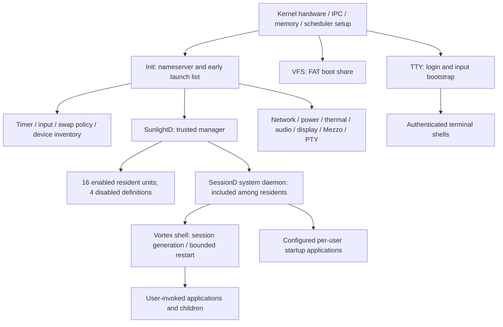

# SunlightD D3.5 boot ownership audit

Source inspected on 2026-10-19. This increment consolidates **DialogD and ClipD
startup ownership** by removing seven client-side automatic-start helpers. Both
already have enabled resident SunlightD units. No kernel or Init service is
migrated, and no activation policy or capability is changed. D3.5C has no Init
removal in this increment. Higher-risk migrations remain blocked below.

This is a source inventory with explicit validation limits, not a claim that the
long-term minimal bootstrap or supervisor recovery protocol is finished.

## Reproducible inventory

- [Current system services and executable catalog](sunlightd-d35-inventory.json):
  launch site/function, launcher versus lifetime supervisor, endpoint aliases,
  capability profile, declared dependencies and source lookup evidence,
  readiness, failure/stop/restart behavior, bootstrap/privileged setup,
  policy/classification, duplicate paths and migration assessment.
- [Ownership and declared dependency graph](sunlightd-d35-dependencies.dot).
  Dependency arrows point from provider to consumer. After is an ordering/readiness
  edge; Wants is advisory. These are different contracts.
- `target/d35-evidence/current-inventory.json` additionally contains the full
  repository Rust call census and source hashes. The original conflicting paths
  are retained in `baseline-inventory.json`. Raw repository spawn/discovery/
  authority searches are preserved alongside those files.

Regenerate the source snapshot and ownership checks with:

```sh
python3 tools/audit_d35_ownership.py --check-owners \
  --snapshot docs/services/sunlightd-d35-inventory.json \
  --graph docs/services/sunlightd-d35-dependencies.dot
```

The inventory includes 41 production/optional system definitions, 14 individually
listed synthetic services/driver children, session/application launch categories,
159 embedded ELF/artifact declarations and 150 workspace Cargo binary targets.
The latter two catalogs describe executable availability, **not process creation**.
Feature variants can embed the same executable more than once in source.
Workspace metadata supplies binary targets; the call census is lexical and also
contains comments/tests. It is not a Rust parser or a proof of every runtime
configuration. Runtime-selected session paths remain identified as such.

No InitD executable, crate or orchestration implementation was found. Current
`init` is both early launcher and nameserver, not a lifetime supervisor. Historical
`docs/SunlightD/SUNLIGHTD_SERVICE_MANAGEMENT.md` still describes kernel-started
Timer/Net and an InitD tier; those assertions do not match current code. D1, D2,
D3, `docs/SUNLIGHT_SESSION_FOUNDATION.md`, session configuration, root bootstrap,
stateful-service guidance and Phase 3 architecture documentation were inspected;
current launch/security source takes precedence over older prose.

## Actual ownership



`kernel/src/main.rs::_start` creates Init, VFS and TTY directly with
`Process::new`, maps their stacks, maps VFS's FAT share page read-only, and maps TTY's
framebuffer with initial geometry arguments and the trusted TTY session marker.
`scheduler_guest_bench` additionally creates a benchmark process only when that
feature is enabled. Kernel-only synthetic security test process records are not
boot services. Hardware backends (NIC/GPU/block/IRQ/entropy/thermal) and embedded
ELFs are not additional kernel-spawned userspace services.

`services/init/src/main.rs::_start -> spawn_service` traverses this actual ordered
list, draining nameserver requests after every spawn:

```text
timer_server, sunlight-kbd, sunlight-mouse, sunlight-usb-mouse,
sunlight-swapd, deviced, sunlightd, networkd, resolved, powerd,
thermald, audiod, sunlight-display, mezzo, pty_server, net_server
```

Init starts each once and logs success/failure without retry or process adoption.
Its nameserver stays available after this pass. It is not supervising those
processes simply because they have `ppid=1`.

`services/sunlightd/src/main.rs::load_units` contains compiled inline definitions,
not on-disk `.service` manifests. `BootStartup` selects enabled Resident units;
`autostart_services -> spawn_service_at -> spawn_named_with_identity` launches
through the existing kernel spawn endpoint. There are 20 default definitions,
16 enabled, plus conditional DocServ/DocView and demand-test definitions. Enabled
state persists separately and can change the actual boot set. `Wants` does not
activate or retain providers. Disabled `After` providers are skipped; `Requires`
is not. Default Type=simple means Running at spawn, not verified D1 Ready.

`services/sunlight-sessiond/src/main.rs::spawn_shell` owns the Vortex session
component, verifies process incarnation, and applies bounded shell restart.
`config_ops::spawn_optional` launches configured application paths, staggered
after desktop readiness. Those launches are legitimate session work. TTY owns
authenticated terminal shell creation (`spawn_tab`, then shell-mediated children).
Display hotkeys launch Runner, Clipman and Emoji Picker as applications. General
libc spawn/exec, sun-exec/sun-open, shell utilities, Solar execution and application
workers remain legitimate child-process paths; they are not system units.

## Dependency and authority boundaries

The JSON retains both manifest edges and direct runtime lookup evidence. Its
lookup list also records optional/reconciliation operations; lookup does not by
itself prove a strict startup dependency. The complete transitive declared graph
is in DOT. Key bootstrap and production chains are:

```text
kernel IPC/spawn -> Init nameserver -> SunlightD registration
kernel FAT/block share -> VFS registration -> SunlightD User=root lookup
Kernel timer syscalls -> bounded IPC deadlines (independent of timer_server)
Input -> interactive login
UAC -> SM -> KV -> ClipD
Rand -> MemoryDB -> Index / Memory / Brain (After/Wants as in manifests)
KV + Rand + Net + NetworkD + Resolved -> TLS (Requires versus After retained)
Display + UAC -> SessionD -> authenticated session -> Vortex -> startup apps
Display -> DialogD
Timezone -> Timed
```

SunlightD registers **before** loading enabled state and before resolving spawn.
It resolves credentials through VFS and reads `/state/sunlightd/enabled-services`;
KV, SM, DNS, NetworkD, display and session services are not prerequisites for its
own registration/event loop. A unit can wait on later Init providers without
making them SunlightD bootstrap dependencies. Moving VFS behind SunlightD would
create a genuine credential/bootstrap cycle unless that contract changes.

The trusted-manager marker is assigned in
`kernel/src/arch/x86_64/syscall.rs::handle_spawn_call` only for the Init-to-exact
`/sbin/sunlightd` path. UAC's trusted-auth marker is assigned only through the
trusted manager. Spawn reply includes PID and kernel process generation under
the spawn lock. `kernel/src/process/spawn.rs` assigns executable-derived names,
lookup masks and trusted embedded-path markers. Moving a launch statement cannot
be assumed to delegate a complete least-privilege profile: Init children use the
unrestricted profile, whereas manager units explicitly supply capability masks.

Examples requiring separate review are name-gated Net frame I/O and Deviced
inventory, PS/2 port access, USB/audio MMIO and DMA device grants, trusted PTY,
SwapAdmin and display paths, and session lock authority. PCI/device setup remains
privileged kernel work even when the process using it could eventually move.
No privilege expansion is included here.

Init registry entries carry endpoint ID/owner metadata and public SEND tokens.
Kernel mediation validates registration ownership/known names, stamps caller
badges and checks actual caller lookup/activation profiles. Lookup/register lazily
removes dead entries; registration is not a global process singleton lock. A
losing duplicate can still be alive even if its registration fails. Endpoint
teardown revokes derived caps. D1/D2/D3 verify separate activation generation,
kernel process incarnation and endpoint ownership; old capabilities cannot
legitimately identify a replacement.

## Classification and retained startup responsibilities

Every default Init process remains listed below rather than being relabeled as
necessary early bootstrap merely because it currently starts early. `true` in the
JSON's privileged-initialization field means a kernel device/setup prerequisite
exists; it does not mean the kernel must create that userspace process itself.

| Service | Launcher / supervisor | Classification / reason |
| --- | --- | --- |
| `init` | Kernel / none | `BootstrapRequired`: Root nameserver and trusted SunlightD handoff; retain |
| `vfs_server` | Kernel / none | `BootstrapRequired`: SunlightD resolves User=root through VFS; boot-share mapping has no equivalent delegated launch contract |
| `tty_server` | Kernel / none | `BootstrapRequired`: Retain login/diagnostic path; authentication and graphical handoff need separate proof |
| `timer_server` | Init / none | `KeepExistingWithReason`: Early tick service; manager deadlines use kernel syscalls. No unit or complete restart contract; preserve tick/phase-gate semantics pending proof. |
| `sunlight-kbd` | Init / none | `KeepExistingWithReason`: Early login input path; no unit or restart/resource cleanup contract |
| `sunlight-mouse` | Init / none | `KeepExistingWithReason`: Input teardown/reinitialization and privilege profile unproven |
| `sunlight-usb-mouse` | Init / none | `KeepExistingWithReason`: DMA/controller reset and safe restart cleanup unproven |
| `sunlight-swapd` | Init / none | `KeepExistingWithReason`: OneShot immutable boot policy; moving later changes reclaim availability; no retry policy established |
| `deviced` | Init / none | `KeepExistingWithReason`: Driver incarnation cleanup and registration/restart contract not proven |
| `sunlightd` | Init / none | `BootstrapRequired`: Exactly one Init list entry; no recovery/adoption or validated ready handoff; must implement before further cleanup |
| `networkd` | Init / none | `KeepExistingWithReason`: No manifest; secure lookup profile and reconciliation after restart unproven |
| `resolved` | Init / none | `KeepExistingWithReason`: No manifest; DNS readiness differs from endpoint publication; restart test required |
| `powerd` | Init / none | `KeepExistingWithReason`: No manifest or generation-aware recovery contract; assess separately |
| `thermald` | Init / none | `KeepExistingWithReason`: Safety policy reapplication and failure recovery not proven; keep resident Init path |
| `audiod` | Init / none | `KeepExistingWithReason`: DMA stop, capture sessions and peer buffer cleanup need dedicated restart gate |
| `sunlight-display` | Init / none | `KeepExistingWithReason`: Compositor surfaces, display authority and session teardown need dedicated validation |
| `mezzo` | Init / none | `KeepExistingWithReason`: Lock authority cleanup and capability profile incomplete; no mass migration |
| `pty_server` | Init / none | `KeepExistingWithReason`: PTY ownership/close/hangup and terminal regression required before migration |
| `net_server` | Init / none | `KeepExistingWithReason`: Sockets/DHCP/packet state and restart recovery need independent native gate |
| `solar` | SunlightD / SunlightD (resident legacy lifecycle) | `SunlightDResident`: Already managed; preserve resident policy and existing privileges. No D2 drain contract proven. Disabled by default; administrative Start only. |
| `timezone_service` | SunlightD / SunlightD (resident legacy lifecycle) | `SunlightDResident`: Already managed; preserve resident policy and existing privileges. No D2 drain contract proven. |
| `timed` | SunlightD / SunlightD (resident legacy lifecycle) | `SunlightDResident`: Already managed; preserve resident policy and existing privileges. No D2 drain contract proven. |
| `niced` | SunlightD / SunlightD (resident legacy lifecycle) | `SunlightDResident`: Already managed; preserve resident policy and existing privileges. No D2 drain contract proven. |
| `gcd` | SunlightD / SunlightD (resident legacy lifecycle) | `SunlightDResident`: Already managed; preserve resident policy and existing privileges. No D2 drain contract proven. |
| `uac_service` | SunlightD / SunlightD (resident legacy lifecycle) | `SunlightDResident`: Already managed; preserve resident policy and existing privileges. No D2 drain contract proven. |
| `sunlight-sessiond` | SunlightD / SunlightD (resident legacy lifecycle) | `SunlightDResident`: Already managed; preserve resident policy and existing privileges. No D2 drain contract proven. |
| `sunlight-sm` | SunlightD / SunlightD (resident legacy lifecycle) | `SunlightDResident`: Already managed; preserve resident policy and existing privileges. No D2 drain contract proven. |
| `sunlight-kv` | SunlightD / SunlightD (resident legacy lifecycle) | `SunlightDResident`: Already managed; preserve resident policy and existing privileges. No D2 drain contract proven. |
| `sunlight-clipd` | SunlightD / SunlightD (resident legacy lifecycle) | `SunlightDResident`: Already managed; preserve resident policy and existing privileges. No D2 drain contract proven. |
| `wiseowl-memoryd` | SunlightD / SunlightD (resident legacy lifecycle) | `SunlightDResident`: Already managed; preserve resident policy and existing privileges. No D2 drain contract proven. |
| `wiseowl-memorydb` | SunlightD / SunlightD (resident legacy lifecycle) | `SunlightDResident`: Already managed; preserve resident policy and existing privileges. No D2 drain contract proven. |
| `wiseowl-indexd` | SunlightD / SunlightD (resident legacy lifecycle) | `SunlightDResident`: Already managed; preserve resident policy and existing privileges. No D2 drain contract proven. |
| `wiseowl-braind` | SunlightD / SunlightD (resident legacy lifecycle) | `SunlightDResident`: Already managed; preserve resident policy and existing privileges. No D2 drain contract proven. |
| `sunlight-dialogd` | SunlightD / SunlightD (resident legacy lifecycle) | `SunlightDResident`: Already managed; preserve resident policy and existing privileges. No D2 drain contract proven. |
| `vortex-lock-presenter` | SunlightD / SunlightD (resident legacy lifecycle) | `SunlightDResident`: Already managed; preserve resident policy and existing privileges. No D2 drain contract proven. Disabled by default; administrative Start only. |
| `rand_service` | SunlightD / SunlightD (resident legacy lifecycle) | `SunlightDResident`: Already managed; preserve resident policy and existing privileges. No D2 drain contract proven. |
| `sunlight-tls` | SunlightD / SunlightD (resident legacy lifecycle) | `SunlightDResident`: Already managed; preserve resident policy and existing privileges. No D2 drain contract proven. |
| `secret_store_test` | SunlightD / SunlightD (resident legacy lifecycle) | `SunlightDResident`: Already managed; preserve resident policy and existing privileges. No D2 drain contract proven. Disabled by default; administrative Start only. |
| `sunlight-thumbd` | SunlightD / SunlightD (resident legacy lifecycle) | `SunlightDResident`: Already managed; preserve resident policy and existing privileges. No D2 drain contract proven. Disabled by default; administrative Start only. |
| `sunlight-docserv` | SunlightD / SunlightD (resident legacy lifecycle) | `SunlightDResident`: Already managed; preserve resident policy and existing privileges. No D2 drain contract proven. |
| `sunlight-docview` | SunlightD / SunlightD (resident legacy lifecycle) | `SunlightDResident`: Already managed; preserve resident policy and existing privileges. No D2 drain contract proven. |

The retained bootstrap set is Kernel: Init/VFS/TTY; Init: SunlightD.
Input remains early to preserve interactive diagnosis. Timer and the other eleven Init
entries are **retained migration blockers**, not established minimal bootstrap
requirements. Swap policy is OneShot, not a continuously resident swap daemon;
its immutable configuration survives service exit in the kernel.

SessionD's daemon remains SunlightDResident while Vortex, terminal shells and
per-user apps are SessionManaged/SessionBound. Lock Presenter is a disabled
SunlightD definition using the Vortex executable alias; Mezzo requests its start.
Optional Solar/ThumbD/secret-store-test remain disabled. Secret-store-test is
OneShot. Conditional document UI tests are not default startup. Fixture policies,
readiness identities and dependency holds remain unchanged.

## Consolidation applied (D3.5B)

Seven client helpers had a check-then-spawn race against the enabled resident
manager unit, and against each other. Both `/sbin` and `/bin` aliases were tried:

| Unit | Former independent starters | Current owner |
| --- | --- | --- |
| sunlight-dialogd | sunlight-dialogs `DialogClient::show_native`, sunlight-dialog CLI `ensure_dialog_service`, Edit `ensure_dialog_service` | SunlightD |
| sunlight-clipd | Clipman, Emoji Picker, API Lab and Control Panel `ensure_clipboard_service` | SunlightD |

Both definitions already provide root credential resolution, existing restricted
capability masks, dependency gating and the legacy resident supervisor's
`Restart=on-failure`, three-second restart delay. ClipD remains after/requiring
KV; DialogD remains after display. No new capability delegation is necessary.
Clients still use `dialogd`/`clipd`, the same protocol and shared-memory ownership,
and the same eight bounded 75 ms lookup attempts. If a service is disabled,
absent or still recovering after that window, clients report their existing
unavailable error. They cannot override the administrator's disabled policy by
creating another daemon. A user retries after recovery; no operation is replayed.

Exactly one production automatic launch component now exists for each of these
two services. This is a **source ownership guarantee**, not a kernel-wide ban on
an administrator manually executing an ELF. Manager incarnation recovery is not
solved. We do not claim these legacy services gained D1/D2 verified readiness or
cooperative unloading. No new Init-to-SunlightD migration was judged ready for
this increment; consequently no redundant Init entry was removed in D3.5C.

The audit explicitly separates two conditional probe paths from production
fallbacks: DocView's `native-ui-smoke::prepare` can start display if missing, and
DocServ's native runtime containment checks spawn argument-specific instances of
its own executable and wait for their exits. Those are test fixtures, not
competing default service supervisors. They remain disclosed in each affected
inventory entry and require isolation when running those features.

## Lifecycle gaps and D3.5D / D4 prerequisites

- Init's SunlightD spawn currently validates only a reply label, with generic
  diagnostics; it does not confirm a generation-qualified operational handoff.
  `sunlightd OK` is emitted before waiting for spawn capability and should not be
  used as an operational-ready proof. If startup fails, Init continues its early
  list and nameserver loop; serial diagnostics and input remain, but login may
  depend on unavailable UAC. There is no bounded recovery guarantee. Add an
  authenticated bootstrap-ready exchange and failure diagnostic deadline before
  reducing Init further. Never retry an ambiguously successful spawn.
- A SunlightD crash drops its table. Init does not restart it. Starting another
  manager can autostart duplicate survivors. There is no adoption/reconciliation
  protocol binding prior owner, unit, process generation and endpoint. Do not
  enable autonomous manager restart before implementing it and testing survivor
  reconciliation and stale capabilities. This is the blocker for the requested
  restart-after-supervisor-recovery scenario; it is not represented as passing.
- Legacy resident processes are monitored through waitpid/PID liveness. Spawn
  returns a process generation but the stronger runtime checks are applied to
  demand units. Bring resident lifecycle observation/signaling/readiness under
  generation-qualified ownership before migrating critical Init services.
- There is no global ordered service shutdown transaction in Init or SunlightD.
  Existing power syscall directly invokes ACPI shutdown/reboot. D3 retains demand
  dependency holds through confirmed consumer cleanup, but that does not prove
  whole-system shutdown ordering. Add ordered bounded shutdown and service-safe
  persistence/device draining before claiming the requested shutdown contract.
- Resident `Type=simple` publication can precede registration, external aliases
  can remain unavailable indefinitely, and boot autostart has no overall failure
  deadline. Establish explicit resident readiness/failure budgets, without
  changing default activation to on-demand.
- Network restart must prove existing socket/DHCP/DNS behavior; audio/USB restart
  must prove DMA cessation, IRQ/device authority and peer buffer cleanup; display
  must prove surface/input/session authority teardown; device inventory must
  prove driver incarnation handling. Power/thermal policy must survive daemon
  failure safely. Each needs its own restricted profile and native failure gate.
- Timer's existing tick/phase-gate contract, VFS's read-only FAT boot mapping and
  credential cycle, and TTY's framebuffer mapping/trusted marker and diagnostic role
  justify retaining those paths until explicit alternative contracts exist. Init's
  comment that Timer enables timed IPC is not proof: deadlines and monotonic time
  use kernel syscalls independently of timer_server. Moving the launcher alone does
  not establish safe lifetime supervision.
- ThumbD and real on-demand pilots retain D3's documented multipart/file-authority/
  readiness/drain blockers. Existing Wise Owl resident identities and state-store
  authority are preserved. No new memory-pressure eviction is introduced.

## Validation and evidence

Generated logs and machine-readable results live in `target/d35-evidence/` and
are deliberately not committed. Earlier `target/d1-evidence`, `d2-evidence` and
`d3-evidence` are preserved. Baseline and final D3 runners are copies of the
existing gate with evidence-directory routing only; they build the same feature
sets and use `tools/sunlightd_d1_gate.py --d2 --d3`.

The baseline host set passes: 29 core, 19 manager, 43 IPC, 35 memory and the
unchanged 51-check scheduler suite (177), plus identity Phase C compilation.
The baseline synthetic native 1/2/4 CPU matrix passes. This is a new baseline
run, distinct from historical D3 results.

Dialog protocol tests pass (13). Each affected application package checks
individually for the configured kernel target. An initial combined package
check failed because feature unification selected conflicting global allocators;
`clients-check.log` preserves that attempt, and `check-<package>.log` records the
successful per-package checks. Normal image builds already build these packages
separately. Unused libc aliases made obsolete by the removed spawns were removed.

Final matrix and resident boot measurements are recorded in
`validation-summary.json` and `boot-observations.json`; the measured status and
limits below must accompany any use of those artifacts.

| Requested scenario | Evidence / limit |
| --- | --- |
| Kernel -> Init / Init -> SunlightD | Boot serial order, registry self-checks and resident gate; no operational bootstrap-ready protocol |
| SunlightD startup failure / supervisor recovery | Source audit identifies missing bounded handoff/recovery; not fault-injected or claimed passing |
| Crash before readiness, concurrent activation, stale endpoints/caps, process replacement, dependency failure | Unchanged D1/D2/D3 native matrix and host assertions |
| Graceful demand unload / dependency shutdown holds | Unchanged D2/D3 native matrix with reaping receipts |
| Default resident boot / repeated fresh boot | Resident gate plus 1/2/4 CPU repeated boot observations |
| DialogD / ClipD production start-owner uniqueness | Source guard checks Init/compiled-unit overlap and independent literal service starts |
| Dialog/clipboard GUI invocation, crash/restart and UI recovery | Host protocol tests / native compilation; no new GUI failure-injection proof |
| Default terminal, file operations, network and full desktop interaction | No complete interactive acceptance matrix in this increment; boot registration is not a functional test |
| Whole-system ordered shutdown | Missing implementation; source assessment only |

The limited client consolidation does not change manager lifecycle mechanisms;
passing synthetic gates does not fill these real-service/manager gaps. Do not
merge a broader Init migration on the strength of these results.

## Measurements and interpretation

| Metric | Baseline | Final | Meaning |
| --- | ---: | ---: | --- |
| Direct kernel userspace services, default | 3 | 3 | Init, VFS, TTY; excludes benchmark/test records |
| Direct Init spawn list | 16 | 16 | Configuration count, includes manager and OneShot SwapD |
| SunlightD default definitions / enabled | 20 / 16 | 20 / 16 | Includes disabled optional definitions; persisted enabled state can differ |
| Independent production fallback helpers | 7 | 0 | Three DialogD + four ClipD helpers; 14 alias spawn call sites removed |
| Duplicate launch attempts at runtime | Unmeasured | Unmeasured | Source paths removed; no synthetic count invented |
| Boot to manager registration / login | Unmeasured | See table below | Host-observed marker times; registration is not operational-ready |
| Boot to verified SunlightD operational-ready | Unavailable | Unavailable | No bootstrap-ready contract |
| Boot to authenticated desktop | Unmeasured | Unmeasured | Requires login and desktop readiness |
| Post-boot resident process snapshot | Unmeasured | Unmeasured | Cannot infer from definition count; SwapD exits and enabled state varies |
| Post-boot physical used / private / shared frames | Unmeasured | Unmeasured | Boot PMM initialization lines are not post-boot accounting |
| Whole-system idle CPU | Unmeasured | Unmeasured | Synthetic fixture CPU samples are not system idle measurements |

Final repeated-boot observations (QEMU TCG, 1024 MiB, no login injection):

| CPUs | Run | Manager registration (ms) | Login screen (ms) | DialogD / ClipD registration (ms) |
| --- | --- | ---: | ---: | --- |
| 1 | 1 | 16227 | 16177 | 16328 / 16480 |
| 1 | 2 | 17785 | 17734 | 17886 / 17936 |
| 2 | 1 | 18035 | 17934 | 18086 / 18187 |
| 2 | 2 | 18336 | 18286 | 18437 / 18538 |
| 4 | 1 | 17336 | 17436 | 17436 / 17588 |
| 4 | 2 | 18395 | 18445 | 18495 / 18647 |

Times are host elapsed from QEMU creation, include firmware/ISO loading, and
have up to 50 ms observation delay. Every 20-second observation window contains
no duplicate `[SPAWN]` records per executable path. This is a new final boot
sample set, not baseline/final latency or memory improvement evidence. All six
boots reached login plus both consolidated-service registrations. The full
resident image gate passes on 2 CPUs. Final D3 host checks (177), identity
compilation and native 1/2/4 CPU lifecycle matrix pass; all runtime sources match
the final native source capture. The inventory generator was refined afterward
to correct bootstrap classifications and include the explicit boot order.

There is no RAM-savings claim. Launcher consolidation changes who can create a
resident daemon, not its residency or private/shared-frame lifetime. Embedded
ELF bytes remain pinned. Historical D2's 3148 KiB synthetic reclamation and D3's
shared dependency graph measurements remain historical references in their own
documents. New baseline/final synthetic receipts, if compared, describe the same
synthetic workload and are not savings from this change.

## File-level changes

- Seven client source files listed in the consolidation table remove daemon
  fallback spawn; three remove the now-unused `libc` import alias.
- `tools/audit_d35_ownership.py` regenerates inventory/catalogs and checks source
  owner overlap; it performs no process starts, capability changes or deployment.
- This report, `sunlightd-d35-inventory.json` and
  `sunlightd-d35-dependencies.dot` preserve the reviewed topology and blockers.
- Evidence logs/builds/measurements remain under ignored `target/d35-evidence/`.

D3.5 delivers an audited topology and a small ownership correction. The larger
minimal-Init architecture remains an incremental follow-up gated by the explicit
bootstrap, resident-generation, supervisor-recovery and shutdown prerequisites.
