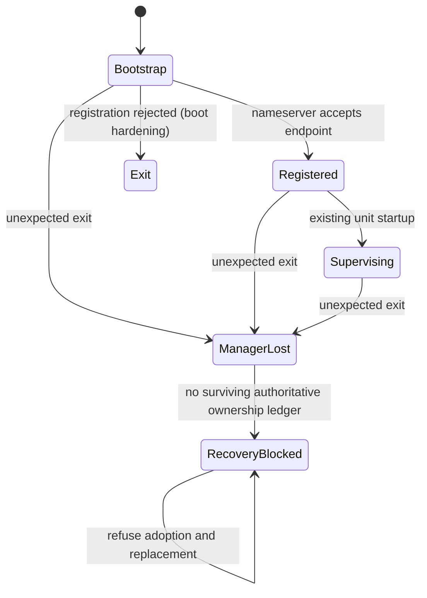

# SunlightD D3.6: recovery audit and safe boundary

Status: **partially complete; recovery implementation blocked at D3.6A**.
This contract was written before the runtime change below. D3.6B–E must not be
declared complete from the inherited D1/D2/D3 gates. Generated evidence is in
`target/d36-evidence/`; its summary distinguishes fresh runs from historical
evidence. No production memory savings or graphical recovery is claimed.

## Supervisor failure audit

Source of truth: `services/init/src/main.rs`,
`services/sunlightd/src/{main,activation,demand_runtime,idle_runtime,idle,dependency,supervisor}.rs`,
`kernel/src/arch/x86_64/syscall.rs` (`handle_spawn_call`,
`sys_session_get_credentials`, `sys_waitpid`, `nameserver_endpoint_validate`),
`kernel/src/sched/mod.rs` (`reap_process_resources`), and
`kernel/src/process/mod.rs`. The D1, D2, D3, D3.5 documents, ownership inventory,
dependency graph and retained validation summaries were reviewed.

Init launches `/sbin/sunlightd` once in its 16-entry boot list. It discards the
spawn identity, drains nameserver traffic between spawns, then serves nameserver
IPC indefinitely. It has no manager exit monitor, ready handoff, startup deadline,
restart budget or backoff. Registration is earlier than unit loading and spawn
capability lookup. The `sunlightd OK` log is earlier than managed startup; it is
not an operational-readiness or desktop milestone. A stuck live manager is also
outside the existing supervision contract. SunlightD's panic handler logs then
spins forever, so a Rust panic does not necessarily produce a process exit.

The kernel marks `/sbin/sunlightd` as trusted when the spawn caller's
`name_str() == "init"`. Executing SunlightD directly as an ordinary caller does
not grant the marker, but the parent check itself is a name predicate, not a
kernel-qualified bootstrap identity. Do not treat the trust-chain comment or
prior phase documentation as proof against a caller named init. This audit has
not demonstrated exploitability through all spawn/profile paths; securing this
bootstrap predicate is a further prerequisite before authority transfer/restart.
The spawn reply supplies PID and address-space generation under the scheduler lock.
Parentage is Init, including processes launched through the manager's spawn IPC.
Parent PID is neither manager ownership nor a service incarnation identity.
Init's ordinary wait interface accepts a child PID; it is not a retained,
generation-qualified manager-recovery receipt.

| State | Authority and lifetime | Effect of manager exit |
| --- | --- | --- |
| Service process and address space | Kernel scheduler, identity generation, active-CPU and borrower guards | Independent process continues until its own exit; no child cascade |
| Service endpoint and SEND derivations | Kernel capability broker; endpoint owner is service | Survive manager death while owner remains alive |
| Service shared mappings and capabilities | Kernel mapping references and per-process capabilities | Retained by surviving processes; peer mappings are not revoked by manager death |
| Manager endpoint, calls and deferred replies | Kernel endpoint/call identities and reaper cleanup | Eventually closed/revoked with manager cleanup; cleanup is not instantaneous at Finished |
| Runtime registry, activation generations and pending requests | Manager memory, 32 units / 16 activation waiters | Lost |
| D2 residency leases and timers | Manager memory, 32 bounded leases | Lost; service-local accepted work is independent and may remain |
| D3 dependency holds | Manager memory, 128 generation-qualified edges | Lost; consumers can remain alive |
| D2 tracked spawn watcher/receipt | Kernel record owned by exact manager PID and process generation | Original watcher ownership is cleared when manager is reaped |
| Unit definitions and enabled state | Compiled manifests; enabled flags in `/state/sunlightd/enabled-services` | Definitions/flags reload; no authoritative runtime state reload |

`Finished` does not prove `Reaped`. The reaper waits for outgoing stack handoff,
queue removal, active address spaces and borrowers before reclaiming resources.
It clears IPC/capability state and records reclaim counters. Watchers are only
installed for opted-in tracked spawns, not every resident managed service.
`sys_session_get_credentials` permits a live trusted manager to inspect process
incarnations, but D2 receipt access additionally requires the original watcher
identity. A restarted manager cannot inherit that access. The reaper explicitly
clears dead-manager watcher ownership, allowing receipt slots to be reused.

Thus managed services can execute without a lifecycle supervisor: they are
operationally orphaned while remaining Init children. Direct service IPC and
existing mappings can continue. A cooperative service may instead have closed
admission and be waiting for a commit that will never come. No general recovery
of its admission state exists. Leases and holds cannot be recovered from client
payloads or nameserver registrations. Nameserver ownership proves an endpoint
owner, not unit membership, dependency ownership or drain completion.

A fresh manager constructs a new empty runtime table and boot queue. It can
spawn another instance before an old service's conflicting registration is
rejected. Absence of a name does not prove absence of an instance: an old process
may be initializing, draining, or have destroyed its endpoint. No automatic
manager restart currently occurs, so enabling one alone would introduce this
duplicate-spawn hazard.

## Recovery contract and invariants

Init remains bootstrap owner. **Automatic restart is refused at this boundary**;
no retries, adoption, forced retirement or authority transfer are implemented.
This is a blocker, not a successful recovery or a new diagnostic supervisor.
Today Init cannot report manager loss automatically. Manual manager relaunch
after failure is unsafe and is not a supported recovery procedure. Resetting
the whole VM discards volatile application state and is not graceful recovery.

1. Identify manager and service incarnations by kernel-issued PID **and** process
   generation. Include endpoint identity and activation generation where needed.
2. Never publish Ready or start a replacement until every prior possible runtime
   for that unit is authoritatively reconciled. A missing name/PID query is not
   a reclamation receipt.
3. Refuse adoption unless process, endpoint, lifecycle rights, service admission,
   client leases and dependency ownership are all proven consistent. Adoption
   is unsupported for every existing unit after manager loss.
4. Retain providers while any consumer can retain work, mappings or authority.
   Quiesce initiation, DRAINED, missing replies and generic deadlines do not
   establish resource reclamation.
5. Manager generations scope all deferred actions. An activation counter alone
   can repeat in a fresh manager and must never authorize cross-manager events.
6. Use bounded metadata, queues and retry budgets. Do not add a global lifecycle
   lock, reconstruct authority from reports or force storage termination.



The ManagerLost/RecoveryBlocked states describe the required recovery outcome;
Init does not yet implement these states or detect the transition. Service
execution in this residual state is not advertised as supervised recovery.

Before D3.6B, a reviewed kernel-owned mechanism must retain ownership of **all**
managed spawns, including resident units, across manager cleanup. It needs an
atomic spawn/ownership contract (including ambiguous spawn reply loss), bounded
retained records, exact process and supervisor generations, authority transfer
rules, endpoint verification, and confirmed retirement receipts. It must also
resolve the lost lease/hold/admission state. Merely retaining the existing D2
watcher is insufficient. Either transfer complete proven state or quarantine
all affected units and providers without granting new lifecycle authority.
This is a wider ownership contract than adding an Init restart loop.

Proposed Init recovery policy after that prerequisite: at most three restart
attempts after the initial bootstrap attempt per boot (four launches maximum),
with 250/1000/4000 ms delays; failed spawn attempts consume the budget,
and registration alone never resets it. Uncertain old-manager termination or
any unreconciled unit immediately enters terminal diagnostic mode with explicit
residual identities. No replacement service spawns in diagnostic mode. A fresh
kernel manager generation is required for each attempt. This policy is a design,
not implemented or validated behavior.

| Crash point | Current residual risk | Required recovery decision |
| --- | --- | --- |
| Before registration | Could be before or after spawn-capability work in future boot changes | Prove no owned runtimes before allowing normal restart |
| After registration / activating | Lost spawn reply or readiness state; old process may lack a name | Quarantine until authoritative reconciliation |
| Draining / committing | Service may have irrevocably closed admission | Retain runtime and providers; no synthetic Ready or blind commit |
| Releasing dependency leases | Partial in-memory release state is lost | Recover authoritative ownership or retain whole affected closure |
| Repeated startup failure | No current automatic loop | Budget all attempts; terminal diagnosis on exhaustion |

Nameserver records are lazily checked using kernel endpoint liveness; live
conflicts are refused and dead entries can be replaced. Old derived SEND tokens
are revoked by endpoint destruction/reaping, not by removing a directory name.
Clients must discard failed transport handles, perform fresh authorized lookup
and repeat any incarnation handshake. In-flight operations must not be replayed
automatically unless the service defines idempotency. D2 services currently learn
manager PID via HELLO, without a complete cross-manager generation protocol;
this is another adoption blocker. No unrelated IPC wire format is changed here.

## Ordered shutdown specification (blocked, not implemented)

Close global activation/Start/Restart admission before planning shutdown; return
an explicit shutdown error to queued/new incompatible requests. Allow bounded
status and ownership-release operations. Cancel unspawned starts and complete
their deferred waiters explicitly. Preserve identities for ambiguous spawns.

Use the bounded static D3 Requires/managed After DAG, deduplicating edges. Wants
remains advisory. At each event-loop turn schedule eligible consumers with no
remaining retained dependents. Independent branches can advance separately;
do not recursively call Stop or hold scheduler/registry locks across IPC.
Each unit proceeds through Quiescing, Draining, Committing, ExitPending, Reaped,
or ResidualFailure. Only confirmed cleanup releases its provider holds. Two
consumers sharing C retain two holds; C stays up until both release safely.

Service-local admission must cover previously issued endpoints, multipart work,
sessions, buffers and persistent transactions. A verified zero-work drain is
required before commit. A crash during drain requires exact reaping proof and
an explicit failed result. Provider loss marks affected dependents residual;
it does not erase their work. Deadline expiry, refusal or malformed/stale replies
retain the runtime and its closure. Late acknowledgements must match manager,
service process, endpoint, activation and shutdown-attempt generations.

Disposable services may have a separately reviewed explicit force policy after
drain failure. Privileged services require a service-specific termination proof.
Persistent-state services require commit/abort consistency guarantees; elapsed
time never grants permission to kill them. Default to residual failure for
unclassified services. Current legacy Stop's SIGTERM/SIGKILL escalation is not
suitable for global graceful shutdown. Existing D2 cooperative Stop refuses
that escalation, and its idle handshake is synchronous; general independent
branch shutdown needs additional event-loop integration.

Manager crash during this protocol returns to the same reconciliation blocker.
Implementing shutdown before resolving it would violate the required sequence.

## DialogD / ClipD source findings and fault matrix

D3.5's seven removed startup helpers remain removed. The lexical owner guard
does not prohibit explicit manual execution or prove concurrent GUI behavior.
Both services are resident Type=simple, Restart=on-failure, RestartSec=3.
They use the legacy supervision path, not verified D1/D2 readiness or drain.
Do not describe spawn success as verified GUI readiness.
There is also an exit-status gap: `observe_managed_process` falls back to
PID liveness for nonchildren and returns Gone without an exit code.
`ServiceEntry::observe_confirmed_exit(None, ...)` uses zero for restart-policy
selection, so Restart=on-failure does not restart that observation. The compiled
policy alone therefore does not prove DialogD/ClipD crash restart. Legacy resident
signaling and liveness also lack the demand path's process-generation checks.

`sunlight-dialogs/src/lib.rs` looks up `dialogd` for each show and has bounded
fallback lookup attempts, but its initial lookup and show use legacy infallible
IPC. Transport failure can become a malformed-result error; no exact stale
incarnation handshake or operation replay contract exists. DialogServer handles
SHOW synchronously through `present_dialog`; simultaneous open-dialog guarantees
cannot be inferred from IPC queuing. A crash loses active dialog state and recent
colors. Session logout cleanup and retained client SHM require native validation.

Clipboard callers are indexed in the generated source inventory, including
Control Panel, API Lab, Clipman, Emoji Picker, the ClipD CLI and
`sunlight-ui/clipboard.rs` (used by Edit, text widgets, Files and the desktop).
The shared UI helper does fresh bounded discovery, but uses legacy `ipc_call`;
its set path accepts any non-ERROR reply without requiring a success label.
This also needs transport/protocol failure handling before claiming explicit
errors during a crash. Fresh helper lookups do
not establish universal cache invalidation. In particular, Clipman retains
`self.clipd`; `reload` only discovers when it is None and does not clear a stale
token on failure. It can interpret a malformed/transport reply as empty history;
`select_current` can also close after an unexpected reply. This is an unresolved
client recovery gap, not an explicit error/retry guarantee. ClipD registers before `load_state`,
then restores best-effort KV history/current/items. Writes use multiple separate
KV requests; history/current persistence errors are discarded. Existing partial
load behavior is not an atomic clipboard crash-consistency guarantee. No promise
is made to preserve clipboard contents or an interrupted transfer. Mapping
references outlive an exiting peer according to kernel SHM ownership rules.

| Scenario | D3.6 result |
| --- | --- |
| Sole automatic startup owner | Source audit / lexical guard only |
| Concurrent dialogs or clipboard requests / duplicate spawn | Not run as real GUI fault test |
| Dialog crash while open, failure during creation, immediate retry | Not run |
| ClipD crash during ownership/transfer, access after restart | Not run |
| Graceful GUI stop/restart and logout with outstanding requests | Blocked on service-specific admission/resource contracts |
| Manager restart with GUI clients | Blocked on authoritative reconciliation |
| Preservation of open dialogs / clipboard contents | Not established |

## Resource and regression evidence

Static configuration counts are three kernel launches, sixteen Init launches,
twenty default manager definitions and sixteen enabled definitions. These are
not observed resident process counts. Historical D3.5 reports 177 host checks,
native 1/2/4 CPU lifecycle passes and six resident boots; those remain historical.
Fresh command results and raw logs are recorded separately in the evidence
summary. Synthetic D3 graph memory/CPU data must not be presented as desktop
idle CPU or manager RSS.

Fresh validation on 2026-10-19: 29 manager-core, 19 manager-adapter, 43 IPC,
35 kernel-memory and 51 scheduler checks pass (177 baseline checks), plus
13 dialog protocol host checks. The identity Phase C feature compiles. Combined
D1/D2/D3 and IPC foundation native gates pass with 1, 2 and 4 CPUs under QEMU
TCG, 1024 MiB, six dependency cycles per CPU (18 total). The synthetic graph's
steady free-frame drift is zero on each CPU configuration. This checks the
existing cooperative service contract; it does not test manager crash recovery.
The legitimate manager registration path is exercised by these boots. The new
registration-rejection branch was compiled/reviewed but was not fault-injected.
The normal 2 CPU resident image gate also passes. An inherited 20-second resident
observation attempt failed with no serial bytes; its logs are preserved in
`initial-20s-attempt/`. A separate 60-second diagnostic boot showed Limine still
loading at 20 seconds and subsequently reached login and all required service
registration markers. Screenshots and monitor/serial logs are retained. This
motivated a 60-second window for repeated observations; it is not evidence of
a service recovery or a boot-time optimization. The first diagnostic monitor
attempt was sandbox-denied; the diagnostic was rerun with the required access.
All six extended resident observations pass (two each on 1/2/4 CPUs, TCG,
1024 MiB), with no duplicate spawn records in those windows. Observed login
markers occur at 20.8–25.5 seconds of host elapsed time including firmware and
ELF loading. `boot-observations.json` retains every sample, marker timestamp,
spawn count and boot PMM line; postboot memory/CPU fields remain unavailable.

Reproduction and raw results:

```sh
bash target/d36-evidence/run-regression.sh
RUSTFLAGS='' cargo test -p sunlight-dialogs --lib --target x86_64-unknown-linux-gnu
SUNLIGHT_TEST_CPUS=2 SUNLIGHT_TEST_SERIAL_LOG=target/d36-evidence/resident-serial.log bash tools/test.sh sunlightd
python3 target/d36-evidence/observe-boots.py
python3 target/d36-evidence/summarize.py
```

The retained regression wrapper is `tools/test_sunlightd_d3.sh` with only its
working directory and evidence destination changed. Its `regression/validation-summary.json`
reports D3 regressions, not D3.6 completion. Per-suite logs, scheduler raw test
output, build logs, source hashes, serial transcripts and synthetic measurements
remain in `regression/`. `audit-findings.json` records exact source anchors;
`fault-matrix.json` explicitly marks unexecuted new scenarios. Production
resource fields remain null in `resource-baseline.json`.

Required checkpoints for a future resource baseline: kernel boot, verified
manager ready, login painted, identical desktop idle after settling, immediately
before/after each fault and confirmed cleanup, and residual shutdown. Record
QEMU command/image hashes, CPU count, RAM, accelerator, workload and elapsed
monotonic time. Sample process counts by authoritative launch owner, allocated/
free frames, separately observable private/shared/page-table frames, manager
resident pages and CPU deltas over a fixed interval. Repeat comparable runs;
retain unavailable fields as null. No global statistics lock or per-event
tracing is needed. Operational-ready, login, desktop, manager RSS, whole-system
idle CPU, recovery and real-service restart latencies are currently unmeasured.

## Exact implementation scope and remaining blockers

The only runtime change implemented after this audit is checking SunlightD's own
nameserver registration result before loading units or spawning services, and
exiting with an explicit diagnostic on rejection. It prevents an undiscoverable
manager from continuing startup after a live-name conflict or registration
failure. It does **not** prevent a newly registered manager duplicating services
left by a dead manager. Init, kernel startup and client protocols are unchanged.
The existing registration helper can wait indefinitely for Init; the guard
handles a returned rejection and adds no startup deadline or watchdog.

D3.6B recovery, D3.6C shutdown, D3.6D graphical faults and D3.6E production resource
baseline remain incomplete. Broader Init migration and D4 remain blocked by
retained authoritative ownership, manager generation fencing, reconciliation,
service-specific admission/drain/persistence, full client transport recovery,
and native fault/graphical/resource evidence. Do not enable automatic restart
using this boot guard as a substitute for those prerequisites.
