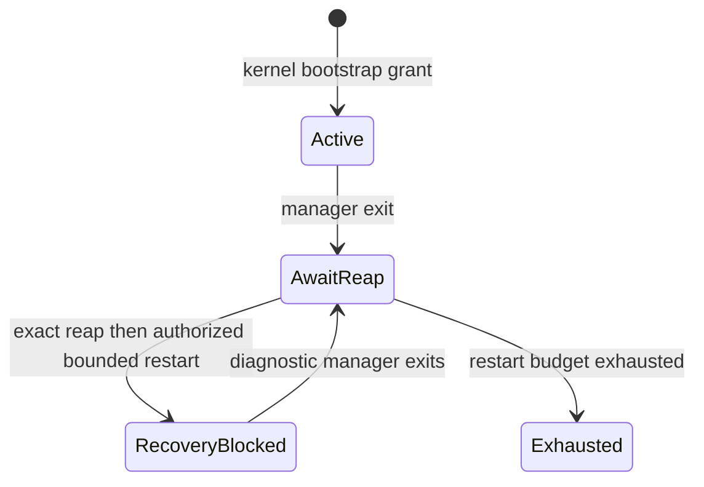

# D3.6R: crash-safe supervision ownership

Implementation contract, written before the ownership changes. This phase selects
the explicit **RecoveryBlocked** outcome, not live adoption or general retirement.
Normal resident startup is retained. No graph, lease policy, shutdown orchestration
or production service migration moves into the kernel.

The missing invariant is atomic retained ownership: every spawn by the authoritative
manager must have a bounded kernel record before the child can run or the reply
can be lost. A nameserver registration only proves endpoint publication. It does
not establish exclusive lifecycle authority or prove absence of unnamed survivors.
D2 watches are receipts owned by a particular manager; the reaper clears their
ownership at manager death. D2 client leases and D3 dependency holds are volatile.
They cannot be recreated from names, PIDs, endpoints or client reports.

## Identities and authority

* Bootstrap identity is the exact (PID, address-space generation) of the Init
  process explicitly installed by kernel boot. A process named init is insufficient.
* Manager identity is its kernel (PID, process generation), plus a checked monotonic
  supervisor epoch. Creation and exclusive grant occur under the existing scheduler
  lock. A second manager cannot be granted while the previous one is unreaped.
* A service identity is its kernel (PID, process generation). A retained record
  adds a nonreused record ID, original manager PID/process generation, original
  supervisor epoch and spawn path words.
  Endpoint ownership remains in the capability broker; no endpoint authority is
  manufactured or transferred by this record.
* Lifecycle authority is a separate Active grant. A successor after manager loss
  receives diagnostic identity only: RecoveryBlocked. Original leases and holds
  remain unknown, never reconstructed as empty.

The kernel retains at most 64 owned spawn records, including resident and tracked
services. Capacity is checked before spawn. Spawn plus record publication and
manager grant use the existing scheduler lock; there is no new global lock.
Reaping updates retained records with the exact generation and reclamation receipt
before process slot reuse. Normal active-manager nontracked records can be removed
after reaping. Tracked records release through the original D2 receipt-release
operation. After manager loss, records survive independently of process slots and
cannot be released by the successor. Metadata retention is bounded, even if all
old runtimes later reap; it never pins private pages or address spaces.

The first manager is Active. Every successor is RecoveryBlocked for the remainder
of the boot, even with an empty inventory: absence of a process does not prove
release of external lifecycle references. Old authority is never transferred.
The old manager must be fully Reaped, including endpoint/capability cleanup and
active CPU/borrower guards, before a successor can be created. No live fencing
or takeover is offered. Privileged manager operations validate the exact current
Active identity, not just the historical trust marker. A blocked manager may
register its own endpoint and answer diagnostics, but may not perform managed
spawns, signal services, release old receipts, or send service control IPC.

Init has one bootstrap launch plus at most three restart attempts per boot;
the kernel enforces the lifetime budget. Init applies 250/1000/4000 ms backoff,
queries exact retained manager status, and continues nameserver service during
backoff. A failed spawn consumes an attempt. A live-manager conflict does not
consume one. No registration or uptime event resets the budget. Exhaustion is
terminal diagnostic state, not success. Panic hangs remain outside exit recovery.

Init probes at most every 100 ms using its existing IPC receive deadlines. Kernel
status distinguishes live Active/Blocked, Exiting, and fully Reaped. A five-second
registration or reap deadline reports terminal recovery failure; it does not kill
the old process, clear records or authorize replacement. A late registration can
publish diagnostics but cannot undo terminal bootstrap policy or make a successor
Active. Registration closes that incarnation's registration deadline; it never
resets the launch budget.

## Implemented mechanism and boundary

`ipc/src/supervision.rs` is the host-testable, fixed-storage state machine used by
the kernel under `SCHEDULER`. It also supplies Init's tested backoff/deadline policy.
Kernel boot installs Init's identity explicitly. The spawn syscall handler checks
the live authenticated caller under the same lock used for process creation. It
publishes a manager grant or service ownership record before returning the PID/
process generation. A Finished caller cannot publish an unrecorded spawn merely
because it once had a manager trust marker. Records are independent of reusable
process slots; IDs do not wrap or get reused.

The existing SessionGetCredentials syscall has explicit read-only supervision
modes for status, record identities, retained physical reap counters, path keys,
and a bounded global free-frame/unreaped-record sample. Only the exact bootstrap
or current manager incarnation can query them. Record IDs, paths and incarnation
tuples convey no signaling, capability, adoption or receipt-release rights.
The original D2 watcher check and the new retained-record release both have to
succeed atomically before a live original manager releases a tracked receipt.

`kernel/src/ipc/mod.rs` requires the current kernel manager incarnation for a
sunlightd nameserver registration. Init's registry still rejects a different live
endpoint, including a second endpoint from the same manager. Diagnostic successors
may only send IPC to register their own endpoint with Init; received status requests
are answered through their own reply target. Service control and even invocation
through a passed old service SEND token are denied. Detailed diagnostic RPCs keep
the existing ServiceLifecycle caller checks, including for leaked bearer tokens.

Diagnostic successors also have a default-deny syscall allowlist at dispatch,
checked in the already-held process-table critical section. It permits their
endpoint receive/reply/register machinery, exit/yield, diagnostics and scalar
identity/time reads. Filesystem, device, capability-grant, memory mapping, signal,
spawn, exec and thread creation paths cannot bypass the lifecycle fence. Active
managers must use the recorded spawn IPC path; direct spawn, exec and thread
creation are refused to prevent splitting the manager's primary identity.

Manager-owned endpoint tokens and pending replies are revoked by the existing
reaper before a successor grant. Independent service SEND tokens held by clients
can remain usable according to existing service permissions; these are not a
transfer of manager authority. Live takeover is unsupported. Therefore a response
executed by a still-live old manager after a new grant is excluded by the reap
precondition, rather than tolerated through a userspace generation guess.

A reply already committed to an old client call before the crash may still be
delivered late. It cannot mutate a successor's lifecycle state: the successor
creates no lease/activation state and rejects all such operations. This phase does
not add supervisor-epoch fields to every legacy reply or promise general client
operation replay. Native tests reject calls through old endpoints after handoff;
they do not inject delivery of every possible precommitted reply.

SunlightD validates its kernel grant before registration. Epoch one runs the
existing startup/activation code. A later epoch registers a diagnostic endpoint
and enters RecoveryBlocked **before loading units or creating a startup queue**.
It reports kernel metadata; activation, READY, lease release and legacy Start/
Stop/Restart receive explicit ERROR(10). No dependency graph or lease table is
reconstructed. This also blocks replacement after all visible old records reap:
physical reaping does not establish release of external lifecycle references.

The retained reap counters prove physical kernel reclamation only. They omit the
old service's drain/commit proof and external lease state and cannot establish
successful cooperative retirement. Metadata remains until reboot after owner loss,
within the fixed 64-record bound. Private pages, stacks, endpoints and shared-map
references still use the existing reaper and are not pinned by this metadata.

## Reconciliation policy



Verified adoption is explicitly unsupported. It would require atomic old-authority
fencing, exact live endpoint ownership, service-local admission/work attestation,
and proven dependency/client lease consistency. These are unavailable today.
No public adoption or receipt-transfer operation is added.

Records identify the kernel incarnation at spawn. Exec/helper-process lineage is
not reconstructed from a PID or process name. An identity without an exact retained
reap receipt remains unresolved, including unsupported incarnation changes. Such
records cannot authorize adoption or replacement; the global blocked outcome is
unchanged. Tracking those transitions and external helper ownership is a prerequisite
for any future return to Active management.

General controlled retirement is also unsupported. A service must first provide
an authenticated quiesce/drain contract that survives manager loss, confirmed
generation-qualified reaping and proof of external reference release. Elapsed
time or knowledge of a record ID grants no right to signal a persistent service.
The narrow slice therefore reports retained live/reaped instances and rejects
new activation. It does not resume normal management or rebuild the old graph.

## Validation result

**The minimal RecoveryBlocked milestone passes. Full D3.6 recovery does not.**
Normal activation after supervisor loss is deliberately refused. Adoption,
general controlled retirement and reconstruction of leases/holds are unsupported.
The requested sequence's safe outcome is a diagnostic successor, not a manager
that resumes work. This boundary is enforced in the kernel and userspace.

The existing disposable `d3-parent` is the target, with its existing `d3-leaf`
and `d2-fixture` providers. No production service definition is added or migrated.
The original manager establishes three verified D3 holds and, in the main case,
one authenticated D2 client lease. The extended D2 driver executes after the
unchanged D1/D2/D3 assertions. Successors preserve the original kernel record
identities and reject activation, READY, old lease release and legacy controls.
Authority probes test a passed service endpoint, generation validation, tagged
and legacy signaling, receipt release, direct spawn and filesystem access.

| Native scenario | CPUs | Verified result |
| --- | --- | --- |
| Crash after Ready, with three holds and one client lease | 1, 2, 4 | Three diagnostic successors; same old service incarnation; no replacement |
| Crash after HELLO, before accepting READY | 4 | Holds already reserved; child explicitly exits on old-manager transport failure; retained exact reap record |
| Crash after verified DRAINED, before commit | 4 | Closed admission remains unresolved; new manager never advertises Ready or sends commit |
| Crash immediately before atomic receipt release | 4 | Reaped identity and original ownership survive; no successor release right |
| Delayed successor registration past five seconds | 4 | Terminal timeout reported; late endpoint remains diagnostic; subsequent exit causes no retry |
| Ordinary resident image | 2 | Normal bootstrap, 20 definitions and existing resident gate pass |

Seven final native boots pass under QEMU TCG, 1024 MiB. Each retains the existing
D1/D2/D3 and IPC-foundation assertions, including six normal dependency cycles
per boot (42 total). Every final source manifest matches the current sources.
The main 1/2/4 CPU trials and three phase-boundary trials each repeat manager
failure through epochs 2, 3 and 4, then verify budget exhaustion without epoch 5.
The registration-timeout trial intentionally stops retries after epoch 2.

All 177 baseline host checks and 13 dialog protocol checks pass. Seventeen new
checks exercise the actual kernel state engine and Init policy: immutable bootstrap
identity, concurrent bootstrap exclusion, stale manager/process generations,
nonreused record IDs, capacity exhaustion, original-owner release, a concurrent
release/reap race, bounded failed attempts, backoff, registration/reap deadlines,
and the diagnostic syscall allowlist. The baseline test names are checked against
the retained D3.6 logs. Identity Phase C also compiles.

Concurrency scope: the host races use a mutex around the same state engine that
the kernel protects with SCHEDULER. Native tests also race two unauthorized
namespace registration attempts and reject a bootstrap competitor while the
original manager is live. They do not pretend that two different processes can
both present Init's actual primary PID/generation. Sequential host modeling alone
is not treated as proof of SMP execution.

Old endpoint/capability calls fail after handoff; READY and old lease messages to
the successor are explicitly blocked. Host tests cover same PID/different
generation and stale record IDs. Native receipt-release fault injection is at the
pre-syscall boundary; the host race checks the two possible atomic orderings. The
literal delivery of every precommitted old reply was not injected. Hangs/panics,
arbitrary exec/helper lineage, storage recovery and GUI failure remain outside
this validated slice.

## Measurements and raw evidence

| CPUs | First diagnostic recovery (ms) | Next recovery (ms) | Third recovery (ms) | Free-frame range across these epochs |
| --- | ---: | ---: | ---: | ---: |
| 1 | 370 | 1110 | 4130 | 0 |
| 2 | 410 | 1110 | 4120 | 0 |
| 4 | 380 | 1110 | 4140 | 0 |

These are guest monotonic intervals from a self-crash request through a verified
diagnostic identity and denial checks, including reaping, configured backoff,
discovery, validation RPCs and scheduling delay. The clock has 10 ms resolution.
They measure the blocked outcome, not production service restoration. For the
4 CPU before-READY/drain/release hooks, fault-point to first verified successor
snapshot was respectively 460/460/410 ms. The intentionally delayed registration
trial returned diagnostics at 6630 ms but **failed its five-second registration
deadline as intended**; it is not successful deadline recovery.

The old synthetic graph has three process incarnations and three ownership records;
recovery starts zero replacement instances. The main fault preserves one original
parent incarnation through all three successor epochs. Before-READY and receipt
release trials already show that parent reaped at the first diagnostic snapshot.
All three graph records retain their original identities through cleanup.

Each graph's exact receipts report 2322 private frames and 36 page-table frames
reclaimed. Each trial waits for all three physical reap proofs. Unreaped retained
records fall to 14 in the final sample, with three retained reaped graph records;
the 14 includes the test driver and other original managed processes. These remain
explicitly unresolved/unsupervised, not adopted. Client leases and dependency holds
after manager loss remain **unknown**, including after graph reaping.

The main/phase trials show zero free-frame range across their three diagnostic
epochs. The timeout case has only one sample and proves no drift interval. Global
PMM changes include manager allocations and other resident work; only the private/
page-table counters are attributed to the exact graph reapers. `free_at_reap` is
one retained receipt's snapshot; `free_now` follows confirmation of all three.
No production RAM savings, long-term leak proof, whole-system idle CPU, or graphical
recovery is claimed.

`target/d36r-evidence/validation-summary.json` indexes final results and coverage.
Each scenario directory retains source hashes, compiler/QEMU versions, build logs,
ISO hashes, serial transcripts, inherited lifecycle measurements and recovery JSON.
`resident-serial.log` retains exact ordinary boot markers. A 300-second native
deadline includes firmware/ELF loading and the full preceding lifecycle matrix;
no observation timeout was hidden as a pass. Earlier development trials are
separate. `failed-open-probe/` preserves the corrected probe compilation failure;
`stale-after-ready-output/` is explicitly excluded from final evidence.

Reproduce:

```sh
bash tools/test_sunlightd_d36r.sh
D36R_SCENARIO=pre-ready bash tools/test_sunlightd_d36r.sh --cpus 4
D36R_SCENARIO=quiescing bash tools/test_sunlightd_d36r.sh --cpus 4
D36R_SCENARIO=receipt-release bash tools/test_sunlightd_d36r.sh --cpus 4
D36R_SCENARIO=registration-timeout bash tools/test_sunlightd_d36r.sh --cpus 4
SUNLIGHT_TEST_CPUS=2 SUNLIGHT_TEST_SERIAL_LOG=target/d36r-evidence/resident-serial.log bash tools/test.sh sunlightd
python3 target/d36r-evidence/summarize.py
```

Host commands use `RUSTFLAGS=''` and `--target x86_64-unknown-linux-gnu`: test
`sunlightd --lib`, `sunlightd --bin sunlightd --features recovery-test`,
`sunlight-ipc --lib`, `sunlight-kernel --lib` and `sunlight-dialogs --lib`;
run `python3 tools/test_scheduler_host.py` and check SunlightD's
`identity-phase-c-test` feature separately. Raw outputs are retained at the
evidence root, including the scheduler's focused log.

## Remaining prerequisites

Returning a successor to Active requires an authorized, atomic per-service
reconciliation contract, complete lease/dependency and external work consistency,
authenticated post-crash admission/drain/commit state, and exact endpoint authority.
The current origin/reap record alone is insufficient. Normal activation resumption
and generic retirement are not implemented, even after every visible record reaps.
New supervisor-epoch fencing in client/service wire protocols and exec/helper
lineage also need design. Init failure and Rust panic hangs need separate handling.
Ordered shutdown, real DialogD/ClipD faults, production resource baselines, broad
migration and D4 remain separately gated work.
